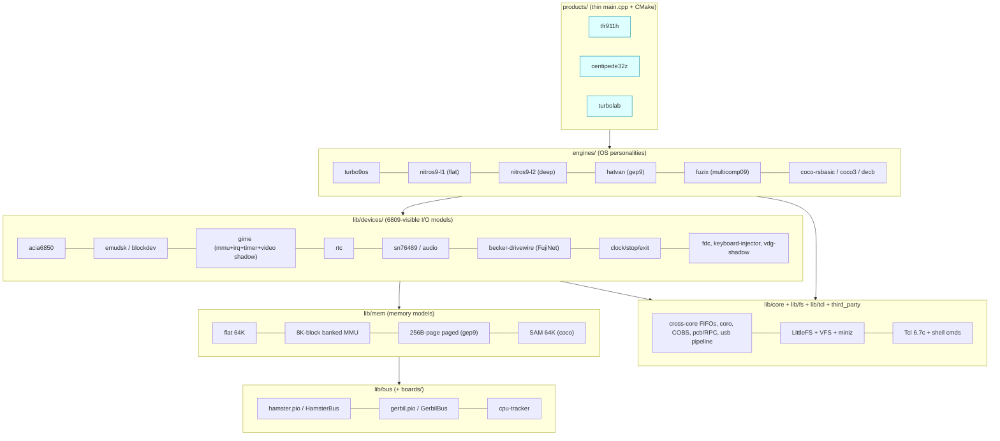

# tfr9 v5 — Notes, Discoveries, Snags, and Recommendations

*Status: proposal / analysis only.  No code has been copied from `../v4/`
yet, and nothing in `../v4/` or in `~/github.com/dillera/tfr9` was modified.
The first draft (`-two.md`) was an independent analysis written from the code
itself.  **This revision (`-two-and-a-half.md`) folds in what a cross‑read of
`-one.md` turned up**: every claim of `-one` that could be checked was checked
against the source/ELF/KiCad files; confirmed items were added as snags
(S26 onward), errors in `-one` are listed in §14 so they don't propagate, and my
advice on the CRTP question is in §5.5.  Changes vs `-two.md` are marked
**[2.5]**.*

Sources studied (all read-only):

| Source | What it is |
|---|---|
| `tfr9/v4/` @ `f963d3f` (Oct 23) | Henry Strickland's current v4: `tfr911h/`, `centipede-32z/`, `turbolab/`, `tether/`, `firmware/one/`, `cpu-tracker/`, `systests/`, `docs/` |
| `~/github.com/dillera/tfr9`, branch `nitros9-l2-tfr911` | 15 commits by Andrew Diller, 2026‑10‑16 … 10‑18, on top of Henry's `4ac54bf` (Sep 28) |
| `coco-shelf/nitros9` (branch `work-deep65280-0`) | Henry's NitrOS‑9 fork with the `flat65280` / `deep65280` recipes |
| `coco-shelf/pico-sdk` 2.3.0, `arm-none-eabi-gcc` 13.2.1, `go` 1.26.3 | The installed toolchain |

---

## 0. TL;DR — the ten recommendations

1. **One firmware library, zero copies.**  v4 already has *two* drifted copies of
   the "shared" library (`firmware/one/` vs `centipede-32z/three/`; 10 of 189
   common files differ, and the differences include real bug fixes living in
   only one copy).  v5 gets exactly one `firmware/lib/` and one `third_party/`.
2. **Split the monolith along the seams that already exist in the code**:
   *board* (pins, flash layout) → *bus* (PIO + foreground loop) → *memory model* →
   *devices* (6809‑visible I/O) → *engine* (= OS personality: memory model + device
   set + boot loader) → *product* (thin `main.cpp`).
3. **Make "I/O emulation for the 6809" a device library**, not a pile of globals in
   `main.cpp`.  v4 contains **three GIME models, four ACIA‑6850 models, five block‑device
   request paths, two RTCs and two audio paths**; they should each become one
   parameterised device.  (§5.3, §7)
4. **Select the engine once (function pointer to a per‑engine `IN_RAM` foreground
   loop), not with `if (current_engine == …)` chains inside the bus loop.**  v4's
   TFR911H foreground evaluates those chains on every bus cycle.  Do it with
   plain policy templates or explicit per‑engine loops — **not** with a CRTP/mixin
   framework (§5.5 **[2.5]**).
5. **Keep exactly two bus loops** (Hamster/E‑Q master for the TFR/911H; Gerbil/snoop for the
   Centipede) but make everything *behind* them shared.  Don't try to unify the loops themselves.
6. **One source of truth for the wire protocol and the cross‑core tags.**  Today
   `FG2BG_*` numeric values *differ* between `tfr911h` and `centipede` even though a comment
   says they're the same.  (§4, snag S5)
7. **One Go module, one `tether`, many `Personality`s.**  v4 has three tether trees
   (12.7K, 15.5K and 5.5K lines).  Fold in Diller's tether changes — including a
   bug fix for `EmulateDiskWrite` that is *still present in Henry's v4*.
8. **Converge NitrOS‑9 Level 2** (Henry's `deep65280` engine vs Diller's `l2`
   engine) into a single `nitros9-l2` engine built on the shared GIME/ACIA/EmuDsk/RTC
   devices.  Take Diller's RTC / 60 Hz VBORD / sound / FujiNet, Henry's VFS‑loaded images.  (§9)
9. **FujiNet becomes a shared device (`becker`/DriveWire over UART0, GPIO 12/13, 921600 baud) plus
   a guest‑side kit**, usable from the TFR/911H *and* the Centipede (same hat, rev 41d).
   Decide the Becker address question first ($FF41 vs $FF45).  (§8)
10. **Never `cp -r ../v4`.**  `v4/` is **749 MB on disk but only 780 tracked files / 45 MB.**  Import
    with `git ls-files` / `git archive`, or you'll import 276 vim undo files, RCS dirs,
    `_log` (3.8 MB), `build/` trees, etc.  (§11)

---

## 1. What v4 actually is (inventory)

### 1.1 Products

| Product | Dir | Source size | What it does |
|---|---|---|---|
| **TFR/911H firmware** (`tfr911h_v4.uf2`) | `v4/tfr911h/` | `v4_tfr911h_main.cpp` **2,618 lines** + `v4_gep9_*.h`, `v4_multicomp09.h`, `turbo9*.h`, ROM headers | RP2350B *is* the motherboard: PIO "Hamster" generates E/Q, RP2350 provides RAM and all I/O. Tcl 6.7 REPL + LittleFS + VFS on core 0, bus loop on core 1. Engines: `turbo9os`, `flat65280`, `deep65280`, `gep9`, `gep9big`, `multicomp09`(Fuzix) |
| **Centipede 32Z firmware** (`centipede.uf2`) | `v4/centipede-32z/firmware/` | `centipede.cpp` **1,644 lines** + `gspoon.h` (1,231), `coco128k.h` (424), `coco64k.h`, `floppy.h`… | RP2350B in the CoCo cartridge slot. PIO "Gerbil" snoops the *real* CoCo's bus and substitutes RAM/ROM/IO selectively. Builds are selected by `#define`s: `BECOME_COCO3`, `FUZIX_COCO2CENTIPEDE`, `FOR_COCO3`, `SAM_BIT_*`, `CENTIPEDE_REV` (32d/32e/32z/original) |
| **TurboLab** (`turbolab_v4.uf2`) | `v4/turbolab/firmware/` | `main.cpp` 57 KB, `hamster.h`, `pio_assembler.h` | Student subset of the TFR/911H: tethered only, **no Tcl, no LittleFS**; trace/trigger/watchpoint focused; OS‑9 Level 1 / TurbOS only |
| **Centiscope** | `v4/centipede-32z/centiscope-firmware/` | small | Logic‑analyzer‑style variant of the Centipede PIO |
| **tether** (Go) ×3 | `v4/tether/`, `v4/centipede-32z/tether/`, `v4/turbolab/tether/` | 12.7K / 15.5K / 5.5K lines | Host program: USB CDC + COBS, VFS server (`/pc`), cycle decode, 6809 disassembler, OS‑9 module listings, web VDG viewer (`:8080`), RPC |
| **cpu-tracker** | `v4/cpu-tracker/` | header‑only C++ | 6809 instruction‑boundary predictor (replaces LIC on the Centipede). Host‑testable against `misc/golden-log-*.txt` |
| **systests** | `v4/systests/` | shell + expect | Hardware tests: RPC, Tcl/VFS, one per engine (turbo9os, flat, deep, fuzix) |

### 1.2 The shared pieces (what v5 must *really* share)

All of these are used by **both** `tfr911h` and `centipede`:

* **LittleFS** (7.8K lines, vendored) + `lfs-centipede.[ch]` flash glue.
* **Tcl 6.7c** (23.7K lines, vendored; `TCL_GENERIC_ONLY=1`; ~39 commands in `tcl_commands.h`).
* **miniz** (9.5K lines) for `zip`/`lzip` in the VFS.
* **VFS** (`vfs.h`, 50 KB): OOP nodes over LittleFS **and** over the tether‑hosted `/pc` (RPC); `vfs_rpc.h`, `pcb.h` (protobuf‑like RPC encoding).
* **COBS** transport (`cobs.h`, `cobs_tx.h`, `usb_pipeline.h`, `circbuf.h`).
* **Dual‑core plumbing**: `CrossCoreFIFO` (`fg2bg`, `bg2fg`), `coro.h` cooperative scheduler, `Say()` console path.
* **The I/O dispatch idiom**: `IOReader IOReaders[256]; IOWriter IOWriters[256];` — one function pointer per `$FFxx`
  — present *identically* in `tfr911h` (main.cpp:128‑131) and `centipede` (centipede.cpp:331‑332).  This is
  the natural seam for a shared device library.
* **Boot‑mode / `modeN.tcl` scripting** (`boot_mode` in `__uninitialized_ram`, `/rc/modeN.tcl`).
* **Config**: `centipede_config` struct + `menu fetch/store`.
* **Flash label** (`flash-label.h`, last 4 KB of 16 MB flash).
* **Go**: `serial`, `cobs`, `open_*.go`, `os9_level{1,2}`, `listings`, `ram_coco{1,3}`, `samvdg`… (25 of the 34 file names the two main tethers share are byte‑identical).

### 1.3 The two "worlds" the shared code must serve

| | TFR/911H | Centipede 32Z |
|---|---|---|
| Who generates E/Q | RP2350B (PIO Hamster) | Real CoCo (SAM) |
| CPU | 6309E/6809E on the board | CoCo's own 6809E |
| RAM | RP2350 SRAM (`ram[256K]`, banked by *emulated* MMU) | RP2350 SRAM substituting CoCo RAM (64K/128K/256K) |
| Real hardware on the bus | none | PIA, SAM, VDG, FDC slot, cassette, sound mux… |
| I/O window | all of `$FF00‑$FFFF` is emulated | only what the cart claims (`SLENB`, `SCS` `$FF40‑$FF5F`, `CTS`), plus snooped/overridden reads |
| Pin map | `RESET=20 … E=29 Q=30 R/W=31`, A on GPIO 32‑47 | `RW=20 E=21 Q=22 … CTS=8 SCS=9 …` (rev‑dependent) |
| Tracing | optional | core feature (FIC prediction via `cpu-tracker`, compressed cycles) |

Consequence: **device models, memory models, VFS/Tcl/FS, protocol, and background services are shareable;
the two foreground loops are not.**

---

## 2. Andrew Diller's work — catalog and assessment

Branch `nitros9-l2-tfr911` (15 commits; **base is Henry's Sep 28 `4ac54bf`**, so it predates Henry's
flat/deep/gep9/multicomp work of Oct 5‑19 — Diller's `v4/tfr911h/` has *no* `v4_gep9_*.h` or
`ENGINE_*` machinery, and Henry's v4 has *none* of Diller's changes).

| Commit | Date | Area | What | Value for v5 |
|---|---|---|---|---|
| `b009255` | 10‑16 | **fw+tether+OS** | `l2` Tcl command boots NitrOS‑9 L2: emulated mini‑CoCo3 (`v4_nitros9_l2.h`, 612 lines: GIME MMU, 60 Hz VBORD IRQ, 6850 ACIA @ `$FF14`, EmuDsk @ `$FF80`, RTC @ `$FFC0`); `nitros9-l2/` builds kernel track → `nitros9_l2_rom.h`; `rmake-l2.tcl`; `launcher.asm` at `$2500`; `run-l2.sh`. Tether: **fix `EmulateDiskWrite` shadowed `disk_param`**, `T_WALLTIME`, `-boot`, `-pass_ctrl_c` | **High** (RTC, GIME IRQ, tether fixes). *Redundant with Henry's `deep65280`* — see §9 |
| `2ed9768` | 10‑16 | OS | Unix‑style commands (`ls`,`cd`,`grep`… as chained alias modules), `unix.tcl`, `helpmsg` | Medium‑high (student usability, TurboLab) |
| `a1b261c` | 10‑16 | OS | Tetris, arrow keys | Demo/value‑add |
| `ca56704` | 10‑16 | **fw** | `v4_audio.h`: PWM audio on **GPIO 8**, 31.25 kHz timer IRQ mixing an **SN76489 @ `$FF41`**, keyclicks, bell, Tcl `beep`/`click`; `$FF42` control reg | High; needs pin abstraction (GPIO 8 is `CTS` on Centipede 32Z!) |
| `4186209` `feb85d9` `600efe4` `25ff98f` | 10‑16/17 | OS/doc | `zm` Z‑machine, `vi`, `info` (reads firmware report through info port `$FF43/$FF44`), ULTRIX‑style manual (LaTeX) | Nice; keep as `os/nitros9/apps/` and `doc/manual/` |
| `8fc598f` | 10‑17 | **fw+OS** | FujiNet: `v4_fujinet.h` (UART0 GPIO 12/13, 921600 8N1, becker port @ **`$FF45/$FF46`**, 4K rx ring, IRQ on core 0), `l2fn` boot, `fujinet` Tcl cmd; NitrOS‑9 `rbdw`, `scdwv`, `dwio`, `fn*` commands (GPLv3) | **High** — the only FujiNet implementation in the tree |
| `363aac3` `f10fd11` `599a314` `923cd18` | 10‑17/18 | OS | `fnnews`, `fnstocks`, `fnbounce`, `fnweather` (C), `fnbattleship`; **`fujinet-lib` v5.0.1 ported to NitrOS‑9** (`bus/os9`), color terminal layer `fujinet/c/term.c` | High for FujiNet story; large vendored code → isolate (§8, §12) |
| `e6c0d4c` | 10‑18 | **tether** | UTF‑8 pass‑through | Take (small) |
| `77ad30c` | 10‑18 | licensing | GPLv3 headers/LICENSE for FujiNet programs | **Needs a decision** (§12) |

Notes:

* **273 tracked files** under `nitros9-l2/`, almost all vendored FujiNet apps/libs.  Treat as a *guest software kit*, not firmware.
* Diller's firmware footprint is small and clean: 4 new headers (`v4_nitros9_l2.h`, `v4_fujinet.h`,
  `v4_audio.h`, two ROM headers) + ~95 lines in `main.cpp` + 2 lines in CMake. They were added to a
  monolith by *another* parallel mechanism (`boot_l2` global, `l2`/`l2fn` Tcl commands, `L2__Foreground`)
  instead of the `Config(engine)` mechanism Henry added the same week.  That's exactly what v5's
  engine registry should absorb.
* External dependencies of the FujiNet work that are **not in this repo**: fujinet‑firmware PR 1631
  (CoCo/DriveWire/`COCO_HS_UART` board), PR 2027 (merged Oct 2026; consume driver‑version byte after
  `OP_DWINIT`), and an **un‑upstreamed** DevKitC fix (`coco-devkitc-no-button-c` in `dillera/fujinet-firmware`:
  floating GPIO 14 "Safe Reset" caused reboots every few seconds under disk traffic and hung the 6309).
  Record these in v5 docs with exact commits, or the hat will "randomly hang" for the next person.

---

## 3. Duplication and drift — the evidence

### 3.1 `firmware/one` vs `centipede-32z/three` (the shared lib, twice)

`tfr911h/CMakeLists.txt` builds from `../firmware/one/…`; `centipede-32z/firmware/CMakeLists.txt` builds
from `../three/…`.  A *third* CMakeLists in `three/firmware/` is a stale leftover (points at a
`centipede.cpp` that is now `centipede.xxxxxxcpp`).

189 files exist in both: **179 identical, 10 differ**:

| File | Δ lines | What differs (important ones) |
|---|---|---|
| `firmware/vfs.h` | 57 | **`firmware/one` splits tether‑VFS `read`/`write` into 256‑byte RPCs and returns partial counts; `three` sends the whole request** → large file I/O via `/pc` behaves differently per product. Take the chunked version. |
| `firmware/pico_rpc.h` | 82 | `three` has `get-ram`, `put-ram`, `type`, `get-status`, `get-cycles`, keyboard injection; `one` doesn't (but these are Centipede‑specific → belong behind a product hook) |
| `firmware/keyboard_injector.h` | 116 | Centipede‑only features |
| `firmware/menu.h` | 69 | config schema differs per product |
| `firmware/tcl_commands.h` | 13 | `three` adds `type` + `run-decb` |
| `firmware/vfs_rpc.h`, `rtc.h`, `floppy.h`, `cobs_tx.h`, `util/cobs.h` | 21/12/26/10/19 | small drift |
| only in `one` | | `firmware/config.h`, `coco64k.h` |
| only in `three` | | `coco3_rom.h`, `coco64k.hxxxxxxxx`, `config.h.not` |

**Merge rule for v5:** for each of the 10, do a 3‑way merge and then push product‑specific parts out into
product hooks (e.g., `PicoRpcRegisterMethod("get-ram", …)` from the Centipede product), so the lib has no `#if`s on
product.

### 3.2 Two incompatible `struct CentipedeConfig`, same include guard

`firmware/one/firmware/config.h` (fields `engine`, `flat_img`, `drive0‑3`, `task1/2`) and
`centipede-32z/firmware/config.h` (fields `fuzix`, `become_coco3`, `preload_decb`) both use guard
`FIRMWARE_H_`.  Whichever is found first silently wins.  The name is also misleading on the TFR/911H.
**v5:** a typed `Config` with a common core + per‑product extension, exposed to Tcl uniformly (`menu fetch/store`).

### 3.3 Tether ×3

* `v4/tether/` (36 files) vs `v4/centipede-32z/tether/` (43 files): of the 34 names they share, **25 are byte‑identical**; the 9 that differ are `pico_rpc.go` (692 lines),
  `tconsole.go` (444), `samvdg.go` (387), `webserver.go` (310), `webserver_test.go`, `utility.go`, `ram_coco3.go`, `open_linux.go`, `load.go`.
  Centipede‑only: `bas_token*`, `font5x7`, `load_command*`, `save_command*`, `ucommand_test`.  TFR911H‑only: `dump_panic*`.
* `v4/turbolab/tether/` is a *separate module* (`module github.com/strickyak/tfr9/v4/turbolab/tether`, `go 1.22`), while the
  repo root `go.mod` says `go 1.25.1` and the installed Go is 1.26.3.
* `tfr911_compat.go` already exists to let one tether speak both firmwares' cycle formats (`C_CYCLE`=200 vs `C_COMPRESSED_CYCLES`=175).  The merge has been *started* by accident.

### 3.4 Hardware models implemented more than once (the "I/O emulation" overlap)

| Concept | Implementations | Where |
|---|---|---|
| **GIME / MMU (8K blocks, 2 tasks)** | (a) `deep65280` (`task_mmu_base[]`, `$FF90` reads 0, 6 Hz tick); (b) Diller `l2` (`slot_base[]`, `$FF90/91/92`, VBORD 60 Hz IRQ, constant page `$FE00`); (c) Centipede `coco128k.h` (full: init0/1, IRQ/FIRQ enr, timer, video regs, palettes, `mmu_base[]`); (d) multicomp09 `mc_map0/1` (different register layout, same 8K×8 idea); (e) gep9 paged MMU (different: 256‑byte pages) | `v4_tfr911h_main.cpp:530‑560, 750‑1000`; `v4_nitros9_l2.h`; `coco128k.h`; `v4_multicomp09.h`; `v4_gep9_mmu.h` |
| **ACIA 6850** | flat/deep `$FF88/89`; Diller `$FF14/15`; multicomp09 `$FFD0/D1`; (plus non‑6850 consoles: Turbo9Sim `$FF00‑03`, Hatvan `$FF00‑05`) | `flat65280_acia_*`, `l2::Acia*`, `mc_*acia*` |
| **Block device request to core 0** | EmuDsk (flat/deep) via `FG2BG_EMUDSK` + atomic status spin; Diller EmuDsk via a `DiskState` machine + `disk_phys[256]` + `disk_deadline`; gep9 disk `FG2BG_GEP9_DISK`; multicomp09 SD `FG2BG_MC_SD`; Centipede FDC `FG2BG_FLOPPY_*`; Centipede Fuzix SD `FG2BG_FUZIX_SD_*` | five+ mechanisms for "core 1 asks core 0 to move a sector, bus stalls until done" |
| **RTC** | `rtc.h` `get_system_time()` (shared) vs Diller `$FFC0‑C7` fed by `T_WALLTIME` | |
| **Audio** | Diller PWM/SN76489 on GPIO 8; Centipede `orchestra90.h` (stereo 8‑bit DAC `$FF7A/7B` on GPIO 10/11 PWM slice 5) | |
| **Timer tick** | 60 Hz `repeating_timer` (Turbo9Sim/L2), `CLOCK_AND_STOP` 60/50/6/0.1 Hz, multicomp 50 Hz, GIME timer (Centipede), 20 ms timer | |
| **"Exit/stop" port** | `CLOCK_AND_STOP $FC/$FD/$FE`, Hatvan `Exit.Code $FF05` | unify as `ExitPort` device |
| **Boot loaders** | DECB parser (`gep9`, Centipede `preload_decb`), raw 64 K image (flat/deep), ROM header embed (turbo9os, Diller L2), track‑35 launcher (Diller) | one `ImageLoader` |

### 3.5 Dead / half‑finished code in v4

* `v4/tfr911h/v4_core_engine.h`, `v4_engine_tfr911.h`, `v4_engine_centipede.xxxxxh`, `v4_compat_centipede.h`,
  `v4_console.h`, `v4_floppy.h`, `v4_interrupts.h`, `v4_os_loader.h`, `v4_ram.h`, `v4_trace.h`, `v4_turbo9sim.h`, `v4_types.h`:
  **none is reachable from `v4_tfr911h_main.cpp`'s include graph.**  They are an *unfinished refactor* toward exactly the CRTP
  platform‑engine design recommended below.  Mine them for ideas; don't resurrect them blindly (they redefine `byte`, `CrossCoreFIFO`,
  use `FG2BG_HIGH_WATERMARK = 6000` while the live code uses `50`, and `v4_multicomp09.h` even declares `extern queue_t fg2bg_queue`, never defined).
* Files disabled by renaming (`*.xxxxxxcpp`, `*.xxxxxxxxh`, `config.h.not`, `coco64k.hxxxxxxxx`): 5 tracked.  Prefer deletion (git remembers) or `#if 0` + comment.
* `hdbchs_rom.h`, `hdbdw3cc3_rom.h`, `hdbsdc_rom.h` (≈52 KB each) in the shared firmware dir: three different HDB‑DOS‑style ROMs that **all define the same array name `disk11_rom[8192]`**,
  and are not included by anything.  They are the obvious starting material for FujiNet/DriveWire‑from‑BASIC on the Centipede but are un‑wired — see §8.
* `v4/turbolab.BAK2/`, `v4-bak-fuzix-coco2-md-io/`, `v4/_err` (203 KB), `_log`, `_out`, `_trace_log.txt` — scratch.

---

## 4. Snags for the unwary

Numbered so other docs can cite them.  *(E = evidence is a file/line you can open; V = inferred, please verify.)*

**S1. The two "shared lib" copies have already diverged** (§3.1) — and the tfr911h copy has the VFS 256‑byte chunking fix the Centipede copy lacks.  (E)

**S2. `.gitignore` silently drops files v5 will need.**  Root `.gitignore` ignores `*.rom.h`, `*.decb`, `*.list`, `*.map`, `*.raw`, `*.rom`, `*.exe`, `*.s`, `*.o`, `_*`, `build/`, `generated/`, `build-*/`.
`git check-ignore --no-index -v` confirms e.g. `turbo9os.rom.h` (matches `*.rom.h`), `kernel_6809.decb`, and anything named `_something`.  The currently tracked ones were force‑added; **new** ROM headers or `.list` files will vanish from `git status`.  v5 needs its own `.gitignore` with explicit `!` exceptions for checked‑in generated headers (or, better, generate them in `build/` and don't check them in). (E)

**S3. `FG2BG_*` tags disagree between products although a comment says they're shared.**
`tfr911h`: `…SYNC_NEEDED=4, NMI=5, FLOPPY_COMMAND=6, FLOPPY_LATCH=7, W_256=8, PEEK_REPLY=9, START_KEYBOARD_INJECTOR=10, FIC=12, EMUDSK=13, GEP9_DISK=14, MC_SD=15`.
`centipede`: `…SYNC_NEEDED=4, FG0BG_FIC=5, UNUSED_NMI=6, FLOPPY_COMMAND=7, FLOPPY_LATCH=8, W_256=9, PEEK_REPLY=10, START_KEYBOARD_INJECTOR=11, FUZIX_SD_READ=12, FUZIX_SD_WRITE=13`.
Same names, different numbers, and `12` means `FIC` in one and `FUZIX_SD_READ` in the other.  Any shared background code compiled against the wrong enum misroutes events.
Same story for wire constants (`C_CYCLE=200` vs `C_COMPRESSED_CYCLES=175`; tfr911h has `C_PRE_LOAD`, `C_DUMP_*`, `C_CORE_DUMP=189`, Diller adds `T_WALLTIME=182`).  **One header + generated Go constants.** (E)

**S4. `main.cpp` is a unity build whose "headers" are not headers.**  `littlefs.h`, `vfs.h`, `tcl_commands.h`, `pico_rpc.h`… contain function *definitions* and depend on globals (`ram`, `IOReaders`, `Say`, `fg2bg`, `byte`, `boot_mode`) defined earlier in `main.cpp`.  The TFR911H main even defeats real headers by pre‑defining their include guards
(`#define FIRMWARE_CONSOLE_H_`, `#define _GSPOON_H_`) and supplies `console::` stubs (`v4_console_tfr911_stub.h`).  Include order is semantics.  The stub's `console::poke/peek` write `ram[addr & 0xFFFF]` — **physical offsets, wrong for banked engines** (deep/gep9) when used by Tcl `poke`/`peek`. (E)

**S5. A hot‑loop `if` chain on the engine.**  `Guts<T>::Foreground()` branches on `current_engine` (`ENGINE_MULTICOMP09`, `ENGINE_GEP9`, `ENGINE_GEP9BIG`, `ENGINE_FLAT65280`, `ENGINE_DEEP65280`, …) for IRQ evaluation every group and for read/write translation on every cycle (main.cpp:1482‑1860).  It works, but every new engine makes every other engine slower and the function bigger in SRAM.  (E)

**S6. Everything core 1 touches must be in SRAM — enforced only by discipline.**  The bus loop and *every* I/O callback are `IN_RAM` (`__not_in_flash`) because an XIP cache miss during a bus cycle makes the 6809 latch garbage (comment at main.cpp:422‑429).  `lfs-centipede.c` programs/erases flash on core 0 with only `save_and_disable_interrupts()` (core‑local); `grep` finds **no** `flash_safe_execute`/`multicore_lockout` anywhere.  So a flash write while core 1 is in Phase 2 is safe only if *no* flash‑resident code, vtable, literal pool, or `const` table is touched by core 1.  Notice: `const byte Nitros9L2_Rom[]` (Diller) is `const` → flash; `byte disk11_rom[8192]` (Centipede) is non‑`const` → RAM copy (probably deliberate).  Add a checklist/CI check (inspect the `.map` for core‑1 symbols in `.text` vs `.time_critical`). (E for facts, V for hazard)
  **[2.5] Evidence from the built ELF** (`v4/tfr911h/build/tfr911h_v4.elf`, Oct 21): `Engine__Foreground()` is in SRAM (`0x20001678`, 2.9 KB) but its call sites go through veneers to **flash‑resident** `Gep9MMU::AllocFrame` / `AllocTaskTable` / `AllocBlockTable` (`0x1006…`; demand paging on first touch of a page), `cobs_printf` (`0x10005ab4`) and `sleep_us` (`0x10030a74`).  So the "everything in SRAM" rule is already violated on gep9 first‑touch paths and in the HALT handshake (`sleep_us(1)`).  Benign‑ish on the TFR/911H (the PIO simply waits and a 6309 is static); **fatal on the Centipede**, whose clock belongs to the real CoCo.  The one build‑time check described in `-one` (`check-core1-sram`) is the right fix; its jump‑table argument is *not* supported on this toolchain (see §14).

**S7. Flash/LittleFS layout is hard‑coded for 16 MB flash.**  `lfs-centipede.h`: offset 4 MB, size 11 MB, 4 KB blocks, and `flash-label.h` at `0x10FFF000` (last 4 KB of 16 MB).  The `tfr911h_rp2350b` board header defines **no** `PICO_FLASH_SIZE_BYTES` (SDK default 2 MB), so the linker believes flash is 2 MB while the code assumes 16 MB.  Works only because the hardware really has 16 MB (Stamp XL‑class module; `CMakeLists` has the Stamp XL line commented out). Put this in a *board profile*. (E/V)

**S8. `TCL_MEM_DEBUG=1` is on globally** (`add_compile_definitions` in both CMakeLists) — Tcl's `ckalloc` debug wrapper in production firmware. Intentional? Measure RAM and speed with it off. (E)

**S9. Build depends on the shelf layout.**  `tfr911h`'s Makefile: `TOP = $(shell cd ../.. && pwd)` → needs `$TOP/{bin,pico-sdk,picotool-install}`; `centipede-32z/Makefile` uses `TOP = ../../..` and `make -C ../../v4/ TETHERS` + `cp ../../v4/build/tether.*.exe build/`, and `v4/Makefile` builds those from `./tether/` — **so the tether binaries bundled with the Centipede are built from the TFR911H tree, while `centipede-32z/tether.sh` (`make run`) uses `go run ./centipede-32z/tether/`**, which has features the bundled binary lacks (`bas_token`, `load_command`, `save_command`, different `pico_rpc`/web code); `centipede-32z/tether.sh` hard‑codes `/home/strick/modoc/coco-shelf/toolshed/cocoroms/...`; docs and skills contain dozens of absolute `/home/strick/...` paths; `misc/pc/*.dsk|img|bin|decb` are tracked **absolute‑path symlinks** into `nitros9/recipes`, `hatvan-os/build`, `~/nand/github.com/EtchedPixels/FUZIX`.  `turbolab/Makefile` references `../../../borges-saver/`.  The helper `misc/install-pico-sdk-and-picotool-on-shelf.sh` has header text for a differently named script and **copies `pico-sdk` into `$TOP/picotool`** (`cp -a pico-sdk "$TOP/picotool"` — should be `picotool`). (E)

**S10. `boot_mode` is overloaded.**  The same `modeNN.tcl` mechanism means different things per product and per place: Centipede `rc/mode84.tcl` = "become CoCo 3"; TFR911H `misc/pc/mode84.tcl` = "NitrOS‑9 L1 flat65280"; `27` (ESC/BREAK) = skip rc; `3/89/90` special‑cased in `centipede.cpp:1631`; TFR911H files are looked up in `/rc/` *then* `/pc/`.  (E)

**S11. Engine selection by string with undocumented aliases and one typo.**  `Config(engine)` accepts `multicomp09fuzix`, **`multicomp09fuxiz`** (typo alias), `multicomp09`, `fuzix`, `gep9big`, … ; `docs/tfr911h-engines.md` documents *four* engines but the code has *six* (`GEP9BIG`, `MULTICOMP09`).  The same doc says Flat65280 "has embedded flash fallback", which commit `d89000c` removed. (E)

**S12. Diller's `L2_RAM_KILOS` is defined twice.**  `v4_tfr911h_main.cpp:213` `#define L2_RAM_KILOS 256` sizes `ram[]` for *all* engines; `v4_nitros9_l2.h:32` `#ifndef … 128`.  The README table says 256K.  Fine today, a trap when someone reorders includes. (E)

**S13. `EmulateDiskWrite` bug is still in Henry's v4 tether** (both `tether/disk.go` and `centipede-32z/tether/disk.go`): `case 256+4:` declares `var disk_param [4]byte` that *shadows* the parameter and then copies it onto itself, so the real data is never used.  Diller's `b009255` fixes it. Carry the fix. (E)

**S14. Address‑map collisions are real the moment engines share devices** (§7).  E.g. Diller's ACIA at `$FF14/15` overlaps Hatvan's disk controller `$FF10‑17`; Diller's RTC at `$FFC0‑C7` and multicomp09's `$FFD0‑DF` sit on top of the CoCo **SAM** register window (`$FFC0‑$FFDF`) — harmless on the TFR/911H, **wrong on a Centipede in a real CoCo**; Diller's sound/info/becker `$FF41‑$FF46` sit inside the CoCo cartridge `SCS` window (`$FF40‑$FF5F`, where the FDC lives), which on a Centipede the cart really owns. **[2.5]** Also: on a real CoCo `$FF14/$FF15` is a **mirror of PIA0** (`$FF00‑$FF1F`, partial decode), so Diller's ACIA address cannot be used on a Centipede at all, and his `fujinet/c/term.c` writes `sta $FF15` directly (line 128) to dodge SCF's ~300 µs/char — that shortcut will talk to PIA0 on a real CoCo. (E)

**S15. Becker port address.**  Emulators and stock NitrOS‑9/HDB‑DOS DriveWire use `$FF41/$FF42`.  Diller moved it to `$FF45/$FF46` *only because he had put the SN76489 at `$FF41`*, and built NitrOS‑9's `dwio`/`rbdw`/`boot_dw` with `BECKBASE=$FF45`.  Decide which one moves **before** more guest software is built (§8). (E)

**S16. GPIO 8 is `CTS` on the Centipede 32Z and audio on the TFR/911H;** Diller's FujiNet UART is GPIO 12/13; Orchestra‑90 uses GPIO 10/11 + PWM slice 5.  Also hardware resources used outside the pins: alarm 2 (audio; "default pool uses 3"), UART0 + its IRQ (FujiNet, on core 0), PIO0 SM0 (bus).  Keep a per‑board resource ledger. (E)

**S17. Centipede board revisions are `#if`‑chained** (`CENTIPEDE_REV` 3204/3205/3226/original) with bodged pins for 32d (`CTS 18`, `SCS 19`).  Decide which revisions v5 supports. (E)

**S18. Three product flavors are chosen by `#define`s in the middle of the .cpp** (`BECOME_COCO3`, `FUZIX_COCO2CENTIPEDE`, `FOR_COCO3`, `SAM_BIT_16K/64K`, `ram[64K/128K/256K]`).  `keep/` holds hand‑named UF2s (`centipede-sam64k.uf2`, `…fff2_03`, `normal-coco2`).  Note `config.h` defaults `FUZIX_COCO2CENTIPEDE` to **1** via `#ifndef` while `centipede.cpp` sets 0 first (commit `e56b04a` made it non‑default); order‑dependent. (E)

**S19. `FG2BG_HIGH_WATERMARK` is 50 in TFR911H, 1000 in Centipede, 6000 in the dead refactor header**, and TFR911H builds with `JUST_WAIT_DONT_HALT=1` (spin with `sleep_us(1)`) instead of HALT throttling.  Document the reasoning before consolidating flow control. (E)

**S20. Docs lag code and contain machine‑specific paths.**  Examples: engines doc (S11); `docs/*.md` link to `file:///home/strick/...`; `.agents/skills/tfr911h-skill/SKILL.md` describes the TurboLab product but is named for tfr911h. (E)

**S21. Tooling‑clutter in the working tree.**  vim undo files (`.*.un~`, 276), RCS dirs (23) and `,v` files (205), `_log` (3.8 MB), `_err` (203 KB), `a.out`.  All ignored by git, but they make `cp -r`, `du`, `grep -r` and IDE indexing miserable. (E)

**S22. Licensing is mixed.**  Repo `LICENSE` is MIT; Tcl 6.7c, miniz, LittleFS carry their own; Diller's FujiNet kit is **GPLv3** (and includes code from NitrOS‑9, fujinet‑lib, fujinet‑news/battleship, bounce‑world‑client — two of which "state no license" per his README). Firmware doesn't link GPL code today; keep it that way unless intended. (E; not legal advice)

**S23. `systests/` need a live board and expect absolute tools; no host‑only CI exists** except `cpu-tracker` (`make test`) and `go test` in tether. (E)

**S24. Time‑critical console behavior:** per Diller, SCF costs ~300 µs per character, so `fnbounce` writes straight to the 6850 at `$FF15`. If a shared ACIA device is introduced, keep it zero‑cost on core 1 and don't add per‑byte `Say()` stalls. (E, from commit text)

**S25. The `V4` AGENTS/skills rules are v4‑scoped.**  `v4/AGENTS.md` (RULE ONE: never edit outside `v4/`; RULE TWO: commit only on `work*` branches) — v5 has no equivalent yet; v5 must obey "do not change v4".  Suggest a v5 `AGENTS.md`. (E)

---


### Snags added in 2.5 (found by cross‑reading `-one.md`, then verified)

**S26. `util/cobs.h` in `firmware/one` (the copy the TFR/911H builds) can overflow its stack buffer.**  `CobsEncodeAndTransmit` copies the payload into `unsigned char ckbuf[1024]` with `i < sizeof(ckbuf)-1`, **then writes `ckbuf[len] = CobsChecksum(...)` unconditionally** — for `len ≥ 1024` that is an out‑of‑bounds write on the stack (and the encoder then reads past the copied bytes).  `three/util/cobs.h` (Centipede copy) uses a zero‑copy `get_byte(idx)` lambda and has no limit.  Packets are ≤ ~512 today (VFS chunks 256, core dump 258), so it hasn't bitten; any future bigger RPC (`get-ram` with large `len`) will.  **Take `three`'s.**  (E; `-one` called it "truncation" — it is worse.)

**S27. `vfs_rpc.h` differs in a way that decides which product can load images.**  `one` works inside a coroutine *and* on the main stack (`Coro::current()==nullptr` → `PumpUsbCobs()` while waiting); `three` does `CENTIPEDE_ASSERT(coro, "vfs_rpc: no Coro")` and only `coro_yield`s.  The TFR/911H calls VFS from the main stack during the `bye` transition (loading `/pc/*.img|*.decb`), so **`three`'s version would assert there**.  v5 must take `one`'s dual‑mode (and document why).  (E)

**S28. `floppy.h` in `one` runs flash code on core 1.**  `ReadScsFloppy`/`WriteScsFloppy` are neither `FORCE_INLINE` nor `IN_RAM` and the "not installed" stubs call `cobs_printf` (flash) from the foreground path; `three` fixed all of that (`FORCE_INLINE static void IN_RAM`).  Only latent on the TFR/911H (floppy unused), but it's the Centipede's copy that is right.  (E)

**S29. `cobs_tx.h`: `C_SHUTDOWN`/`cobs_shutdown()` exist only in `one`.**  The tether's `Dump6309PanicState` on `C_SHUTDOWN=255` depends on it; `three` (Centipede) lacks it, so a merged lib must carry it and the Centipede tether must tolerate it.  Likewise `keyboard_injector.h` in `three` is the better one (double‑buffered 256‑entry `probe_table[2][256]` with `active_table_idx`, 256 actions, `queue_char`), `rtc.h` in `three` is the `inline` (multi‑TU‑safe) one, and `vfs.h` in `one` has the `/lfs` alias (`path.empty() && token=="lfs"`) plus 256‑byte chunking.  **Net merge rule: `three` for cobs/floppy/keyboard_injector/rtc; `one` for vfs/vfs_rpc/cobs_tx.**  (E)

**S30. `hamster.pio` drift is a behavior difference, not cosmetics.**  TurboLab's copy has `gpio_pull_up(31)` (R/W) in the init; `tfr911h`'s doesn't.  `main.cpp` (≈line 1617‑1635) documents *phantom writes during HALT* because R/W floats and the weak pull‑up is slow.  A one‑line port may be the actual fix (verify on hardware).  (E; effect V)  *(Promoted from a migration‑table remark.)*

**S31. `hat-fuji-41d` does not route GPIO 13 where Diller's firmware config and the 40c bodge expect.**  From the 41d KiCad netlist (and the DevKitC symbol's own pin numbers): `J1‑9 (/H12 = GPIO12) → J2‑8 = ESP32 IO33`; `J1‑11 (/H13 = GPIO13) → J2‑15 = ESP32 IO13`; `J1‑13 (/H14) → J2‑10 = IO26`; `J1‑15 (/H15) → J2‑9 = IO25`.  Bill Athing's 40c bodge instead sends `J1‑11 → J3‑15 = IO21`, and Diller's README wires "GPIO12→ESP32 GPIO33 (UART1 RX), GPIO13←ESP32 GPIO21 (UART1 TX)".  So **on an unmodified 41d the ESP32 must use `PIN_UART1_TX = 13`** (RX=33 is right for both); a FujiNet firmware built for TX=21 transmits into nothing.  (E)  *(`-one` found this; its IO‑number labels are off by one for J2‑8/9/10 and its suggested `RX=32` should be 33 — see §14.)*

**S32. `centiscope-firmware` does not match its own PIO program.**  `gerbil.pio` there defines `.program passive_gerbil` (generated functions are `passive_gerbil_program_*`), but `centiscope.cpp:414` still does `#define GERBIL_GET() gerbil_program_get_word(pio, sm)` (and `_put_word`), names that program no longer defines; the checked‑in `centiscope.uf2` predates (Sep 5) the dir's last change (Sep 25).  Almost certainly fails to compile today (not build‑verified, since building writes into v4).  Also its CMake pulls `littlefs/miniz/tcl` from `../../firmware/one`, a third consumer of the shared lib.  (E; build V)

**S33. Diller's FujiNet hardware dependency list should be a snag, not a paragraph.**  DevKitC `GPIO14` (hat `SAFE_RESET`) floats without a pull‑up and restarts the FujiNet under disk traffic (`BUTTON_C: SHORT PRESS` / `ACTION: Reboot`, 6309 hangs on a lost request).  On the **41d** schematic, `R7` ties `IO14` to +3.3 V, which cures it; a bare DevKitC (Diller's setup) or a 40c without `R7` does not.  Plus the FujiNet firmware prerequisites: board `fujinet-coco-devkitc-centipede`, PR 1631, PR 2027, branch `coco-devkitc-no-button-c`.  (E)

**S34. Guest‑side C toolchain traps (from Diller's commit/README text, not independently reproduced).**  CMOC `--os9` programs need `--add-os9-stack-space=2048` (default stack too small even for `printf`); CMOC puts arrays of string pointers in the data area that the OS‑9 module header doesn't count (stack overflow at start; use single strings / fixed `char[]`); `flag ? byteval : -1` keeps the byte type (−1 → 255); a byte×byte constant stays a byte (drew icons from the wrong rows).  Record in `os/` build notes.  (E‑doc)

**S35. `PICO_RP2350A` hygiene (non‑bug).**  The TFR/911H board header doesn't define `PICO_RP2350A`; `-one` argues this makes the SDK treat the chip as an RP2350A.  **That is not what SDK 2.3.0 does**: `pico/platform.h` leaves it undefined (`#if 0`), `#if PICO_RP2350A` is then false, so `NUM_BANK0_GPIOS=48` and `ADC_TEMPERATURE_CHANNEL_NUM = NUM_ADC_CHANNELS‑1 = 8`.  The `set(PICO_RP2350A 0)` in the CMakeLists appears inert (nothing in the SDK's CMake reads it).  Still, define `PICO_RP2350A 0` in the board header (as `solderparty_rp2350_stamp_xl.h` does) — it costs nothing and survives SDK changes.  **The "−200 C … +400 C" readings that `-one` reports for Diller's `ChipTemperature()` are therefore *not* explained by this** (I did not reproduce them; his code only says the sensor "reads nonsense on some boards (its ADC supply or reference)" and suppresses values outside −20…110 C).  Check ADC_AVDD/VREF decoupling on the board before blaming software.  (E)

**S36. Hardware I did not review.**  I did not open the KiCad/Gerber trees for `tfr911h`, `tfr911k`, `rp2350b-add-psram-a/b`, `centipede-32z`, except the 41d hat.  `-one` makes PSRAM and 16 MB flash statements ("`U4` Winbond", "2 MB/8 MB PSRAM with GPIO19 CS") that I could neither confirm nor refute; they'd be useful for S7 and for ever lifting the 256 KB RAM ceiling.  (V)

**S37. Two incompatible `struct CentipedeConfig` with the same include guard `FIRMWARE_H_`** (`firmware/one/firmware/config.h` vs `centipede-32z/firmware/config.h`): whichever header is found first silently wins; field sets differ (§3.2).  Promoted from §3.2 so it has a number.  (E)

---

## 5. Proposed v5 structure

### 5.1 Layering



Rules that keep the layering honest:

* `lib/core`, `lib/fs`, `lib/tcl`, `lib/devices`, `lib/mem` **never `#include` a product or board header**; they get pins/flash/RAM size from a `BoardProfile` (constexpr struct) passed in via a template parameter or a single `board.h` selected by CMake.
* `lib/devices` have **no dependency on the Pico SDK except through a tiny HAL** (`hal.h`: `gpio_*`, `time_us_64`, `multicore`, `irq`).  Then device models *compile on the host* and can be unit‑tested (§11).
* A device exposes: `Install(IoMap&, Params)` (claims addresses; **IoMap panics on overlap**), `IN_RAM` read/write handlers, optional `Poll()` (core 0), `Tick60Hz()`, `OnReset()`, `Report()` (for the `info` port/stats).
* An engine = `{name, aliases, boards, ram_bytes, Setup(Config) [core 0], Foreground [IN_RAM, core 1], Report}`.  `bye` → `EngineRegistry::Launch(name)`.  `l2`, `l2fn`, `bye` become *aliases/boot recipes*, not special globals.
* Each engine gets **its own** `IN_RAM` foreground function (specialised at compile time — by a plain policy template or by an explicit hand‑written loop, see §5.5) and core 0 does `multicore_launch_core1(engine.foreground)`.  **[2.5]** Earlier text here said "template `Foreground<Bus, Mem, Irq, Trace>` … like the Centipede's CRTP `Engine0`/`Engine3`"; I now advise against CRTP/mixins specifically (§5.5).  Check the RAM budget with the `.map` file — RP2350B has 520 KB SRAM and `ram[]` takes 256 KB.

### 5.2 Directory tree

```
v5/
  README.md                 what/where/how-to-build; supported matrix (product × engine × OS)
  AGENTS.md                 workspace rules (never edit ../v4; branch policy; "git ls-files" import rule)
  Makefile                  thin front door:  make doctor | all | tfr911h | centipede | turbolab | tether | test | systest
  .gitignore                explicit; with ! exceptions for any checked-in generated header
  cmake/                    toolchain discovery, pico_sdk_import wrapper, helper functions (add_tfr_product())
  scripts/                  env.sh ($SHELF), doctor.sh, import-from-v4.sh (git ls-files based), fetch-pico-sdk.sh (fixed)
  boards/
    tfr911h_rp2350b.h       PICO board header (+ pins.h, flash_layout.h, resources.md ledger)
    centipede32z.h          (and legacy revs only if you decide to keep them)
    hat-fuji.md             pinout of the 41d hat for both hosts
  third_party/
    littlefs/  miniz/  tcl6.7c/     vendored, with PATCHES.md (the exact local changes) and original LICENSEs
  firmware/
    lib/
      core/                 cross-core.h, circbuf.h, cobs*.h, usb_pipeline.h, pcb.h, coro.h, abort.h, flash-label.h, boot_mode.h, protocol.h (single source of truth)
      fs/                   lfs_pico.[ch] (parameterised by flash layout), vfs.h, vfs_rpc.h, littlefs cmds
      tcl/                  tcl_glue, tcl_io.h, shell commands split by concern (core, fs, config/menu, system, debug)
      bus/                  hamster.pio, gerbil.pio, hamster bus loop pieces, cpu_tracker/ (moved here)
      mem/                  flat64k.h, banked8k.h, paged256.h, sam64k.h
      devices/              acia6850.h, emudsk.h (blockdev), gime.h, rtc.h, audio_sn76489.h, becker_drivewire.h, clockstop.h, exitport.h, fdc_wd17xx.h, kbd_injector.h, vdg_shadow.h, orchestra90.h, turbo9sim_acia.h, hatvan_*.h, multicomp09_*.h
      images/               ImageLoader (raw64k, DECB, track-35 launcher), embedded-ROM helpers
    engines/                turbo9os/ nitros9_l1/ nitros9_l2/ hatvan/ fuzix_multicomp09/ coco_rsbasic/ coco3/   (one dir each: engine.h, setup.cpp, foreground.cpp, README.md w/ address map)
    products/
      tfr911h/              main.cpp (~200 lines), CMakeLists.txt, tcl_product.cpp (product-only Tcl cmds)
      centipede32z/         main.cpp, CMakeLists.txt, variants.cmake (coco2 | coco3 | fuzix | centiscope)
      turbolab/             main.cpp (+ pio_assembler.h, tuning), CMakeLists.txt  [no Tcl/LFS]
  host/
    go.mod                  one module
    cmd/tether/             main + personality wiring
    cmd/turbolab-tether/    only if a lean binary is still wanted (or: tether -profile=turbolab)
    internal/               serial, cobs, protocol (generated), rpc, vfsserver, trace, dis6809, os9 (listings, api, err), web (vdg viewer), bootmenu, uf2label
    tools/                  annealing, borges-saver (moved in, no ../../.. paths)
  os/                       guest software (built with lwasm/lwlink/cmoc/os9 from toolshed)
    nitros9/                recipes (l1 flat, l2 deep), modules (clock2_tfr911, dwio/scdwv, sc6850 descriptors), unix aliases, rmake*.tcl, startup, helpmsg
    fujinet/                cmds, lib, defs, apps(news, stocks, weather, bounce, battleship), fujinet-lib/os9 bus  — own LICENSE (GPLv3)
    hatvan/  fuzix/  turbos/  rsbasic/      (build notes + patch queues; images stay outside git, referenced by manifest)
  rc/                       the modeNN.tcl catalog, one place, one table (see §6)
  tests/
    host/                   go test; device-model unit tests (C++ host build); cpu-tracker golden logs
    systests/               hardware tests (one per engine + fujinet), common.sh with SHELF/ports from env
  doc/
    v5-notes-and-recommendations.md   (this file)
    architecture.md  io-map.md  protocol.md  boot-modes.md  board-resources.md  engines/*.md  user/ (manual)
```

### 5.3 Device library — concrete suggestions

* Keep `IOReaders[256]/IOWriters[256]` (it's what both products do and it's fast), but **widen the handler signature to carry a context pointer** — `byte (*)(void* ctx, uint addr)` — so two ACIAs (or an ACIA at a different base) can exist without copy/paste globals.  Measure; one extra register argument is negligible against a 1–2 MHz bus.
* **`IoMap::Claim(base, len, name)`** records ownership and aborts at `Setup()` on overlap.  Generate `doc/io-map.md` from the registry at build time (a `make io-map` that dumps each engine's table).  This turns S14 from a trap into a test.
* **`BlockDevice` request** replaces the five bespoke paths:
  `struct BlockReq { uint8 drive; uint32 lsn; uint16 count; AddrXlate xlate; Cmd cmd; atomic<int8> status; }`, one `FG2BG_BLOCK` tag,
  one core‑0 service coroutine (VFS file, tether file, or LittleFS), per‑engine `AddrXlate` (flat, 8K MMU, paged).  Sector size/protocol (EmuDsk 256 B, multicomp SD 512 B + status protocol, FDC) stay in the *device front‑end*.
* **`Gime` device with feature levels**: `Mmu` (deep65280) → `+Irq/VBORD` (Diller L2) → `+Timer/FIRQ + video‑shadow + palettes` (Centipede coco3).  The NitrOS‑9 L2 engine then differs from the Centipede CoCo3 mode only in `Bus`, not in GIME code.
* **`Acia6850`** parameterised by base address and IRQ line; Turbo9Sim ACIA and Hatvan console stay separate small devices.
* **`Audio`**: pin from the board profile; SN76489 + clicks + `beep` in one module; Orchestra‑90 as a second front‑end on the same PWM mixer.  On the Centipede the `G_SND` pin (26) is the natural output; verify analog routing before enabling.
* **`Becker`** (DriveWire over UART) — §8.
* **Devices that need memory (DMA) — [2.5] why CRTP is not required for it.**  Block devices must turn a logical address into a physical one, and that depends on the MMU.  In v4 this happens only on **core 0, while core 1 is stalled**: EmuDsk (`translate_deep_addr(buf_addr)` once per sector, main.cpp:2241), gep9 disk (`gep9_mmu.TranslateRead/Write(task, addr+i)` per byte), Diller's EmuDsk (`disk_phys[256]` precomputed per byte on core 1 at command time).  Not per bus cycle, so an indirect call costs nothing.  Give devices a small `MemoryView` handed to them at `Setup()` — `Phys(task, logical)` plus `CopyIn/CopyOut(task, logical, buf, len)` that translate per byte (or per run within one block).  Two latent issues to fix when doing so: (1) v4's flat/deep EmuDsk translates only the *start* of the 256‑byte buffer, wrong if a buffer ever straddles an 8 K MMU block boundary (gep9 and Diller's code translate per byte); (2) consistency relies on core 1 being stalled during the transfer — document that invariant.  The Centipede's Fuzix SD is a byte‑FIFO port (6809 moves the bytes), so it needs no memory view.  `get-ram`/`put-ram` in `pico_rpc.h` and the console `peek/poke` stub address *physical* RAM; give them the same `MemoryView`.
* **IRQ policy** as a tiny object (`IrqSources` bitmask → `ChangeInterruptPin`) rather than a function per engine.

### 5.4 Core/boot flow to preserve (it works; keep the semantics)

*[2.5] On whether to add a third "middleground" execution tier, see **Appendix E**.*

Phase 1 (core 0): GPIO init, 250 MHz, USB stdio, PIO load, CPU held in RESET+HALT, Tcl REPL on USB → `bye`.
Transition: read `Config`, `engine.Setup()` (open drives via VFS, load images, install devices), reset PIO, `multicore_launch_core1(engine.foreground)`, wait for `foreground_running`, release RESET/HALT.
Phase 2: core 1 = bus + devices only; core 0 = coroutine scheduler (`drain_task`, USB pump, console, block service, timers).
Keep the property documented in v4 docs that the 6309 is *static* (clock stop during block I/O is safe) — and **write down that this is why the bus can be stalled**; it does not hold for a real 6809E on the Centipede.

---

### 5.5 Should v5 drop the Curiously Recurring Template Pattern?  **[2.5]**

*Tutorials for colleagues: **Appendix C** (policy templates) and **Appendix D** (CRTP).*

`-one` recommends dropping CRTP.  My advice: **yes for CRTP/mixin inheritance as a framework; no for compile‑time specialisation of the per‑engine hot loop.**  These are different things and v4 conflates them.

**What v4 actually has** (facts):

| Where | Shape | Verdict |
|---|---|---|
| `centipede.cpp` | `CoreEngine<T>` + mixins `DoFloppy<T>`, `DoCoco64k<T>`/`DoCoco128k<T>` (+ `Dont…` null mixins), final classes `Engine0`/`Engine3`; foreground calls `T::IsCoco3Rom()`, `T::TranslateCoco64kRamAddress()`… all `FORCE_INLINE static` | **Works and ships.**  But in practice *one* engine is used per UF2 (`#if BECOME_COCO3` picks `Engine3::RunEngine()` else `Engine0`), so it is a compile‑time feature switch, not run‑time polymorphism.  Mixins reach into globals declared earlier in the .cpp (`SamTyBit`, `SamP1Bit`, `ram`, `IOWriters`), so the headers aren't self‑contained. |
| `v4_tfr911h_main.cpp` | `Guts<T>`/`DoTurbo9os<Engine,…>` — CRTP‑shaped, instantiated **once**; engines chosen by **run‑time `if (current_engine==…)`** inside the loop | CRTP buys nothing here; the real problem is the `if` chain (S5). |
| `v4_core_engine.h`, `v4_engine_tfr911.h`, `v4_compat_centipede.h` (dead) | `CoreEngine<T>` + `TFR911Engine<T>`/`CentipedeEngine<T>` platform mixins, to unify **both products' loops** | **Stalled and never wired in.**  `-one`'s diagnosis is right: the two inner loops are genuinely different (Hamster: PIO is clock master and always drives D; Gerbil: slave to EBAR/QBAR, per‑cycle DRIVE/PASS decision, SLENB, spoonfeed).  A shared base class was at the wrong layer. |

**One stated reason in the dead header is false.**  `v4_core_engine.h` says *"GCC does not support `__attribute__((section))` on class methods, so the loops must be free functions"*.  I tested the installed `arm-none-eabi-g++ 13.2.1` (`-O2 -mcpu=cortex-m33`): a static member function, a CRTP static method and a function template **all** land in a named `.time_critical.*` section.  So `IN_RAM` is not a reason to avoid classes or templates.  (Scratch test: `brain/…/scratch/sec.cpp`.)

**What I'd drop:**
* CRTP as the cross‑product abstraction (`CoreEngine<T>` for both boards) — confirmed dead end.
* Mixin inheritance chains (`DoX<T>` depending on `T` and on file‑scope globals).  They hide coupling, make include order semantic (S4), make GDB/linker‑map reading harder, and block the host‑compilable‑device goal (§5.1: devices must be self‑contained).
* `Dont…<T>` null‑object mixins — replace with `static constexpr bool kHasX` + `if constexpr`.

**What I'd keep (the part that matters for speed):**
* Specialise each engine's foreground at compile time.  The budget is real: ~150 core cycles per 1.6 MHz TFR/911H bus cycle (TurboLab measures ≈1.63 MHz) and a hard real‑time deadline on the Centipede.  Today's TFR/911H `if (current_engine…)` chains already cost cycles on every read/write and bloat one 2.9 KB SRAM function; every new engine makes all others slower.
* The simplest mechanism that gets this, in order of preference:
  1. **Policy templates, no inheritance**: `template<class Mem, class Irq> IN_RAM void foreground()` where `Mem`/`Irq` are plain structs with `static FORCE_INLINE` members (`Read(addr)`, `Write(addr,v)`, `Translate`, `IrqNeeded()`).  Depth one, no `T::` reaching into a derived class, explicit instantiation per engine in `engines/<name>/foreground.cpp`.  This is the same compile‑time dispatch CRTP gave, minus the base class.
  2. **Explicit per‑engine loops** (copy the ~100‑line bus skeleton per engine, shared helpers as `FORCE_INLINE` free functions).  More duplication, zero template machinery; reasonable if the team finds even policies unwelcome.  Mitigate drift with a golden‑trace test per engine.
  3. *Not* run‑time dispatch per cycle (function pointer for Read/Write): the I/O page already pays one indirect call; don't add it to every RAM access.
* The **device layer stays run‑time and non‑templated**: `IOReaders[256]/IOWriters[256]` function‑pointer tables with a context pointer (§5.3) — as `-one` also proposes.

**How to settle it with data, cheaply** (half a day): build `nitros9-l2` and `hatvan` both ways (policy template vs. v4's `if` chain), compare (a) `.map`/`objdump` size of the foreground, (b) the `info` port's measured 6309 MHz, (c) `nm`‑based "no callee outside SRAM" check (S6/S26–S28).  Adopt whichever is not worse on (b) and clean on (c); if equal, choose #2 for readability.

Also note a bonus from `-one`: its **`IODriveMask[8]` 256‑bit "drive vs pass" bitmap** for the Centipede (device declares whether it drives the bus or lets the CoCo answer) is a good, cheap table‑driven idea; adopt it in the Gerbil product's I/O layer.

---

## 6. Migration map (v4 → v5) and merge decisions

| v4 | v5 | Action |
|---|---|---|
| `firmware/one/{littlefs,miniz,tcl6.7c}` ≡ `three/{…}` (identical, 179 files) | `third_party/` | Copy once; add `PATCHES.md` (diff vs upstream: Tcl 6.7c compat dir, `TCL_GENERIC_ONLY`, `lfs-centipede.*`) |
| `firmware/one/firmware/{cobs_tx,usb_pipeline,cross-core,coro,abort,pcb,flash-label,compress}.h`, `util/{cobs,circbuf}.h` | `firmware/lib/core/` | `cobs.h` from `three` (S26), `cobs_tx.h` from `one` (S29); `compress.h` is Centipede‑trace‑only → `lib/bus/` |
| `vfs.h`, `vfs_rpc.[hc]`, `littlefs.h`, `tcl_io.h`, `tcl_commands.h`, `menu.h`, `pico_rpc.h`, `rtc.h` | `lib/fs`, `lib/tcl` | Take **chunked** VFS from `one`; split product methods (`get-ram`, `type`, `run-decb`…) into product hooks |
| `hamster.pio` (tfr911h), `turbolab/firmware/hamster.pio` | `lib/bus/hamster.pio` | They differ by **one line: TurboLab's has `gpio_pull_up(31)` (R/W) which tfr911h's lacks** — relevant to the HALT phantom‑write issue described in main.cpp:1630. Verify on hardware, then keep one |
| `gerbil.pio`, `centiscope-firmware/gerbil.pio` | `lib/bus/gerbil.pio` + centiscope variant | Diff, decide |
| `cpu-tracker/` | `lib/bus/cpu_tracker/` (+ `tests/host`) | Move as is; keep golden logs |
| `tfr911h/v4_tfr911h_main.cpp` (2,618 l.) | split → `products/tfr911h/main.cpp` + `lib/*` + `engines/*` | The big refactor (Phase 3 below) |
| `v4_gep9_{mmu,io}.h` | `engines/hatvan/` + `mem/paged256.h` | Mostly self‑contained already |
| `v4_multicomp09.h` | `engines/fuzix_multicomp09/` | Keep the SD‑write fix (docs/fuzix-summary §D); drop bogus `extern queue_t fg2bg_queue` |
| flat/deep EmuDsk/ACIA/CLOCK_AND_STOP/Install_* in main.cpp | `devices/{emudsk,acia6850,clockstop}.h`, `engines/nitros9_l1`, `engines/nitros9_l2` | |
| `turbo9sim.h`, `turbo9os.h`, `*.mod.h`, `turbo9os.rom.h`, `romlist.h` | `engines/turbo9os/` (+ ROM headers generated from `os/turbos`) | |
| Diller `v4_nitros9_l2.h`, `v4_audio.h`, `v4_fujinet.h`, `nitros9_l2*_rom.h` | `engines/nitros9_l2/` (merge), `devices/audio_*`, `devices/becker_drivewire.h` | §8, §9 |
| `centipede.cpp`, `coco64k.h`, `coco128k.h`, `floppy.h`, `gspoon.h`, `keyboard_injector.h`, `console.h`, `egg.h`, `bug.h`, `disk11_rom.h`, `coco3_rom.h` | `products/centipede32z/`, `devices/{gime,sam64k,fdc,kbd_injector,vdg_shadow}`, `engines/coco_*` | Keep Centipede's CRTP `Engine0/Engine3` shape as the template for others |
| `v4_core_engine.h`, `v4_engine_tfr911.h`, `v4_compat_centipede.h`… (dead) | *(mine, don't copy)* | Delete after extracting ideas |
| `hdb*_rom.h` | `os/rsbasic/` (generated) | They define the same symbol; generate one chosen ROM per build |
| `tether/`, `centipede-32z/tether/`, `turbolab/tether/` | `host/` | Union (take the larger set), add Diller's patches, replace hand constants with generated `protocol`; then peel `package main` into `internal/*` |
| `docs/*`, `turbolab/docs/*`, `centipede-32z/docs/*` | `doc/` | Rewrite paths relative; keep the BASIC "unravelled" text dumps (≈2.4 MB) out of the default tree or under `doc/reference/` |
| `misc/pc/*` | `rc/` + a `manifest` | **No absolute symlinks.** A `manifest.txt` of `name → build recipe/URL`, and `scripts/stage-pc.sh` that creates `/tmp/pc` |
| `systests/`, `turbolab/systests/` | `tests/systests/` | Parameterise ports/paths; add `fujinet` + `nitros9-l2` |
| `turbolab/tool/{annealing,borges-saver}.go` | `host/tools/` | |
| `misc/golden-log*.zip` (31 MB!) | Git LFS or external release asset | |

### Boot modes (`rc/`)
One catalog (`rc/README.md` table: *mode → product → effect*), and prefer **named** modes (`boot nitros9-l2`) with numeric keys as shortcuts.
Reserve numeric namespaces per product to end S10 (e.g., 1‑99 Centipede keyboard‑chord modes, 100+ TFR911H).  Keep `27` (BREAK = skip rc) global.

### Protocol
`firmware/lib/core/protocol.h` is the source; a small generator (Go or Python, run by `make`) writes `host/internal/protocol/protocol_gen.go`.
Allocate wire IDs and FIFO tag ranges once, with a "reserved/never reuse" list (`FG2BG_NMI`‑era values, `C_RAM*`…).

---

## 7. Consolidated I/O address map (as found) and proposal

| Range | Meaning today | Used by |
|---|---|---|
| `$FF00‑03` | Turbo9Sim ACIA (`TX,RX,Stat,Ctrl`) | turbo9os |
| `$FF00‑05` | Hatvan console `Term.Out/In, Reg.Stat/Ctrl, logchar, Exit.Code` | gep9 |
| `$FF00‑$FF23` (real CoCo) | PIA0/PIA1 — **real hardware** | Centipede |
| `$FF10‑17` | Hatvan disk (`/d0‑/d3`) | gep9 |
| **`$FF14/15`** | MC6850 console | Diller L2 ← *overlaps Hatvan disk* |
| `$FF20‑2F` | TaskFuse, DMA engine, curtain, TaskFlags, PurgeTaskMem | gep9 |
| `$FF40‑5F` (real CoCo) | **Cartridge SCS window** (FDC at `$FF40‑4B`) | Centipede floppy |
| **`$FF40‑47`** | gep9 lets *user* tasks touch this range | gep9 |
| **`$FF41/42`** | Diller: SN76489 / sound control (bit0 click, bit1 bell, bit7 raw arrows) | L2 |
| `$FF43/44` | Diller info port | L2 |
| **`$FF45/46`** | Diller becker (status/data) — *standard is `$FF41/42`* | L2 + FujiNet |
| `$FF7A/7B` | Orchestra‑90 L/R DAC | Centipede |
| `$FF80‑86` | EmuDsk | flat, deep, Diller L2 |
| `$FF87` | CLOCK_AND_STOP (`$FC`/`$FD`/`$FE` = stop/fail/panic‑dump) | flat, deep |
| `$FF88/89` | MC6850 console | flat, deep |
| `$FF90‑9E`, `$FFA0‑AF`, `$FFB0‑BF` | GIME init/IRQ/timer/video, MMU, palettes | deep, Diller L2, Centipede coco3 |
| `$FFC0‑C7` | Diller RTC (clock2_jvemu‑style) — *on the SAM window* | L2 |
| `$FFC0‑DF` (real CoCo) | SAM (`$FFD4/D5` P1, `$FFDE/DF` TY handled in `coco64k.h`) | Centipede |
| `$FFD0/D1`, `$FFD8‑DC`, `$FFDD`, `$FFDE/DF` | multicomp09 ACIA, SD, 50 Hz timer, MMU | fuzix |
| `$FFF0‑FF` | vectors | all |

Proposal:
* The map is **per engine**, generated and documented; a TFR/911H engine may use any free address.
* For things that must also work on a **Centipede in a real CoCo**, stay inside the cart's window (`$FF40‑$FF5F`, or `$FF60‑$FF6F` if free), and avoid `$FF00‑$FF3F` and the SAM/GIME ranges unless emulating a CoCo 3.
* Suggested allocation for the *new, shared* devices (to be confirmed): Becker at **`$FF41/$FF42`** (standard; no guest rebuilds for stock drivers), SN76489 + control + info at a free cart‑window slot (e.g. `$FF50‑$FF55`), keeping Diller's bit layout.  Cost: change `BECKBASE` back (trivial) and re‑address `beep.asm`, `click.asm`, `tetris.c`, `vi`, `info` (small, all his).

---

## 8. FujiNet — one shared implementation

What exists: *only* Diller's `v4_fujinet.h` on the TFR/911H and the 41d hat (README: "Works with Centipede 32z and the TFR/911h").  The Centipede firmware has **no** FujiNet code in v4 (grep: nothing), though the hat and the ROM stubs `hdb*_rom.h` suggest the intent.

Plan:
1. **`devices/becker_drivewire.h`** from `v4_fujinet.h`, with: pins/UART/baud from `boards/…` (GPIO 12/13, `uart0`, 921600 8N1), address from `IoMap::Claim`, rx ring filled by a *core‑0 UART IRQ*, tx ring drained by core 0, core 1 touches only the rings (this design is correct for a bus loop that must answer every cycle — keep it).  Add the stats hook for `info`.
2. **Centipede**: expose the same Becker device in the cart's `SCS` window.  Open points:
   * the CoCo's own interrupts: Becker status polled (NitrOS‑9 `dwio`, HDB‑DOS DW) — no IRQ line needed;
   * **HDB‑DOS**: pick *one* variant ROM, generate `disk11_rom`‑slot content from a build step rather than three same‑named headers.  Verify which HDB variant expects Becker vs bit‑banger (**V** — I did not disassemble the ROMs).
3. **Guest side** (`os/fujinet/`): Diller's `dwio/scdwv/rbdw`, `fn*` commands, `fujinet-lib` NitrOS‑9 bus, apps.  Keep GPLv3 here with its own `LICENSE`, *outside* `firmware/`.  Bring the same DriveWire/`fujinet-lib` approach to Fuzix and Hatvan only after NitrOS‑9 is stable.
4. **Documentation of external requirements** (S‑section above): FujiNet firmware build target `fujinet-coco-devkitc-centipede`, PR 1631 / PR 2027 / `coco-devkitc-no-button-c`, the floating‑GPIO‑14 symptom (`BUTTON_C: SHORT PRESS`, `ACTION: Reboot` in the FujiNet log).
5. **Tests**: `systests/07_fujinet.exp` — `fujinet` link check, `fujinet mount 1`, `l2fn` boot, CRC of a transferred file; run with and without the hat (skip cleanly).

---

## 9. NitrOS‑9 Level 2 — converging Henry's `deep65280` and Diller's `l2`

| | Henry `deep65280` (+`flat65280`) | Diller `l2` / `l2fn` |
|---|---|---|
| NitrOS‑9 source | `coco-shelf/nitros9` fork, branch `work-deep65280-0`, `recipes/{flat,deep}65280` | **stock** NitrOS‑9 tree via `$NITROS9_DIR`, modules assembled by `rmake-l2.tcl` (adapted from v3's TFR/905H) |
| Boot path | whole 64 K boot image (`deep65280.img`, `$FFFE`→`OS9Cold`) loaded from VFS at `bye` | kernel *track* + `launcher.asm` at `$2500` → `rel` at `$2602` (same as Disk BASIC `DOS`), embedded in firmware as ROM header |
| Console | 6850 `$FF88`, driver `sc6850` | 6850 `$FF14`, driver descriptors adapted |
| Clock | `CLOCK_AND_STOP` `$FF87`, 6 Hz tick, modified `clock` | **60 Hz GIME VBORD IRQ**, `clock2_tfr911` on RTC `$FFC0` (wall time via `T_WALLTIME`) |
| RAM | 256 KB, mask `0x1F` (shadow `$20‑$3F`) | `L2_RAM_KILOS` (256), block‑wrap probing |
| Disk | EmuDsk `$FF80`, async FG2BG | EmuDsk `$FF80`, state machine + `disk_phys[256]` |
| Extras | stop/panic port, core‑dump | sound, info port, FujiNet, unix cmds, games, manual |
| Selection | `Config(engine)="deep65280"` + `bye` (`-bootmode=8`) | `l2` / `l2fn` Tcl commands |

Recommendation: **one engine, `nitros9-l2`**, built on shared `Gime(Mmu+Irq)`, `Acia6850`, `EmuDsk`, `Rtc`, `ExitPort`:

* Hardware personality: take Diller's (closer to a real CoCo 3: VBORD IRQ at 60 Hz, RTC) — but **choose the ACIA address once**. `$FF14` collides with nothing in an L2‑only map, but matching the CoCo/Wildbits convention may matter if stock descriptors are wanted; `$FF88` is Henry's.  (Open question Q3.)
* Boot path: keep **both** as options of the same engine: *(a) image from VFS* (developer loop; no firmware rebuild) and *(b) embedded kernel track* (students: works with only `-disks`; and **required for tether‑less `l2fn`**, where the Pico must supply `rel`+`boot_dw` before anything can be read from the FujiNet).  **[2.5]** `-one` argues embedding "wastes flash" with 64 KB images; measured: `nitros9_l2_rom.h` is **≈4.8 KB of data (304 lines × 16 bytes; 29 KB of source text)** — the kernel *track* loaded at `$2500`, not a 64 KB image.  Keep it, but generate it at build time instead of checking it in (S2).  Ship the `launcher.asm` approach only if it avoids maintaining a fork of NitrOS‑9.
* NitrOS‑9 source: prefer **stock + patches** (Diller) over a long‑lived fork, unless `deep65280`'s `krn` placement changes are needed upstream; record the exact NitrOS‑9 commit in `os/nitros9/VERSION`.
* Keep `flat65280` (L1) as a sibling engine sharing every device except the MMU.
* Both the stop port (`$FF87 $FC/$FD/$FE`) and Diller's info port survive as `ExitPort` and `InfoPort` devices.
* Acceptance: both existing systests (`04_engine_flat65280`, `05_engine_deep65280`) pass unchanged; add `08_nitros9_l2_unix` (Diller's `man unix`, `ls`, `vi` smoke) and `l2fn`.

---

## 10. TurboLab inside the unified structure

TurboLab's spec is explicit: *no Tcl, no LittleFS, tether‑only, "completely independent … not necessarily compatible"* with the normal v4 firmware/tether, student‑facing, "alpha".  Respect that.

* Keep it a **separate product** (own `main.cpp`, own UF2, `-profile=turbolab` for the tether or a lean `cmd/turbolab-tether`) so a student never sees Tcl/LFS surface area — but have it **consume the same `lib/core`, `lib/bus/hamster.pio`, `boards/tfr911h`, `protocol.h`, `host/internal/{serial,cobs,trace,os9,dis6809}`**.
* TurboLab's unique asset is the **bus trace machinery**: FIC tracking, `--trigger/--stop/--watch` (module‑relative `@kernel+0x1B`), runtime PIO assembler (`pio_assembler.h`) and the annealing tuner.  Treat those as `lib/bus/trace/` + `lib/bus/pio_assembler.h`; TFR911H and Centipede can then opt in.
* Its `hamster.pio` is the one with `gpio_pull_up(31)`; make it the baseline (verify).
* The simplicity argument also applies to **setup**: provide `make turbolab-bundle` that outputs `{turbolab.uf2, tether.<os>.exe, run.sh/run.bat, turbos image, listings}` in one zip (v4 already does half of this with `build/tether.*.exe` and `data/turbos-*.zip`).  `tether --exit` (probe which exe runs on this host) is a good trick to keep.
* Rename the agent skill (`tfr911h-skill` describes TurboLab) to avoid confusing future agents.

---

## 11. Build, test, and developer‑environment recommendations

1. **`make doctor`** checks: `PICO_SDK_PATH` = pico‑sdk **2.3.0**, `picotool`, `arm-none-eabi-gcc` (13.2.1 here), `cmake ≥ 3.13`, `go ≥ 1.25`, `tclsh`, `lwasm/lwlink/lwar`, `cmoc`, `os9` (toolshed), optional `fujinet` build tree. Prints versions; fails with *how to fix*.
2. **Configurable `SHELF`**, defaulting to `../..` but overridable; no `../../..` or `/home/strick` in committed files.
3. **One CMake superproject**, one build dir per product (`build/tfr911h`, `build/centipede32z-coco2`, `-coco3`, `-fuzix`, `build/turbolab`), named UF2 artifacts (no hand‑renamed `keep/`).  Variants are CMake options → generated `config_variant.h`, **not** `#define`s at the top of a `.cpp`.
4. **Generated headers are generated**: ROM/boot images, `*.pio.h`, protocol constants → `build/generated/`; check in only the *inputs*.  Fixes S2.
5. **Import discipline**: `scripts/import-from-v4.sh` takes a path list and uses `git -C ../ archive HEAD:v4/<path>` or `git ls-files`.  Never `cp -r`.
6. **Host tests** (no board): `go test ./...`; `cpu-tracker` against golden logs; **device models as host‑compilable C++** with a fake bus, and replay of recorded bus logs; later, run the real OS images against the device library on the host using `gep9`/gomar‑style emulation (the Hatvan `gep9` emulator already defines the expected hardware for that engine).
7. **Hardware tests** (`tests/systests`): keep Henry's expect‑based per‑engine suites; make port, tether binary, and image paths environment‑driven; add FujiNet (skippable) and L2.
8. **Map‑file lint** in CI: assert that symbols reachable from core‑1 entry points are in `.time_critical*`/RAM (S6); report SRAM usage per engine.
9. **Perf notes to keep with the code**: PIO timing constants (250 MHz), `GROUP_SIZE`, `DUMP_FIRST_CYCLES`, the `JUST_WAIT_DONT_HALT` decision, flash `qmi` divider (`safe_adjust_flash_speed`: 250/4 = 62.5 MHz, rxdelay 4).
10. **Go**: single module, pin one Go version (`go 1.25.1`/toolchain), `CGO_ENABLED=0` cross‑builds from the Makefile (the 8 targets in v4 are good).
11. **Docs**: relative links, no `file:///home/strick`; each engine README holds its register map (generated); `doc/manual/` carries Diller's ULTRIX‑style manual (LaTeX source + built PDF, ~300 KB).

---

## 12. Suggested order of work

| Phase | Deliverable | Exit test |
|---|---|---|
| **0 Scaffold** | tree, `AGENTS.md`, `.gitignore`, `Makefile doctor`, `scripts/import-from-v4.sh`, CI skeleton | `make doctor` green |
| **1 Lib** | `third_party/` + `firmware/lib/{core,fs,tcl}` merged from `firmware/one` + `three`; **TFR911H builds from them with behavior unchanged** (still monolithic main) | systests 01‑03 pass |
| **2 Tether** | single Go module `host/`; union of tethers; Diller's `disk.go` fix, `T_WALLTIME`, `-boot`, `-pass_ctrl_c`, UTF‑8; generated protocol | `go test ./...`; talks to both fw builds |
| **3 Devices/engines (TFR911H)** | split main.cpp; `Acia6850`, `EmuDsk/BlockDevice`, `ClockStop`, `Gime(Mmu)`, `IoMap::Claim`; per‑engine foregrounds; engines: turbo9os, nitros9‑l1, nitros9‑l2 (merged), hatvan, fuzix | systests 03‑06 pass; SRAM and bus‑speed numbers ≥ v4 |
| **4 Centipede on the lib** | `products/centipede32z` using shared core/fs/tcl + `Gime(full)`, `Sam64k`, FDC, VDG shadow; board header; variants via CMake | CoCo2 BASIC + CoCo3 modes demo (existing "CoCo Nation" skill) + Fuzix‑coco2 |
| **5 Audio + Becker + FujiNet** | devices; both products; `os/fujinet`; docs of external fujinet‑firmware requirements | `l2fn` boot; Centipede NitrOS‑9/HDB mount from FujiNet |
| **6 TurboLab flavor** | separate product + bundle; trace lib reuse | existing `turbolab/systests` pass |
| **7 Docs/CI/release** | generated io‑map, manual, release notes | |

---

## 13. Open questions for Strick

1. **Becker address**: `$FF41/42` (standard; Diller's modules re‑address sound) or keep Diller's `$FF45/46`?
2. **Is TurboLab one UF2 or two?**  I recommend two (separate product, shared libs).  Keep "no Tcl/no LFS" strictly?
3. **NitrOS‑9 L2 console ACIA address** (`$FF88` vs `$FF14`) and whether stock NitrOS‑9 descriptors or the `deep65280` fork are the baseline.
4. **Which Centipede board revisions does v5 support?** (32z only? 32e? 32d with bodges?)
5. **Fuzix/Hatvan/RS BASIC on Centipede**: which are in scope for v5.0 vs later? (Fuzix‑coco2‑Centipede and CoCo 3 mode exist today in v4.)
6. **Licensing**: keep GPLv3 FujiNet kit in-tree (under `os/fujinet/`) or as a submodule / separate repo?  Anything with "no license stated" upstream must be resolved before redistribution.
7. **Large artifacts** (`golden-log.zip` 31 MB, BASIC "unravelled" dumps 2.4 MB, `turbos-*.zip`): Git LFS, release assets, or leave behind?
8. **Branch policy for v5** (v4 required commits only on `work*` branches) and who coordinates with Diller (upstream his Tether/firmware patches, or has he agreed to rebase on v5)?
9. **The TFR/911H flash size** (16 MB assumption in LittleFS offset and label address) — confirm all 911H boards carry 16 MB parts.
10. **`TCL_MEM_DEBUG=1`** — intentional in production builds?
11. Should the *name* `CentipedeConfig` / `centipede_config` go away on the TFR/911H (`Config`)?  (I recommend yes; Tcl‑visible array name `Config` stays.)

---

12. **[2.5] CRTP decision** (§5.5): policy templates (my lean), explicit per‑engine loops, or keep Centipede's mixins as is for now?
13. **[2.5] ACIA aliasing**: `-one` suggests mapping the 6850 at both `$FF88` and `$FF14` for compatibility.  I'd pick one canonical address per engine (and re‑address descriptors) with at most a transitional alias flag; `$FF14` is a PIA0 mirror on a real CoCo.  Your call.
14. **[2.5] `term.c` fast path**: replacing the direct `sta $FF15` with `I$WritLn` is right for portability but, by Diller's own numbers, drops `fnbounce` from 9.3 to ~2.8 frames/s.  Want a portable fast path (e.g. a driver `SetStat` for bulk write) before removing it?

---

## 14. Cross‑read of `-one.md`: what it got right, what I'd argue against  **[2.5]**

Everything below was checked against files in the tree unless marked otherwise.

### 14.1 Good observations in `-one` that I had missed (now in this doc)
| `-one` item | Status | Where |
|---|---|---|
| `cobs.h` stack buffer in `one` | **Confirmed, and worse than claimed** (OOB write at `ckbuf[len]`) | S26 |
| `vfs_rpc.h`: `one` dual‑mode vs `three` asserts on no‑Coro | Confirmed | S27 |
| `floppy.h`: `one` not `IN_RAM`, `cobs_printf` on core 1 | Confirmed | S28 |
| `cobs_tx.h` `C_SHUTDOWN` only in `one`; `keyboard_injector`/`rtc`/`/lfs` alias drift details | Confirmed | S29 |
| `hat-fuji-41d` routes GPIO13 to ESP32 `IO13`, not `IO21` like the 40c bodge | **Confirmed from the 41d netlist** (labels in `-one` off by one; RX should be 33 not 32) | S31 |
| `centiscope` PIO/C++ mismatch and its reach into `firmware/one` | Confirmed by symbol names; not build‑verified | S32 |
| `$FF14/$FF15` is a PIA0 mirror on a real CoCo; `term.c` hard‑codes `$FF15` | Confirmed | S14 (extended) |
| Audio on GPIO 8 collides with Centipede `CTS` | I had it | S16 |
| Core‑1 flash discipline + a `check-core1-sram` build check | Same idea as my map‑file lint; now backed by concrete ELF evidence | S6, §11.8 |
| Hardware audit (PSRAM boards, 16 MB flash, 41a/40c/41d hats) | I did not review hardware; only 41d was checked | S36 |
| `IODriveMask` bitmap for drive‑vs‑pass on the Centipede | Good idea, adopt | §5.5 |
| Single Becker/audio/RTC/info‑port modules with board‑selected pins | Same direction as mine | §5.3, §8 |

### 14.2 Where `-one` is wrong (don't copy these)
1. **Snag #1 (`PICO_RP2350A` "defaults to 1")**: false for SDK 2.3.0 (S35).  Define it anyway; don't call it the cause of bad temperature readings.
2. **Diller facts**: his commits are **Oct 16–18, 2026** (not "April 10–19"); hashes `a9d0b1a`, `7c24e93`, `7e99f77` don't exist in his history (real: `b009255`, `ca56704`, `8fc598f`, …); `T_WALLTIME` is **182**, not 183.
3. **Inventory numbers (§1)**: `deep65280` is **256 KB**, not 2 MB; `multicomp09` is on the 256 KB `ram[]`, SD is at **`$FFD8‑$FFDC`** (with `$FFD2‑D5` UART stubs), not `$FFD2‑D7`; `gep9big` preloads **1,024 256‑byte pages (=256 KB)**, not "2 MB"; Centipede CoCo 3 mode is 128 KB.
4. **"Embedded ROM wastes flash (64 KB images)"**: it's a ≈4.8 KB kernel track and is needed for tether‑less `l2fn` (§9).
5. **Snag #6 jump tables in flash**: on this Cortex‑M33 build, `Engine__Foreground` has **0** `tbb/tbh` and no table in `.rodata` (Thumb‑2 keeps tables inline in the function's section, here SRAM).  The jump‑table trap is real on Cortex‑M0+ (RP2040), not demonstrated here.  The *real* core‑1 hazards are calls into flash functions (S6/S28).
6. **TurboLab as a "mode" of `firmware/tfr911h`** (comment in its tree) contradicts its own `firmware/turbolab/` entry and TurboLab's spec (no Tcl/LittleFS).  Keep it a separate product (§10).
7. **"Register the ACIA at both `$FF88` and `$FF14`"**: compatibility shim that perpetuates the collision; prefer one canonical address (Q13).
8. **"Fix `term.c` to use `I$WritLn`"** without a fast path regresses Diller's measured throughput (Q14).
9. **`rp2350/core0/` as a flat bucket** of ~25 unrelated headers (`bug.h`, `egg`, `editor.h`, `md5.h`, `heuristic_file.h`, …) re‑creates v4's monolith in a new folder; my layering (core / fs / tcl / bus / mem / devices / engines / products) keeps the seams.  `-one` also never addresses the run‑time `current_engine` chain (S5) or an engine registry.
10. **Becker address**: `-one` keeps Diller's `$FF45/46` and calls `$FF41/42` optional.  Aliasing both is impossible when the SN76489 owns `$FF41/$FF42` (writes collide), so the decision (Q1) can't be deferred.

### 14.3 Did every bug I saw make it into the document?
Honest accounting (original draft → now):
* **Already numbered snags**: `EmulateDiskWrite` shadowing (S13), FG2BG tag mismatch (S3), `.gitignore` traps (S2), typo engine alias (S11), `L2_RAM_KILOS` twice (S12), install script copying `pico-sdk` into `picotool` (S9), Centipede bundle built from the TFR911H tether (S9), `FUZIX_COCO2CENTIPEDE` default conflict (S18), stale docs (S11/S20), console‑stub `poke` writes physical RAM (S4), watermark inconsistency (S19).
* **Present only in prose/tables, now promoted**: `hamster.pio` missing `gpio_pull_up(31)` (→ S30), FujiNet DevKitC GPIO14 reset (→ S33), CMOC traps (→ S34), shared‑lib drift lines (→ S26‑S29), two `CentipedeConfig` with one include guard (§3.2; still not numbered — add if you like), `extern queue_t fg2bg_queue` never defined (§3.5).
* **Missed entirely until the `-one` cross‑read**: the `cobs.h` OOB write (S26), `vfs_rpc.h` coroutine‑vs‑main‑stack (S27), `floppy.h` running flash code on core 1 (S28), `centiscope` mismatch (S32), the 41d GPIO13 routing (S31).
* **Found during this pass, not by either document**: core‑1 loop calling flash‑resident `Gep9MMU::Alloc*`, `cobs_printf`, `sleep_us` (S6 evidence); the false "GCC can't put methods in a section" claim (§5.5).

---

## Appendix A — Where to look (evidence index)

* Include graph / dead headers: `v4/tfr911h/v4_tfr911h_main.cpp` lines 44‑100, 239‑455 (includes), `v4_core_engine.h` header comment.
* Engine enum & selection: `v4_tfr911h_main.cpp:460‑468`, `2450‑2470`; hot‑loop chains `1482‑1860`.
* IO tables: `v4_tfr911h_main.cpp:125‑131`, `centipede.cpp:331‑332`.
* Flat/deep devices: `v4_tfr911h_main.cpp:470‑760`.
* Centipede engines: `centipede.cpp:1511‑1562` (`Engine0`, `Engine3`), `coco64k.h`, `coco128k.h`.
* FG2BG tag enums: `v4_tfr911h_main.cpp:140‑157`, `centipede.cpp:358‑376`.
* Flash layout: `three/littlefs/lfs-centipede.h`, `three/firmware/flash-label.h`.
* Shared‑lib drift: `diff -rq v4/firmware/one v4/centipede-32z/three`.
* Config structs: `v4/firmware/one/firmware/config.h`, `v4/centipede-32z/firmware/config.h`.
* Tether duplicates: compare `v4/tether`, `v4/centipede-32z/tether`, `v4/turbolab/tether`; bug at `v4/tether/disk.go` (`EmulateDiskWrite`).
* Diller: `git -C ~/github.com/dillera/tfr9 log 4ac54bf..HEAD`; `v4/tfr911h/v4_nitros9_l2.h`, `v4_fujinet.h`, `v4_audio.h`; `v4/nitros9-l2/README.md`, `fujinet/README.md`.
* NitrOS‑9 recipes: `coco-shelf/nitros9/recipes/{flat65280,deep65280}`.
* gitignore effect: `git check-ignore --no-index -v v4/tfr911h/turbo9os.rom.h v4/misc/pc/kernel_6809.decb`.
* Repo clutter: `du -sh v4` (749 MB) vs `git ls-files v4 | wc -l` (780 files, 45 MB).

## Appendix B — Things I did **not** verify

* I did not build or flash anything (v4 must not be modified; builds write into it).  The ELF/disassembly checks (S6, §14.2) are of the existing `tfr911h_v4.elf` from Oct 21, which may not match HEAD exactly.
* Hazards marked **V** (S6 flash‑vs‑core‑1, S7 hardware flash size, HDB ROM variants, `pull_up(31)` effect, Centipede audio routing) need a hardware check.
* RAM/SRAM budgets per engine (520 KB total, `ram[]` 256 KB) were not measured; check the `.map` files in `build/`.
* I did not read the contents of any file whose mode is `000`, per instruction.

---

## Appendix C — Policy templates, explained for the team  **[2.5]**

*All code in this appendix was compiled with `arm-none-eabi-g++ 13.2.1 -O2 -mcpu=cortex-m33 -Wall -Wextra` (C++17; the concept example needs `-std=gnu++20`).*

### C.1 The problem they solve

The bus loop runs on core 1 and has about 150 core cycles per TFR/911H bus cycle.  Different engines need different *small* behaviors inside that loop — how a logical address becomes a physical one, when IRQ is asserted, whether writes are traced.  There are three ways to pick the behavior:

| Technique | When chosen | Cost per bus cycle | Code size | Used in v4 |
|---|---|---|---|---|
| `if (current_engine == X) … else if …` | run time | a compare+branch per test, every cycle | one big function that grows with every engine | TFR/911H `Guts::Foreground()` (S5) |
| `virtual` / function pointer per access | run time | indirect call (+ no inlining) | small | only for the `$FFxx` I/O table (fine there) |
| **template parameter ("policy")** | **compile time** | **zero — the choice is baked in and inlined** | one specialised function per engine | Centipede (via CRTP, see Appendix D) |

### C.2 What a policy is

A **policy** is an ordinary `struct` (or `class`) whose only job is to provide a fixed set of `static` members — a tiny compile-time interface.  An algorithm written as a template takes the policy as a template parameter and calls its members.  Nothing inherits from anything.

```cpp
// Two memory-model policies.  Same "shape": static Read/Write.
struct FlatMem {                                   // NitrOS-9 L1: $0000-$FEFF is flat RAM
  static FORCE_INLINE byte Read (uint a)         { return ram[a]; }
  static FORCE_INLINE void Write(uint a, byte d) { ram[a] = d; }
};
struct BankedMem {                                 // NitrOS-9 L2: 8 KB blocks via MMU
  static FORCE_INLINE uint Phys(uint a) { return task_mmu_base[a >> 13] | (a & 0x1FFF); }
  static FORCE_INLINE byte Read (uint a)         { return ram[Phys(a)]; }
  static FORCE_INLINE void Write(uint a, byte d) { ram[Phys(a)] = d; }
};

// Two IRQ policies.
struct ClockAndAciaIrq { static FORCE_INLINE bool Needed() { return ClockIrq() || AciaIrq(); } };
struct AciaOnlyIrq     { static FORCE_INLINE bool Needed() { return AciaIrq(); } };

// The algorithm, written once.  Mem and Irq are the "policies".
template <class Mem, class Irq>
IN_RAM void foreground() {
  for (;;) {
    ChangeIrqPin(Irq::Needed());
    uint addr; bool reading; byte wdata;
    if (!NextCycle(addr, reading, wdata)) return;
    bool io = addr >= 0xFF00;
    if (reading) PutData(io ? IOReaders[addr & 0xFF](addr) : Mem::Read(addr));
    else if (io) IOWriters[addr & 0xFF](addr, wdata);
    else         Mem::Write(addr, wdata);
  }
}

// One tiny, explicit instantiation per engine (engines/<name>/foreground.cpp):
void l1_foreground() { foreground<FlatMem,   ClockAndAciaIrq>(); }
void l2_foreground() { foreground<BankedMem, ClockAndAciaIrq>(); }
void hv_foreground() { foreground<BankedMem, AciaOnlyIrq>();     }   // Hatvan-style
// Core 0 then does:  multicore_launch_core1(l2_foreground);
```

The compiler generates three separate machine‑code functions.  In `l2_foreground` the MMU lookup is inlined straight into the loop; in `l1_foreground` there is no MMU code at all.  No test of "which engine am I?" exists at run time.  Each instantiation can carry `IN_RAM` (the section attribute works on templates — see §5.5).

### C.3 Variations you will see

* **Constants instead of functions** — replaces v4's `DontCoco64k<T>` "null object" classes:

  ```cpp
  struct NoShadow { static constexpr bool kHasShadow = false; };
  struct Shadow   { static constexpr bool kHasShadow = true;  static FORCE_INLINE void Note(uint, byte); };

  template <class Mem, class Shadow_>
  FORCE_INLINE void WriteRam(uint a, byte d) {
    Mem::Write(a, d);
    if constexpr (Shadow_::kHasShadow) Shadow_::Note(a, d);   // not even compiled when false
  }
  ```
* **State** lives in the policy as `static` data (or in a global it names), because there is no object.  If two instances are needed, make the policy a non‑static class and pass an object — that is then an ordinary object parameter, no longer purely compile‑time.
* **Type‑level parameters** work too (`template <class Mem, uint kRamKilos>`), e.g. the 128 K vs 256 K RAM size that is currently a `#define`.

### C.4 Checking that a policy is complete

Out of the box, a policy that is missing a member gives a long error *inside* the template.  Two cheap fixes:

* **`static_assert` at the top of the template** (works in C++17): `static_assert(sizeof(Mem::Read(0)) == 1, "Mem::Read must return a byte");`
* **C++20 concepts** (needs `-std=gnu++20`; GCC 13 supports it, and `cpu-tracker` already builds as `gnu++20`):

  ```cpp
  template <class M> concept MemPolicy = requires(unsigned a, uint8_t d) {
    { M::Read(a) }  -> std::same_as<uint8_t>;
    { M::Write(a, d) } -> std::same_as<void>;
  };
  template <MemPolicy M> void fg();
  // fg<BadPolicy>() now fails with "constraints not satisfied" pointing at the missing member.
  ```

### C.5 Why this suits TFR9

* **Speed equals hand‑specialised code**, with one source for the loop skeleton.
* **Each dependency is visible** in the parameter list: `foreground<BankedMem, AciaOnlyIrq>` tells you what the engine is made of.
* **Policies are self‑contained** if you forbid them from reaching into globals declared earlier in `main.cpp` — then they compile on the PC with a fake `ram[]`, so they can be unit‑tested (§11.6).
* **Per‑engine functions** let `nm`/`objdump` verify "no call leaves SRAM" for each engine separately (S6).

### C.6 Costs and limits — be honest about them

* **Code size**: N engines → N copies of the loop in SRAM (each a few KB).  Check the `.map`; the RP2350B has 520 KB SRAM and `ram[]` takes 256 KB.
* **Compile times and error messages** are worse than plain code (mitigated by C.4).
* **Not for devices**: the `$FFxx` handlers stay run‑time function‑pointer tables with a context pointer (§5.3) because devices are registered at run time from `Config`.
* **Not free of coupling**: a policy that quietly uses a global is just a hidden dependency with extra syntax — the rule "policies get everything from their own members or arguments" is the whole point.
* **Debuggers** show instantiated names (`foreground<BankedMem, AciaOnlyIrq>`); that's fine, but breakpoints on a template set break in all instantiations.

### C.7 House rules proposed for v5

1. One level only: a policy is a plain struct; it does not inherit and is not inherited.
2. Members are `static FORCE_INLINE` (hot path) or plain `static` (cold path).
3. No file‑scope globals defined *after* the policy and used by it; declare what it needs in its own header.
4. One `static_assert` or concept per policy kind (`MemPolicy`, `IrqPolicy`, `TracePolicy`, `BusPolicy`).
5. One instantiation site per engine, in `engines/<name>/foreground.cpp`.
6. Prefer `static constexpr bool` + `if constexpr` to "null object" policies.

---

## Appendix D — CRTP (the Curiously Recurring Template Pattern), explained for the team  **[2.5]**

### D.1 What it is

CRTP is a class that inherits from a template **instantiated with itself**:

```cpp
template <class T>                 // "T" will be the derived class
struct CoreEngine {
  // A base-class member that calls *down* into the derived class — with no virtual:
  static FORCE_INLINE byte ReadLogical(uint a) { return ram[T::Phys(a)]; }
  void Run() { static_cast<T*>(this)->OnStart(); }      // non-static form
};

struct L2Engine : CoreEngine<L2Engine> {                // <-- "curiously recurring": L2Engine appears in its own base
  static FORCE_INLINE uint Phys(uint a) { return task_mmu_base[a >> 13] | (a & 0x1FFF); }
  void OnStart() { /* … */ }
};

byte t1(uint a) { return L2Engine::ReadLogical(a); }    // compiles to ~8 instructions: shift, table load, mask, load byte.  No call.
```

Ordinary inheritance lets a *derived* class call *base* members.  CRTP also lets the *base* call *derived* members — resolved at compile time, so it can be inlined, unlike `virtual`.  The base is therefore often called a **mixin**: reusable behavior bolted onto many derived classes.

(`std::enable_shared_from_this<T>` is CRTP, and v4's `class VfsNode : public std::enable_shared_from_this<VfsNode>` uses it correctly and harmlessly.  Nothing in this appendix argues against *that*.)

### D.2 How v4 uses it

`centipede.cpp` builds engines from mixins (simplified from lines 1511‑1562 and `floppy.h`, `coco64k.h`, `coco128k.h`):

```cpp
template <class T> struct DoFloppy   { static FORCE_INLINE bool IsScs(uint a) { /* … */ } /* … */ };
template <class T> struct DoCoco64k  { static FORCE_INLINE uint TranslateCoco64kRamAddress(uint a); /* uses SamP1Bit */ };
template <class T> struct DoCoco128k { /* GIME, MMU, palettes … uses mmu_base[], gime_init0 */ };
template <class T> struct CoreEngine { static void foreground() { /* calls T::IsCoco3Rom(a), T::UseCoco64kRam(a), … */ } };

struct Engine0 : DoFloppy<Engine0>, DoCoco64k<Engine0>,  CoreEngine<Engine0> { /* … */ };
struct Engine3 : DoFloppy<Engine3>, DoCoco128k<Engine3>, CoreEngine<Engine3> { /* … */ };
```

`foreground()` is written once; `Engine0::foreground()` and `Engine3::foreground()` are two specialised machine‑code functions.  Absent features are `Dont…<T>` classes (e.g. `DontCoco64k<T>` in `coco64k.h`) whose members return constants.  The TFR/911H's dead `v4_core_engine.h` / `v4_engine_tfr911.h` try the same for *both products at once*.

### D.3 What it does well

* Static polymorphism with **no vtable and no indirect call**; everything inlines into the `IN_RAM` loop.
* Lets shared code (the loop, default behaviors) live in the base and engine‑specific behavior in the derived class.
* A well‑known idiom; there is nothing "exotic" for the compiler.

### D.4 Where it hurts — pitfalls seen or easily hit

1. **Base cannot use the derived class's *types* in its own declarations.** At the moment `CoreEngine<L2Engine>` is instantiated, `L2Engine` is still incomplete.  Verified with g++ 13:

   ```cpp
   template <class T> struct Bad { typename T::Word w; };
   struct D2 : Bad<D2> { using Word = int; };
   // error: invalid use of incomplete type 'struct D2'
   ```
   Member *function bodies* are fine (instantiated later); member *declarations* that need `T`'s members are not.
2. **The derived class can name the wrong `T` and still compile.**

   ```cpp
   struct A : Base<A> { void Hook() {} };
   struct B : Base<A> { };         // copy/paste slip: should be Base<B>
   void f() { B b; b.Run(); }      // compiles with -Wall, silently does static_cast<A*>(B*): undefined behavior
   ```
   Mitigation: `private` constructor in `Base` and `friend T`.
3. **Hidden coupling.** Mixins call `T::Something` and often file‑scope globals (`DoCoco64k` uses `SamP1Bit`/`SamTyBit` declared earlier in `centipede.cpp`).  The header only compiles after those globals exist — include order becomes semantics (S4), and the mixin cannot be compiled on the PC alone.
4. **Contract is implicit.** What must `T` provide?  You find out from template errors that point deep inside the base.
5. **Diamond/ordering of mixins**: several `DoX<T>` mixins that need each other make the inheritance list order‑ and name‑sensitive.
6. **Readability/debugging**: to know what `Engine3::foreground()` does you read `CoreEngine<T>`, three mixins, and their globals; stack traces and the `.map` show long mangled names.
7. **Wrong abstraction level** (the v4 lesson): putting both products' *different* inner loops under one `CoreEngine<T>` stalled — the base wanted to call things that mean different things on Hamster and Gerbil buses.

### D.5 CRTP vs policy templates vs virtual (quick comparison)

| | `virtual` | CRTP / mixins | Policy template |
|---|---|---|---|
| Dispatch | run time (vtable) | compile time | compile time |
| Inlinable in hot loop | no | yes | yes |
| Inheritance involved | yes | yes (derived passes itself to base) | **no** |
| Base can call derived | yes | yes (that is its distinctive power) | not needed: the algorithm *is* the template and calls the policy |
| Dependencies visible at use site | in the class | hidden in base list + globals | **in the template argument list** |
| Typical failure | slow | incomplete‑type errors, wrong‑`T` UB, hidden globals | long template errors (fixed by concepts/`static_assert`) |
| Fits "run time choice from `Config`" | yes | no | no (choose once, then call the per‑engine function) |

### D.6 When CRTP *is* the right tool (so nobody over‑corrects)

* A base class that provides **many members derived from a few** the derived class defines (e.g. all comparison operators from `<`; `enable_shared_from_this`; an iterator facade).
* Library code where users must not pay for virtual calls and the "base calls derived" direction is essential.
* Static interface checking with `static_cast<T*>(this)` in a small, self‑contained header with **no globals**.

None of those describes the TFR9 engine/mixin structure, where the "derived" part is a handful of static functions and the real need is "pick this MMU, that IRQ rule".

### D.7 Recommendation for v5 (repeats §5.5, in one place)

* **Do not use CRTP/mixin inheritance as the engine framework.**  Use policy templates (Appendix C) or explicit per‑engine loops.
* **Do not unify the Hamster and Gerbil loops under one base.**  Share devices, memory models, background services — not the loop.
* **Keep** `std::enable_shared_from_this` (and any other genuinely small CRTP use) as is.
* **Existing Centipede mixins**: port them mechanically at first (`DoFloppy<T>` → a `FloppyPolicy` struct, `DoCoco64k<T>` → `Sam64kMem`, `DoCoco128k<T>` → `GimeMem`), turning `T::foo` calls into `Policy::foo` and moving each mixin's globals into its own header.  Then verify identical size/behavior (`objdump`, golden traces) before refactoring further.
* **If a colleague prefers to keep CRTP** for the Centipede product only: acceptable *if* mixin headers are self‑contained, there is one level of mixing, and a `static_assert`/private‑ctor guard prevents the wrong‑`T` slip.  The decision that matters is **not letting it spread into the shared `lib/`**.

### D.8 One‑paragraph summary for a hallway conversation

> CRTP lets a base class call into its derived class at compile time, so it's fast and needs no vtable.  We used it to build "engines" out of mixins, but it hid dependencies (globals, include order), made errors hard to read, and the attempt to share one base across both boards stalled.  A **policy template** gets the same speed — the compiler specialises the bus loop per engine — but passes the engine's parts (`BankedMem`, `AciaOnlyIrq`) as plain template arguments with no inheritance, so the dependencies are visible and each piece can be tested on a PC.

---

## Appendix E — A "middleground" execution tier: should it be resurrected?  **[2.5]**

### E.1 What was proposed, and what v4 already decided

v4 records this idea in `v4/centipede-32z/docs/middleground-proposal-rejected.md` (2026‑09‑27, branch `work-sept25-try-coco3`, commit `c9cfb77`, **Status: Rejected**).  Summary of the proposal: when a bus event needs more work than fits in the foreground window (e.g. a write to the GIME MMU registers `$FFA0‑AF`), core 1 drops the address/data into a shared SRAM mailbox and rings an SIO doorbell; core 0 takes the interrupt immediately, recomputes the lookup tables (`mmu_base[]`), and returns to its background work.

Recorded reasons for rejection:

1. **Deal‑breaker 1 — interrupt‑disable latency on core 0.**  The SDK, TinyUSB and LittleFS use `save_and_disable_interrupts()`; critical sections of 2‑5 µs are normal; if the 6809 needs the new mapping in the very next cycle, that is too late.
2. **Deal‑breaker 2 — core‑0 code cannot be guaranteed to be 100 % SRAM.**  The ISR, its vector, and everything it touches must never miss in the XIP cache.
3. **It isn't needed.**  The MMU update is `mmu_base[reg] = (d & 0x0F) << 13;` — about 3 instructions (≈12 ns).  `coco128k.h` `DoWriteFFAx_MMU` does exactly this inline, `IN_RAM`.  Inter‑core ISR round trip ≈ 250‑400 ns best case, unbounded worst case: ~20× slower and less deterministic than inlining.

The new proposal in this brainstorm improves on (1): the 6809 usually does **not** need the new mapping on the *next* fetch, because the instruction that writes the MMU runs from the **constant trampoline page** (`$FE00‑$FEFF`, hard‑wired to one physical block — `translate_deep_addr()` in `main.cpp`, `CONST_PAGE_PHYS` in Diller's L2), and the mapping is needed "a few cycles later".

### E.2 New facts since the rejection (checked)

* **RP2350 can route an interrupt to NMI**, per core.  `M33_EPPB_NMI_MASK0/1` (`hardware/regs/m33_eppb.h`: "NMI mask for IRQs 0‑31 / 32‑51; core‑local") — set the bit for `SIO_IRQ_BELL` (IRQ 26, `intctrl.h`) and the doorbell becomes a non‑maskable interrupt.  **`save_and_disable_interrupts()` (PRIMASK) does not block NMI.**  That removes the main obstacle in Deal‑breaker 1.  (I read the register definitions; I did not run it.  Confirm NMI semantics against the RP2350 datasheet and test.)
* The SDK **copies the vector table to RAM by default** (`runtime_init.c`: `#if !(PICO_NO_RAM_VECTOR_TABLE || PICO_NO_FLASH)`), so an NMI vector fetch need not touch flash.
* Core 0's flash erase/program run from SRAM with XIP disabled; an SRAM‑only NMI handler can legitimately run during them.
* The SIO also has an inter‑core **FIFO** (`fifo_wr`) that raises `SIO_IRQ_FIFO` on the other core — mailbox *and* interrupt in a single write, with 8 entries of queueing.  It is shared with the SDK (`multicore_launch_core1`, `multicore_lockout`, `flash_safe_execute`), so using it for this collides unless you give up those SDK features.

### E.3 What would still be wrong or risky

1. **Guest semantics, not just timing.**  A real GIME applies an MMU write **immediately**.  The Centipede's job includes running *arbitrary* CoCo 3 software (Super Extended BASIC, games, NitrOS‑9 programs), and plenty of it does `sta $FFA3` / `lda $6000` back‑to‑back outside the common page.  A scheme that is right only for guests that respect a trampoline convention (NitrOS‑9 L2, Fuzix, Hatvan, probably) is *incorrect* for the product's main promise.  For a TFR/911H running only cooperating kernels it could be acceptable.
2. **Bursts.**  NitrOS‑9 and Fuzix typically write **all eight** MMU registers in a row (`$FFA0‑A7`).  A single mailbox (address+data) is overwritten; it must be a ring, drained by the handler, with an ordering guarantee relative to a following read of `$FFAx` (`DoReadFFAx_MMU` returns `mmu_task[][]`, which *is* updated inline today).
3. **Tearing.**  Foreground reads `mmu_base[]` while the handler writes it.  Single aligned 32‑bit stores are atomic on M33, but multi‑word updates (e.g. recomputing both tasks) need the double‑buffer + generation index pattern already used by `keyboard_injector.h` (`probe_table[2][256]`, `active_table_idx`, `__dmb()`).
4. **Handler discipline.**  An NMI handler may preempt *anything* on core 0 (USB ISR, LittleFS, an SDK spinlock holder).  It must be `IN_RAM`, touch only SRAM data, call no SDK function, take no locks, never `cobs_printf`.  Any `const` table it reads is in flash unless explicitly placed (S6).  One slip = a rare, timing‑dependent crash — the hardest kind to debug.
5. **Latency is bounded, not zero.**  Entry is ~12‑16 cycles (50‑64 ns) plus handler plus one in‑flight bus access on core 0 (an XIP miss, ~sub‑µs).  Expect **~100‑200 ns typical, ≲1‑2 µs worst** (to be measured with the M33 `DWT->CYCCNT`).  A Centipede bus cycle is ≈1118 ns (≈280 core cycles); a TFR/911H cycle ≈610 ns (≈150 cycles).  So NMI‑routed middleground would *probably* meet "needed a few cycles later" — but "probably" is what the original rejection was about.
6. **Observability.**  Today a bug in an MMU mapping is deterministic.  With a timing window, the same guest passes or fails depending on core‑0 load (USB traffic, flash writes).  Add a counter/log for "foreground read a stale mapping" or you will chase ghosts.

### E.4 The real question: is there a customer?

For **MMU base pointers**, no.  The precompute *is* the 3‑instruction inline store; there is nothing left to defer.  The remaining candidates:

| Candidate heavy operation | Today | Better than a middleground interrupt |
|---|---|---|
| gep9 first‑touch page allocation (`AllocFrame`, `AllocTaskTable`, `AllocBlockTable`) | Called **from the foreground loop in flash** (S6 evidence) | **Background‑replenished free pool**: core 0 keeps N pre‑zeroed frames/tables ready; core 1 pops one in O(1) from an SPSC ring (the *reverse* of `fg2bg`); low‑watermark tag on the existing FIFO wakes the refiller.  No cross‑core interrupt, bounded foreground cost. |
| gep9/Deep task switch recomputing 8 (or 256) slot bases | Table walk | **Precompute per task, not per switch**: keep each task's slot‑base array up to date when its *mapping* changes; a switch is then one pointer assignment. |
| Cycle/FIC prediction, trace, screen shadow for the web view | Background via `fg2bg` | Already tolerant of latency — keep FIFO. |
| Block I/O (EmuDsk, SD, floppy sector) | Foreground posts request, **spins** until core 0 finishes (TFR/911H); FIFO + HALT/status bits (Centipede) | This *is* a synchronous "middleground": on the TFR/911H the PIO clock simply stops (static 6309), so latency of core 0 is irrelevant.  Keep. |
| Anything needing the result **this** cycle | impossible | cannot be deferred by any tier; precompute ahead or do inline |

Rule of thumb: **inline if ≲ 30‑40 core cycles; else make the result a *pool/table prepared ahead of time by background*; else (TFR/911H only) stall the clock and wait; else (Centipede) assert HALT and wait; only then consider an NMI tier.**  Note the 6809's `HALT` is honored at the end of the current instruction, so on the Centipede it costs up to ~the longest instruction in cycles before the bus pauses.

### E.5 Recommendation

* **Do not resurrect it as a general third tier for v5.0.**  The motivating case (MMU pointers) is already solved inline; the generalisation brings guest‑semantics risk (E.3.1) and a class of non‑deterministic failures (E.3.4, E.3.6) for no current customer.
* **Do record the new fact** (RP2350 NMI routing removes the interrupt‑lockout objection) so the v4 rejection note isn't read as the last word.  If a future operation is too big for inline *and* tolerant of ~1 µs staleness *and* guest‑agnostic, an NMI‑doorbell tier becomes a legitimate, narrow tool.
* **Prefer these cheaper patterns first** (all already half‑present in v4): inline store; per‑task precomputed tables; background‑refilled pools; double‑buffered tables with a generation index; synchronous stall (TFR/911H) or HALT (Centipede).
* **If it is ever built**, minimum spec: `mid::Post(tag, a, d)` pushes to an SRAM SPSC ring (≥16 entries) and writes `sio_hw->doorbell_out_set`; core 0 routes `SIO_IRQ_BELL` to NMI via `M33_EPPB_NMI_MASK0`; handler is `IN_RAM`, SRAM‑only, lock‑free, drains the ring; tables double‑buffered with `__dmb()`; a `stale_reads` counter in the foreground; a stress test running a MMU‑hammering guest while LittleFS formats the flash in a loop; latency histogram from `DWT->CYCCNT`; and a compile‑time/`Config` switch so it can be turned off per engine.

### E.6 Where the "tier" vocabulary is useful anyway

Even without the NMI tier, naming the levels in the code and docs helps new contributors:

| Level | Runs on | Rules |
|---|---|---|
| **Foreground** | core 1 | 100 % SRAM, no locks, no SDK calls, never blocks except the deliberate clock‑stall (TFR/911H) |
| **Background** | core 0 | may stall; talks to foreground only through FIFOs, rings and flags; may *request* a stall/HALT |
| *(Middleground — not adopted)* | core 0 NMI | see E.5 |

and the three communication idioms: *FIFO (async)*, *request+spin (sync, TFR/911H)*, *request+HALT (sync, Centipede)*.
