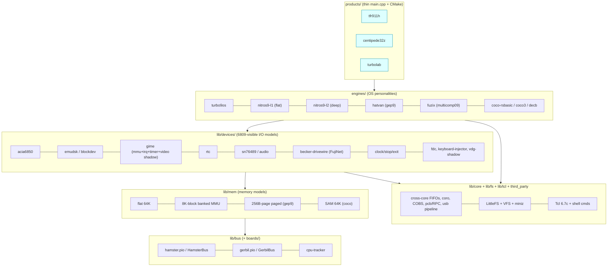

# tfr9 v5 — Notes, Discoveries, Snags, and Recommendations

*Status: proposal / analysis only.  No code has been copied from `../v4/`
yet, and nothing in `../v4/` or in `~/github.com/dillera/tfr9` was modified.
The first draft (`-two.md`) was an independent analysis written from the code
itself.  **This revision (`-two-and-a-half.md`) folds in what a cross‑read of
`-one.md` turned up**: every claim of `-one` that could be checked was checked
against the source/ELF/KiCad files; confirmed items were added as snags
(S26 onward), errors in `-one` are listed in §14 so they don't propagate, and my
advice on the CRTP question is in §5.5.  Changes vs `-two.md` are marked
**[2.5]**.  **On 2026‑10‑29 the recommendations were accepted; the answers to §13 are recorded there, their consequences in §15, and every place I departed from or had to reinterpret a decision is listed in §16 ("Revisions") for your review.  Items marked **[R#]** in the text refer to §16.***

Sources studied (all read-only):

| Source | What it is |
|---|---|
| `tfr9/v4/` @ `f963d3f` (Oct 23) | Henry Strickland's current v4: `tfr911h/`, `centipede-32z/`, `turbolab/`, `tether/`, `firmware/one/`, `cpu-tracker/`, `systests/`, `docs/` |
| `~/github.com/dillera/tfr9`, branch `nitros9-l2-tfr911` | 15 commits by Andrew Diller, 2026‑10‑16 … 10‑18, on top of Henry's `4ac54bf` (Sep 28) |
| `coco-shelf/nitros9` (branch `work-deep65280-0`) | Henry's NitrOS‑9 fork with the `flat65280` / `deep65280` recipes |
| `coco-shelf/pico-sdk` 2.3.0, `arm-none-eabi-gcc` 13.2.1, `go` 1.26.3 | The installed toolchain |

---

## 0. TL;DR — the ten recommendations

1. **One firmware library, zero copies.**  v4 already has *two* drifted copies of
   the "shared" library (`firmware/one/` vs `centipede-32z/three/`; 10 of 189
   common files differ, and the differences include real bug fixes living in
   only one copy).  v5 gets exactly one `firmware/lib/` and one `third_party/`.
2. **Split the monolith along the seams that already exist in the code**:
   *board* (pins, flash layout) → *bus* (PIO + foreground loop) → *memory model* →
   *devices* (6809‑visible I/O) → *engine* (= OS personality: memory model + device
   set + boot loader) → *product* (thin `main.cpp`).
3. **Make "I/O emulation for the 6809" a device library**, not a pile of globals in
   `main.cpp`.  v4 contains **three GIME models, four ACIA‑6850 models, five block‑device
   request paths, two RTCs and two audio paths**; they should each become one
   parameterised device.  (§5.3, §7)
4. **Select the engine once (function pointer to a per‑engine `IN_RAM` foreground
   loop), not with `if (current_engine == …)` chains inside the bus loop.**  v4's
   TFR911H foreground evaluates those chains on every bus cycle.  Do it with
   plain policy templates or explicit per‑engine loops — **not** with a CRTP/mixin
   framework (§5.5 **[2.5]**).
5. **Keep exactly two bus loops** (Hamster/E‑Q master for the TFR/911H; Gerbil/snoop for the
   Centipede) but make everything *behind* them shared.  Don't try to unify the loops themselves.
6. **One source of truth for the wire protocol and the cross‑core tags.**  Today
   `FG2BG_*` numeric values *differ* between `tfr911h` and `centipede` even though a comment
   says they're the same.  (§4, snag S5)
7. **One Go module, one `tether`, many `Personality`s.**  v4 has three tether trees
   (12.7K, 15.5K and 5.5K lines).  Fold in Diller's tether changes — including a
   bug fix for `EmulateDiskWrite` that is *still present in Henry's v4*.
8. **Keep every engine** (`flat65280`, `deep65280`, `gep9`/`gep9big`, `multicomp09fuzix`, `turbo9os`; none is retired) and make them **parameterizable**: an engine takes a tagged **port profile** (`TFR4` or `COCO`) and can be **enhanced** with optional devices (audio, RTC, info, Becker/FujiNet, …) at addresses from a tagged enhancement map.  Diller's separate L2 *engine* is not adopted; his devices become enhancements and his guest software is kept.  Tcl chooses among the predefined tags at run time.  (§7, §9, Appendix F)
9. **FujiNet becomes a shared device (`becker`/DriveWire over UART0, GPIO 12/13, 921600 baud) plus
   a guest‑side kit**, usable from the TFR/911H *and* the Centipede (same hat, rev 41d).
   **Decided: Becker at `$FF41/$FF42`** (Q1); sound/info/RTC move (§7).  (§8)
10. **Never `cp -r ../v4`.**  `v4/` is **749 MB on disk but only 780 tracked files / 45 MB.**  Import
    with `git ls-files` / `git archive`, or you'll import 276 vim undo files, RCS dirs,
    `_log` (3.8 MB), `build/` trees, etc.  (§11)

---

## 1. What v4 actually is (inventory)

### 1.1 Products

| Product | Dir | Source size | What it does |
|---|---|---|---|
| **TFR/911H firmware** (`tfr911h_v4.uf2`) | `v4/tfr911h/` | `v4_tfr911h_main.cpp` **2,618 lines** + `v4_gep9_*.h`, `v4_multicomp09.h`, `turbo9*.h`, ROM headers | RP2350B *is* the motherboard: PIO "Hamster" generates E/Q, RP2350 provides RAM and all I/O. Tcl 6.7 REPL + LittleFS + VFS on core 0, bus loop on core 1. Engines: `turbo9os`, `flat65280`, `deep65280`, `gep9`, `gep9big`, `multicomp09fuzix`(Fuzix) |
| **Centipede 32Z firmware** (`centipede.uf2`) | `v4/centipede-32z/firmware/` | `centipede.cpp` **1,644 lines** + `gspoon.h` (1,231), `coco128k.h` (424), `coco64k.h`, `floppy.h`… | RP2350B in the CoCo cartridge slot. PIO "Gerbil" snoops the *real* CoCo's bus and substitutes RAM/ROM/IO selectively. Builds are selected by `#define`s: `BECOME_COCO3`, `FUZIX_COCO2CENTIPEDE`, `FOR_COCO3`, `SAM_BIT_*`, `CENTIPEDE_REV` (32d/32e/32z/original) |
| **TurboLab** (`turbolab_v4.uf2`) | `v4/turbolab/firmware/` | `main.cpp` 57 KB, `hamster.h`, `pio_assembler.h` | Student subset of the TFR/911H: tethered only, **no Tcl, no LittleFS**; trace/trigger/watchpoint focused; OS‑9 Level 1 / TurbOS only |
| **Centiscope** | `v4/centipede-32z/centiscope-firmware/` | small | Logic‑analyzer‑style variant of the Centipede PIO |
| **tether** (Go) ×3 | `v4/tether/`, `v4/centipede-32z/tether/`, `v4/turbolab/tether/` | 12.7K / 15.5K / 5.5K lines | Host program: USB CDC + COBS, VFS server (`/pc`), cycle decode, 6809 disassembler, OS‑9 module listings, web VDG viewer (`:8080`), RPC |
| **cpu-tracker** | `v4/cpu-tracker/` | header‑only C++ | 6809 instruction‑boundary predictor (replaces LIC on the Centipede). Host‑testable against `misc/golden-log-*.txt` |
| **systests** | `v4/systests/` | shell + expect | Hardware tests: RPC, Tcl/VFS, one per engine (turbo9os, flat, deep, fuzix) |

### 1.2 The shared pieces (what v5 must *really* share)

All of these are used by **both** `tfr911h` and `centipede`:

* **LittleFS** (7.8K lines, vendored) + `lfs-centipede.[ch]` flash glue.
* **Tcl 6.7c** (23.7K lines, vendored; `TCL_GENERIC_ONLY=1`; ~39 commands in `tcl_commands.h`).
* **miniz** (9.5K lines) for `zip`/`lzip` in the VFS.
* **VFS** (`vfs.h`, 50 KB): OOP nodes over LittleFS **and** over the tether‑hosted `/pc` (RPC); `vfs_rpc.h`, `pcb.h` (protobuf‑like RPC encoding).
* **COBS** transport (`cobs.h`, `cobs_tx.h`, `usb_pipeline.h`, `circbuf.h`).
* **Dual‑core plumbing**: `CrossCoreFIFO` (`fg2bg`, `bg2fg`), `coro.h` cooperative scheduler, `Say()` console path.
* **The I/O dispatch idiom**: `IOReader IOReaders[256]; IOWriter IOWriters[256];` — one function pointer per `$FFxx`
  — present *identically* in `tfr911h` (main.cpp:128‑131) and `centipede` (centipede.cpp:331‑332).  This is
  the natural seam for a shared device library.
* **Boot‑mode / `modeN.tcl` scripting** (`boot_mode` in `__uninitialized_ram`, `/rc/modeN.tcl`).
* **Config**: `centipede_config` struct + `menu fetch/store`.
* **Flash label** (`flash-label.h`, last 4 KB of 16 MB flash).
* **Go**: `serial`, `cobs`, `open_*.go`, `os9_level{1,2}`, `listings`, `ram_coco{1,3}`, `samvdg`… (25 of the 34 file names the two main tethers share are byte‑identical).

### 1.3 The two "worlds" the shared code must serve

| | TFR/911H | Centipede 32Z |
|---|---|---|
| Who generates E/Q | RP2350B (PIO Hamster) | Real CoCo (SAM) |
| CPU | 6309E/6809E on the board | CoCo's own 6809E |
| RAM | RP2350 SRAM (`ram[256K]`, banked by *emulated* MMU) | RP2350 SRAM substituting CoCo RAM (64K/128K/256K) |
| Real hardware on the bus | none | PIA, SAM, VDG, FDC slot, cassette, sound mux… |
| I/O window | all of `$FF00‑$FFFF` is emulated | only what the cart claims (`SLENB`, `SCS` `$FF40‑$FF5F`, `CTS`), plus snooped/overridden reads |
| Pin map | `RESET=20 … E=29 Q=30 R/W=31`, A on GPIO 32‑47 | `RW=20 E=21 Q=22 … CTS=8 SCS=9 …` (rev‑dependent) |
| Tracing | optional | core feature (FIC prediction via `cpu-tracker`, compressed cycles) |

Consequence: **device models, memory models, VFS/Tcl/FS, protocol, and background services are shareable;
the two foreground loops are not.**

---

## 2. Andrew Diller's work — catalog and assessment

Branch `nitros9-l2-tfr911` (15 commits; **base is Henry's Sep 28 `4ac54bf`**, so it predates Henry's
flat/deep/gep9/multicomp work of Oct 5‑19 — Diller's `v4/tfr911h/` has *no* `v4_gep9_*.h` or
`ENGINE_*` machinery, and Henry's v4 has *none* of Diller's changes).

| Commit | Date | Area | What | Value for v5 |
|---|---|---|---|---|
| `b009255` | 10‑16 | **fw+tether+OS** | `l2` Tcl command boots NitrOS‑9 L2: emulated mini‑CoCo3 (`v4_nitros9_l2.h`, 612 lines: GIME MMU, 60 Hz VBORD IRQ, 6850 ACIA @ `$FF14`, EmuDsk @ `$FF80`, RTC @ `$FFC0`); `nitros9-l2/` builds kernel track → `nitros9_l2_rom.h`; `rmake-l2.tcl`; `launcher.asm` at `$2500`; `run-l2.sh`. Tether: **fix `EmulateDiskWrite` shadowed `disk_param`**, `T_WALLTIME`, `-boot`, `-pass_ctrl_c` | **High** (RTC, GIME IRQ, tether fixes). *Redundant with Henry's `deep65280`* — see §9 |
| `2ed9768` | 10‑16 | OS | Unix‑style commands (`ls`,`cd`,`grep`… as chained alias modules), `unix.tcl`, `helpmsg` | Medium‑high (student usability, TurboLab) |
| `a1b261c` | 10‑16 | OS | Tetris, arrow keys | Demo/value‑add |
| `ca56704` | 10‑16 | **fw** | `v4_audio.h`: PWM audio on **GPIO 8**, 31.25 kHz timer IRQ mixing an **SN76489 @ `$FF41`**, keyclicks, bell, Tcl `beep`/`click`; `$FF42` control reg | High; needs pin abstraction (GPIO 8 is `CTS` on Centipede 32Z!) |
| `4186209` `feb85d9` `600efe4` `25ff98f` | 10‑16/17 | OS/doc | `zm` Z‑machine, `vi`, `info` (reads firmware report through info port `$FF43/$FF44`), ULTRIX‑style manual (LaTeX) | Nice; keep as `os/nitros9/apps/` and `doc/manual/` |
| `8fc598f` | 10‑17 | **fw+OS** | FujiNet: `v4_fujinet.h` (UART0 GPIO 12/13, 921600 8N1, becker port @ **`$FF45/$FF46`**, 4K rx ring, IRQ on core 0), `l2fn` boot, `fujinet` Tcl cmd; NitrOS‑9 `rbdw`, `scdwv`, `dwio`, `fn*` commands (GPLv3) | **High** — the only FujiNet implementation in the tree |
| `363aac3` `f10fd11` `599a314` `923cd18` | 10‑17/18 | OS | `fnnews`, `fnstocks`, `fnbounce`, `fnweather` (C), `fnbattleship`; **`fujinet-lib` v5.0.1 ported to NitrOS‑9** (`bus/os9`), color terminal layer `fujinet/c/term.c` | High for FujiNet story; large vendored code → isolate (§8, §12) |
| `e6c0d4c` | 10‑18 | **tether** | UTF‑8 pass‑through | Take (small) |
| `77ad30c` | 10‑18 | licensing | GPLv3 headers/LICENSE for FujiNet programs | **Needs a decision** (§12) |

Notes:

* **273 tracked files** under `nitros9-l2/`, almost all vendored FujiNet apps/libs.  Treat as a *guest software kit*, not firmware.
* Diller's firmware footprint is small and clean: 4 new headers (`v4_nitros9_l2.h`, `v4_fujinet.h`,
  `v4_audio.h`, two ROM headers) + ~95 lines in `main.cpp` + 2 lines in CMake. They were added to a
  monolith by *another* parallel mechanism (`boot_l2` global, `l2`/`l2fn` Tcl commands, `L2__Foreground`)
  instead of the `Config(engine)` mechanism Henry added the same week.  That's exactly what v5's
  engine registry should absorb.
* External dependencies of the FujiNet work that are **not in this repo**: fujinet‑firmware PR 1631
  (CoCo/DriveWire/`COCO_HS_UART` board), PR 2027 (merged Oct 2026; consume driver‑version byte after
  `OP_DWINIT`), and an **un‑upstreamed** DevKitC fix (`coco-devkitc-no-button-c` in `dillera/fujinet-firmware`:
  floating GPIO 14 "Safe Reset" caused reboots every few seconds under disk traffic and hung the 6309).
  Record these in v5 docs with exact commits, or the hat will "randomly hang" for the next person.

---

## 3. Duplication and drift — the evidence

### 3.1 `firmware/one` vs `centipede-32z/three` (the shared lib, twice)

`tfr911h/CMakeLists.txt` builds from `../firmware/one/…`; `centipede-32z/firmware/CMakeLists.txt` builds
from `../three/…`.  A *third* CMakeLists in `three/firmware/` is a stale leftover (points at a
`centipede.cpp` that is now `centipede.xxxxxxcpp`).

189 files exist in both: **179 identical, 10 differ**:

| File | Δ lines | What differs (important ones) |
|---|---|---|
| `firmware/vfs.h` | 57 | **`firmware/one` splits tether‑VFS `read`/`write` into 256‑byte RPCs and returns partial counts; `three` sends the whole request** → large file I/O via `/pc` behaves differently per product. Take the chunked version. |
| `firmware/pico_rpc.h` | 82 | `three` has `get-ram`, `put-ram`, `type`, `get-status`, `get-cycles`, keyboard injection; `one` doesn't (but these are Centipede‑specific → belong behind a product hook) |
| `firmware/keyboard_injector.h` | 116 | Centipede‑only features |
| `firmware/menu.h` | 69 | config schema differs per product |
| `firmware/tcl_commands.h` | 13 | `three` adds `type` + `run-decb` |
| `firmware/vfs_rpc.h`, `rtc.h`, `floppy.h`, `cobs_tx.h`, `util/cobs.h` | 21/12/26/10/19 | small drift |
| only in `one` | | `firmware/config.h`, `coco64k.h` |
| only in `three` | | `coco3_rom.h`, `coco64k.hxxxxxxxx`, `config.h.not` |

**Merge rule for v5:** for each of the 10, do a 3‑way merge and then push product‑specific parts out into
product hooks (e.g., `PicoRpcRegisterMethod("get-ram", …)` from the Centipede product), so the lib has no `#if`s on
product.

### 3.2 Two incompatible `struct CentipedeConfig`, same include guard

`firmware/one/firmware/config.h` (fields `engine`, `flat_img`, `drive0‑3`, `task1/2`) and
`centipede-32z/firmware/config.h` (fields `fuzix`, `become_coco3`, `preload_decb`) both use guard
`FIRMWARE_H_`.  Whichever is found first silently wins.  The name is also misleading on the TFR/911H.
**v5:** a typed `Config` with a common core + per‑product extension, exposed to Tcl uniformly (`menu fetch/store`).

### 3.3 Tether ×3

* `v4/tether/` (36 files) vs `v4/centipede-32z/tether/` (43 files): of the 34 names they share, **25 are byte‑identical**; the 9 that differ are `pico_rpc.go` (692 lines),
  `tconsole.go` (444), `samvdg.go` (387), `webserver.go` (310), `webserver_test.go`, `utility.go`, `ram_coco3.go`, `open_linux.go`, `load.go`.
  Centipede‑only: `bas_token*`, `font5x7`, `load_command*`, `save_command*`, `ucommand_test`.  TFR911H‑only: `dump_panic*`.
* `v4/turbolab/tether/` is a *separate module* (`module github.com/strickyak/tfr9/v4/turbolab/tether`, `go 1.22`), while the
  repo root `go.mod` says `go 1.25.1` and the installed Go is 1.26.3.
* `tfr911_compat.go` already exists to let one tether speak both firmwares' cycle formats (`C_CYCLE`=200 vs `C_COMPRESSED_CYCLES`=175).  The merge has been *started* by accident.

### 3.4 Hardware models implemented more than once (the "I/O emulation" overlap)

| Concept | Implementations | Where |
|---|---|---|
| **GIME / MMU (8K blocks, 2 tasks)** | (a) `deep65280` (`task_mmu_base[]`, `$FF90` reads 0, 6 Hz tick); (b) Diller `l2` (`slot_base[]`, `$FF90/91/92`, VBORD 60 Hz IRQ, constant page `$FE00`); (c) Centipede `coco128k.h` (full: init0/1, IRQ/FIRQ enr, timer, video regs, palettes, `mmu_base[]`); (d) multicomp09 `mc_map0/1` (different register layout, same 8K×8 idea); (e) gep9 paged MMU (different: 256‑byte pages) | `v4_tfr911h_main.cpp:530‑560, 750‑1000`; `v4_nitros9_l2.h`; `coco128k.h`; `v4_multicomp09.h`; `v4_gep9_mmu.h` |
| **ACIA 6850** | flat/deep `$FF88/89`; Diller `$FF14/15`; multicomp09 `$FFD0/D1`; (plus non‑6850 consoles: Turbo9Sim `$FF00‑03`, Hatvan `$FF00‑05`) | `flat65280_acia_*`, `l2::Acia*`, `mc_*acia*` |
| **Block device request to core 0** | EmuDsk (flat/deep) via `FG2BG_EMUDSK` + atomic status spin; Diller EmuDsk via a `DiskState` machine + `disk_phys[256]` + `disk_deadline`; gep9 disk `FG2BG_GEP9_DISK`; multicomp09 SD `FG2BG_MC_SD`; Centipede FDC `FG2BG_FLOPPY_*`; Centipede Fuzix SD `FG2BG_FUZIX_SD_*` | five+ mechanisms for "core 1 asks core 0 to move a sector, bus stalls until done" |
| **RTC** | `rtc.h` `get_system_time()` (shared) vs Diller `$FFC0‑C7` fed by `T_WALLTIME` | |
| **Audio** | Diller PWM/SN76489 on GPIO 8; Centipede `orchestra90.h` (stereo 8‑bit DAC `$FF7A/7B` on GPIO 10/11 PWM slice 5) | |
| **Timer tick** | 60 Hz `repeating_timer` (Turbo9Sim/L2), `CLOCK_AND_STOP` 60/50/6/0.1 Hz, multicomp 50 Hz, GIME timer (Centipede), 20 ms timer | |
| **"Exit/stop" port** | `CLOCK_AND_STOP $FC/$FD/$FE`, Hatvan `Exit.Code $FF05` | unify as `ExitPort` device |
| **Boot loaders** | DECB parser (`gep9`, Centipede `preload_decb`), raw 64 K image (flat/deep), ROM header embed (turbo9os, Diller L2), track‑35 launcher (Diller) | one `ImageLoader` |

### 3.5 Dead / half‑finished code in v4

* `v4/tfr911h/v4_core_engine.h`, `v4_engine_tfr911.h`, `v4_engine_centipede.xxxxxh`, `v4_compat_centipede.h`,
  `v4_console.h`, `v4_floppy.h`, `v4_interrupts.h`, `v4_os_loader.h`, `v4_ram.h`, `v4_trace.h`, `v4_turbo9sim.h`, `v4_types.h`:
  **none is reachable from `v4_tfr911h_main.cpp`'s include graph.**  They are an *unfinished refactor* toward exactly the CRTP
  platform‑engine design recommended below.  Mine them for ideas; don't resurrect them blindly (they redefine `byte`, `CrossCoreFIFO`,
  use `FG2BG_HIGH_WATERMARK = 6000` while the live code uses `50`, and `v4_multicomp09.h` even declares `extern queue_t fg2bg_queue`, never defined).
* Files disabled by renaming (`*.xxxxxxcpp`, `*.xxxxxxxxh`, `config.h.not`, `coco64k.hxxxxxxxx`): 5 tracked.  Prefer deletion (git remembers) or `#if 0` + comment.
* `hdbchs_rom.h`, `hdbdw3cc3_rom.h`, `hdbsdc_rom.h` (≈52 KB each) in the shared firmware dir: three different HDB‑DOS‑style ROMs that **all define the same array name `disk11_rom[8192]`**,
  and are not included by anything.  They are the obvious starting material for FujiNet/DriveWire‑from‑BASIC on the Centipede but are un‑wired — see §8.
* `v4/turbolab.BAK2/`, `v4-bak-fuzix-coco2-md-io/`, `v4/_err` (203 KB), `_log`, `_out`, `_trace_log.txt` — scratch.

---

## 4. Snags for the unwary

Numbered so other docs can cite them.  *(E = evidence is a file/line you can open; V = inferred, please verify.)*

**S1. The two "shared lib" copies have already diverged** (§3.1) — and the tfr911h copy has the VFS 256‑byte chunking fix the Centipede copy lacks.  (E)

**S2. `.gitignore` silently drops files v5 will need.**  Root `.gitignore` ignores `*.rom.h`, `*.decb`, `*.list`, `*.map`, `*.raw`, `*.rom`, `*.exe`, `*.s`, `*.o`, `_*`, `build/`, `generated/`, `build-*/`.
`git check-ignore --no-index -v` confirms e.g. `turbo9os.rom.h` (matches `*.rom.h`), `kernel_6809.decb`, and anything named `_something`.  The currently tracked ones were force‑added; **new** ROM headers or `.list` files will vanish from `git status`.  v5 needs its own `.gitignore` with explicit `!` exceptions for checked‑in generated headers (or, better, generate them in `build/` and don't check them in). (E)

**S3. `FG2BG_*` tags disagree between products although a comment says they're shared.**
`tfr911h`: `…SYNC_NEEDED=4, NMI=5, FLOPPY_COMMAND=6, FLOPPY_LATCH=7, W_256=8, PEEK_REPLY=9, START_KEYBOARD_INJECTOR=10, FIC=12, EMUDSK=13, GEP9_DISK=14, MC_SD=15`.
`centipede`: `…SYNC_NEEDED=4, FG0BG_FIC=5, UNUSED_NMI=6, FLOPPY_COMMAND=7, FLOPPY_LATCH=8, W_256=9, PEEK_REPLY=10, START_KEYBOARD_INJECTOR=11, FUZIX_SD_READ=12, FUZIX_SD_WRITE=13`.
Same names, different numbers, and `12` means `FIC` in one and `FUZIX_SD_READ` in the other.  Any shared background code compiled against the wrong enum misroutes events.
Same story for wire constants (`C_CYCLE=200` vs `C_COMPRESSED_CYCLES=175`; tfr911h has `C_PRE_LOAD`, `C_DUMP_*`, `C_CORE_DUMP=189`, Diller adds `T_WALLTIME=182`).  **One header + generated Go constants.** (E)

**S4. `main.cpp` is a unity build whose "headers" are not headers.**  `littlefs.h`, `vfs.h`, `tcl_commands.h`, `pico_rpc.h`… contain function *definitions* and depend on globals (`ram`, `IOReaders`, `Say`, `fg2bg`, `byte`, `boot_mode`) defined earlier in `main.cpp`.  The TFR911H main even defeats real headers by pre‑defining their include guards
(`#define FIRMWARE_CONSOLE_H_`, `#define _GSPOON_H_`) and supplies `console::` stubs (`v4_console_tfr911_stub.h`).  Include order is semantics.  The stub's `console::poke/peek` write `ram[addr & 0xFFFF]` — **physical offsets, wrong for banked engines** (deep/gep9) when used by Tcl `poke`/`peek`. (E)

**S5. A hot‑loop `if` chain on the engine.**  `Guts<T>::Foreground()` branches on `current_engine` (`ENGINE_MULTICOMP09`, `ENGINE_GEP9`, `ENGINE_GEP9BIG`, `ENGINE_FLAT65280`, `ENGINE_DEEP65280`, …) for IRQ evaluation every group and for read/write translation on every cycle (main.cpp:1482‑1860).  It works, but every new engine makes every other engine slower and the function bigger in SRAM.  (E)

**S6. Everything core 1 touches must be in SRAM — enforced only by discipline.**  The bus loop and *every* I/O callback are `IN_RAM` (`__not_in_flash`) because an XIP cache miss during a bus cycle makes the 6809 latch garbage (comment at main.cpp:422‑429).  `lfs-centipede.c` programs/erases flash on core 0 with only `save_and_disable_interrupts()` (core‑local); `grep` finds **no** `flash_safe_execute`/`multicore_lockout` anywhere.  So a flash write while core 1 is in Phase 2 is safe only if *no* flash‑resident code, vtable, literal pool, or `const` table is touched by core 1.  Notice: `const byte Nitros9L2_Rom[]` (Diller) is `const` → flash; `byte disk11_rom[8192]` (Centipede) is non‑`const` → RAM copy (probably deliberate).  Add a checklist/CI check (inspect the `.map` for core‑1 symbols in `.text` vs `.time_critical`). (E for facts, V for hazard)
  **[2.5] Evidence from the built ELF** (`v4/tfr911h/build/tfr911h_v4.elf`, Oct 21): `Engine__Foreground()` is in SRAM (`0x20001678`, 2.9 KB) but its call sites go through veneers to **flash‑resident** `Gep9MMU::AllocFrame` / `AllocTaskTable` / `AllocBlockTable` (`0x1006…`; demand paging on first touch of a page), `cobs_printf` (`0x10005ab4`) and `sleep_us` (`0x10030a74`).  So the "everything in SRAM" rule is already violated on gep9 first‑touch paths and in the HALT handshake (`sleep_us(1)`).  Benign‑ish on the TFR/911H (the PIO simply waits and a 6309 is static); **fatal on the Centipede**, whose clock belongs to the real CoCo.  The one build‑time check described in `-one` (`check-core1-sram`) is the right fix; its jump‑table argument is *not* supported on this toolchain (see §14).

**S7. Flash/LittleFS layout is hard‑coded for 16 MB flash.**  `lfs-centipede.h`: offset 4 MB, size 11 MB, 4 KB blocks, and `flash-label.h` at `0x10FFF000` (last 4 KB of 16 MB).  The `tfr911h_rp2350b` board header defines **no** `PICO_FLASH_SIZE_BYTES` (SDK default 2 MB), so the linker believes flash is 2 MB while the code assumes 16 MB.  Works only because the hardware really has 16 MB (Stamp XL‑class module; `CMakeLists` has the Stamp XL line commented out). Put this in a *board profile*. (E/V)

**S8. `TCL_MEM_DEBUG=1` is on globally** (`add_compile_definitions` in both CMakeLists) — Tcl's `ckalloc` debug wrapper in production firmware. Intentional? Measure RAM and speed with it off. (E)

**S9. Build depends on the shelf layout.**  `tfr911h`'s Makefile: `TOP = $(shell cd ../.. && pwd)` → needs `$TOP/{bin,pico-sdk,picotool-install}`; `centipede-32z/Makefile` uses `TOP = ../../..` and `make -C ../../v4/ TETHERS` + `cp ../../v4/build/tether.*.exe build/`, and `v4/Makefile` builds those from `./tether/` — **so the tether binaries bundled with the Centipede are built from the TFR911H tree, while `centipede-32z/tether.sh` (`make run`) uses `go run ./centipede-32z/tether/`**, which has features the bundled binary lacks (`bas_token`, `load_command`, `save_command`, different `pico_rpc`/web code); `centipede-32z/tether.sh` hard‑codes `/home/strick/modoc/coco-shelf/toolshed/cocoroms/...`; docs and skills contain dozens of absolute `/home/strick/...` paths; `misc/pc/*.dsk|img|bin|decb` are tracked **absolute‑path symlinks** into `nitros9/recipes`, `hatvan-os/build`, `~/nand/github.com/EtchedPixels/FUZIX`.  `turbolab/Makefile` references `../../../borges-saver/`.  The helper `misc/install-pico-sdk-and-picotool-on-shelf.sh` has header text for a differently named script and **copies `pico-sdk` into `$TOP/picotool`** (`cp -a pico-sdk "$TOP/picotool"` — should be `picotool`). (E)

**S10. `boot_mode` is overloaded.**  The same `modeNN.tcl` mechanism means different things per product and per place: Centipede `rc/mode84.tcl` = "become CoCo 3"; TFR911H `misc/pc/mode84.tcl` = "NitrOS‑9 L1 flat65280"; `27` (ESC/BREAK) = skip rc; `3/89/90` special‑cased in `centipede.cpp:1631`; TFR911H files are looked up in `/rc/` *then* `/pc/`.  (E)

**S11. Engine selection by string with undocumented aliases and one typo.**  `Config(engine)` accepts `multicomp09fuzix`, **`multicomp09fuxiz`** (typo alias), `multicomp09fuzix`, `fuzix`, `gep9big`, … ; `docs/tfr911h-engines.md` documents *four* engines but the code has *six* (`GEP9BIG`, `MULTICOMP09`).  The same doc says Flat65280 "has embedded flash fallback", which commit `d89000c` removed. (E)

**S12. Diller's `L2_RAM_KILOS` is defined twice.**  `v4_tfr911h_main.cpp:213` `#define L2_RAM_KILOS 256` sizes `ram[]` for *all* engines; `v4_nitros9_l2.h:32` `#ifndef … 128`.  The README table says 256K.  Fine today, a trap when someone reorders includes. (E)

**S13. `EmulateDiskWrite` bug is still in Henry's v4 tether** (both `tether/disk.go` and `centipede-32z/tether/disk.go`): `case 256+4:` declares `var disk_param [4]byte` that *shadows* the parameter and then copies it onto itself, so the real data is never used.  Diller's `b009255` fixes it. Carry the fix. (E)

**S14. Address‑map collisions are real the moment engines share devices** (§7).  E.g. Diller's ACIA at `$FF14/15` overlaps Hatvan's disk controller `$FF10‑17`; Diller's RTC at `$FFC0‑C7` and multicomp09's `$FFD0‑DF` sit on top of the CoCo **SAM** register window (`$FFC0‑$FFDF`) — harmless on the TFR/911H, **wrong on a Centipede in a real CoCo**; Diller's sound/info/becker `$FF41‑$FF46` sit inside the CoCo cartridge `SCS` window (`$FF40‑$FF5F`, where the FDC lives), which on a Centipede the cart really owns. **[2.5]** Also: on a real CoCo `$FF14/$FF15` is a **mirror of PIA0** (`$FF00‑$FF1F`, partial decode), so Diller's ACIA address cannot be used on a Centipede at all, and his `fujinet/c/term.c` writes `sta $FF15` directly (line 128) to dodge SCF's ~300 µs/char — that shortcut will talk to PIA0 on a real CoCo. (E)

**S15. Becker port address.** *(Decided 2026‑10‑29: standard `$FF41/$FF42`; Diller's sound/control/info/RTC are re‑addressed, §7.)*  Emulators and stock NitrOS‑9/HDB‑DOS DriveWire use `$FF41/$FF42`.  Diller moved it to `$FF45/$FF46` *only because he had put the SN76489 at `$FF41`*, and built NitrOS‑9's `dwio`/`rbdw`/`boot_dw` with `BECKBASE=$FF45`.  Decide which one moves **before** more guest software is built (§8). (E)

**S16. GPIO 8 is `CTS` on the Centipede 32Z and audio on the TFR/911H;** Diller's FujiNet UART is GPIO 12/13; Orchestra‑90 uses GPIO 10/11 + PWM slice 5.  Also hardware resources used outside the pins: alarm 2 (audio; "default pool uses 3"), UART0 + its IRQ (FujiNet, on core 0), PIO0 SM0 (bus).  Keep a per‑board resource ledger. (E)

**S17. Centipede board revisions are `#if`‑chained** (`CENTIPEDE_REV` 3204/3205/3226/original) with bodged pins for 32d (`CTS 18`, `SCS 19`).  Decide which revisions v5 supports. (E)  **Resolved (§13 Q4): 32z only** — drop the `CENTIPEDE_REV` chain and the bodged‑pin variants; one `boards/centipede32z.h`. [R7]

**S18. Three product flavors are chosen by `#define`s in the middle of the .cpp** (`BECOME_COCO3`, `FUZIX_COCO2CENTIPEDE`, `FOR_COCO3`, `SAM_BIT_16K/64K`, `ram[64K/128K/256K]`).  `keep/` holds hand‑named UF2s (`centipede-sam64k.uf2`, `…fff2_03`, `normal-coco2`).  Note `config.h` defaults `FUZIX_COCO2CENTIPEDE` to **1** via `#ifndef` while `centipede.cpp` sets 0 first (commit `e56b04a` made it non‑default); order‑dependent. (E)

**S19. `FG2BG_HIGH_WATERMARK` is 50 in TFR911H, 1000 in Centipede, 6000 in the dead refactor header**, and TFR911H builds with `JUST_WAIT_DONT_HALT=1` (spin with `sleep_us(1)`) instead of HALT throttling.  Document the reasoning before consolidating flow control. (E)

**S20. Docs lag code and contain machine‑specific paths.**  Examples: engines doc (S11); `docs/*.md` link to `file:///home/strick/...`; `.agents/skills/tfr911h-skill/SKILL.md` describes the TurboLab product but is named for tfr911h. (E)

**S21. Tooling‑clutter in the working tree.**  vim undo files (`.*.un~`, 276), RCS dirs (23) and `,v` files (205), `_log` (3.8 MB), `_err` (203 KB), `a.out`.  All ignored by git, but they make `cp -r`, `du`, `grep -r` and IDE indexing miserable. (E)

**S22. Licensing is mixed.**  Repo `LICENSE` is MIT; Tcl 6.7c, miniz, LittleFS carry their own; Diller's FujiNet kit is **GPLv3** (and includes code from NitrOS‑9, fujinet‑lib, fujinet‑news/battleship, bounce‑world‑client — two of which "state no license" per his README). Firmware doesn't link GPL code today; keep it that way unless intended. (E; not legal advice)

**S23. `systests/` need a live board and expect absolute tools; no host‑only CI exists** except `cpu-tracker` (`make test`) and `go test` in tether. (E)

**S24. Time‑critical console behavior:** per Diller, SCF costs ~300 µs per character, so `fnbounce` writes straight to the 6850 at `$FF15`. If a shared ACIA device is introduced, keep it zero‑cost on core 1 and don't add per‑byte `Say()` stalls. (E, from commit text)

**S25. The `V4` AGENTS/skills rules are v4‑scoped.**  `v4/AGENTS.md` (RULE ONE: never edit outside `v4/`; RULE TWO: commit only on `work*` branches) — v5 has no equivalent yet; v5 must obey "do not change v4".  Suggest a v5 `AGENTS.md`. (E)

---


### Snags added in 2.5 (found by cross‑reading `-one.md`, then verified)

**S26. `util/cobs.h` in `firmware/one` (the copy the TFR/911H builds) can overflow its stack buffer.**  `CobsEncodeAndTransmit` copies the payload into `unsigned char ckbuf[1024]` with `i < sizeof(ckbuf)-1`, **then writes `ckbuf[len] = CobsChecksum(...)` unconditionally** — for `len ≥ 1024` that is an out‑of‑bounds write on the stack (and the encoder then reads past the copied bytes).  `three/util/cobs.h` (Centipede copy) uses a zero‑copy `get_byte(idx)` lambda and has no limit.  Packets are ≤ ~512 today (VFS chunks 256, core dump 258), so it hasn't bitten; any future bigger RPC (`get-ram` with large `len`) will.  **Take `three`'s.**  (E; `-one` called it "truncation" — it is worse.)

**S27. `vfs_rpc.h` differs in a way that decides which product can load images.**  `one` works inside a coroutine *and* on the main stack (`Coro::current()==nullptr` → `PumpUsbCobs()` while waiting); `three` does `CENTIPEDE_ASSERT(coro, "vfs_rpc: no Coro")` and only `coro_yield`s.  The TFR/911H calls VFS from the main stack during the `bye` transition (loading `/pc/*.img|*.decb`), so **`three`'s version would assert there**.  v5 must take `one`'s dual‑mode (and document why).  (E)

**S28. `floppy.h` in `one` runs flash code on core 1.**  `ReadScsFloppy`/`WriteScsFloppy` are neither `FORCE_INLINE` nor `IN_RAM` and the "not installed" stubs call `cobs_printf` (flash) from the foreground path; `three` fixed all of that (`FORCE_INLINE static void IN_RAM`).  Only latent on the TFR/911H (floppy unused), but it's the Centipede's copy that is right.  (E)

**S29. `cobs_tx.h`: `C_SHUTDOWN`/`cobs_shutdown()` exist only in `one`.**  The tether's `Dump6309PanicState` on `C_SHUTDOWN=255` depends on it; `three` (Centipede) lacks it, so a merged lib must carry it and the Centipede tether must tolerate it.  Likewise `keyboard_injector.h` in `three` is the better one (double‑buffered 256‑entry `probe_table[2][256]` with `active_table_idx`, 256 actions, `queue_char`), `rtc.h` in `three` is the `inline` (multi‑TU‑safe) one, and `vfs.h` in `one` has the `/lfs` alias (`path.empty() && token=="lfs"`) plus 256‑byte chunking.  **Net merge rule: `three` for cobs/floppy/keyboard_injector/rtc; `one` for vfs/vfs_rpc/cobs_tx.**  (E)

**S30. `hamster.pio` drift is a behavior difference, not cosmetics.**  TurboLab's copy has `gpio_pull_up(31)` (R/W) in the init; `tfr911h`'s doesn't.  `main.cpp` (≈line 1617‑1635) documents *phantom writes during HALT* because R/W floats and the weak pull‑up is slow.  A one‑line port may be the actual fix (verify on hardware).  (E; effect V)  *(Promoted from a migration‑table remark.)*

**S31. `hat-fuji-41d` does not route GPIO 13 where Diller's firmware config and the 40c bodge expect.**  From the 41d KiCad netlist (and the DevKitC symbol's own pin numbers): `J1‑9 (/H12 = GPIO12) → J2‑8 = ESP32 IO33`; `J1‑11 (/H13 = GPIO13) → J2‑15 = ESP32 IO13`; `J1‑13 (/H14) → J2‑10 = IO26`; `J1‑15 (/H15) → J2‑9 = IO25`.  Bill Athing's 40c bodge instead sends `J1‑11 → J3‑15 = IO21`, and Diller's README wires "GPIO12→ESP32 GPIO33 (UART1 RX), GPIO13←ESP32 GPIO21 (UART1 TX)".  So **on an unmodified 41d the ESP32 must use `PIN_UART1_TX = 13`** (RX=33 is right for both); a FujiNet firmware built for TX=21 transmits into nothing.  (E)  *(`-one` found this; its IO‑number labels are off by one for J2‑8/9/10 and its suggested `RX=32` should be 33 — see §14.)*

**S32. `centiscope-firmware` does not match its own PIO program.**  `gerbil.pio` there defines `.program passive_gerbil` (generated functions are `passive_gerbil_program_*`), but `centiscope.cpp:414` still does `#define GERBIL_GET() gerbil_program_get_word(pio, sm)` (and `_put_word`), names that program no longer defines; the checked‑in `centiscope.uf2` predates (Sep 5) the dir's last change (Sep 25).  Almost certainly fails to compile today (not build‑verified, since building writes into v4).  Also its CMake pulls `littlefs/miniz/tcl` from `../../firmware/one`, a third consumer of the shared lib.  (E; build V)

**S33. Diller's FujiNet hardware dependency list should be a snag, not a paragraph.**  DevKitC `GPIO14` (hat `SAFE_RESET`) floats without a pull‑up and restarts the FujiNet under disk traffic (`BUTTON_C: SHORT PRESS` / `ACTION: Reboot`, 6309 hangs on a lost request).  On the **41d** schematic, `R7` ties `IO14` to +3.3 V, which cures it; a bare DevKitC (Diller's setup) or a 40c without `R7` does not.  Plus the FujiNet firmware prerequisites: board `fujinet-coco-devkitc-centipede`, PR 1631, PR 2027, branch `coco-devkitc-no-button-c`.  (E)

**S34. Guest‑side C toolchain traps (from Diller's commit/README text, not independently reproduced).**  CMOC `--os9` programs need `--add-os9-stack-space=2048` (default stack too small even for `printf`); CMOC puts arrays of string pointers in the data area that the OS‑9 module header doesn't count (stack overflow at start; use single strings / fixed `char[]`); `flag ? byteval : -1` keeps the byte type (−1 → 255); a byte×byte constant stays a byte (drew icons from the wrong rows).  Record in `os/` build notes.  (E‑doc)

**S35. `PICO_RP2350A` hygiene (non‑bug).**  The TFR/911H board header doesn't define `PICO_RP2350A`; `-one` argues this makes the SDK treat the chip as an RP2350A.  **That is not what SDK 2.3.0 does**: `pico/platform.h` leaves it undefined (`#if 0`), `#if PICO_RP2350A` is then false, so `NUM_BANK0_GPIOS=48` and `ADC_TEMPERATURE_CHANNEL_NUM = NUM_ADC_CHANNELS‑1 = 8`.  The `set(PICO_RP2350A 0)` in the CMakeLists appears inert (nothing in the SDK's CMake reads it).  Still, define `PICO_RP2350A 0` in the board header (as `solderparty_rp2350_stamp_xl.h` does) — it costs nothing and survives SDK changes.  **The "−200 C … +400 C" readings that `-one` reports for Diller's `ChipTemperature()` are therefore *not* explained by this** (I did not reproduce them; his code only says the sensor "reads nonsense on some boards (its ADC supply or reference)" and suppresses values outside −20…110 C).  Check ADC_AVDD/VREF decoupling on the board before blaming software.  (E)

**S36. Hardware I did not review.**  I did not open the KiCad/Gerber trees for `tfr911h`, `tfr911k`, `rp2350b-add-psram-a/b`, `centipede-32z`, except the 41d hat.  `-one` makes PSRAM and 16 MB flash statements ("`U4` Winbond", "2 MB/8 MB PSRAM with GPIO19 CS") that I could neither confirm nor refute; they'd be useful for S7 and for ever lifting the 256 KB RAM ceiling.  (V)

**S37. Two incompatible `struct CentipedeConfig` with the same include guard `FIRMWARE_H_`** (`firmware/one/firmware/config.h` vs `centipede-32z/firmware/config.h`): whichever header is found first silently wins; field sets differ (§3.2).  Promoted from §3.2 so it has a number.  (E)

**S38. Several firmware routines hold an entire file in RAM.  [R19]**  (Audit of `firmware/one/firmware/*.h`; the engines' image loaders and most commands are fine.)

| Where | What it does | Fix |
|---|---|---|
| `ZipArchiveNode::open_file`, `vfs.h:706` | `mz_zip_reader_extract_to_heap` — **every** read of `x.zip!/entry` (or `x.pak!/…`) decompresses the whole entry into heap | *stored* entries: seek/read the byte range directly in the archive; *deflated* entries: streaming inflate (`tinfl`, 32 KB window) with forward reads, restart on backward seek; size cap with a clear error as the fallback |
| `minizip_cmd` (Tcl `zip`), `tcl_commands.h:798` | `ckalloc(uncomp_size+1)` — a whole entry becomes one Tcl string | extract with `mz_zip_reader_extract_to_callback` into a VFS file or chunked output |
| `source_cmd`, `tcl_commands.h:883‑935` | `ckalloc(size+1)`, then `Tcl_Eval` of the whole file (for `source x.pak!/boot.tcl` that is *two* copies: heap extract + Tcl buffer) | evaluate **one command at a time**: read lines into a small growing buffer, `Tcl_CommandComplete()`, `Tcl_Eval`, repeat — the technique the REPL already uses |
| `multifile_cmd`, `tcl_commands.h:941‑` | `std::string content(info.size)` | process in chunks/lines |
| `tail_cmd`, `tcl_commands.h` ≈379‑425 | collects **every line** in a `std::vector<std::string>` and prints the last *n* | ring buffer of *n* lines (or seek from the end) |
| `edit` (`editor.h` ≈85‑110) | loads the whole file into `std::vector<std::string> lines` | acceptable for a text editor, but add a size guard (e.g. 64 KB) and a message |
| `Os9DirNode`, `vfs.h:225` | `std::vector<uint8_t> dir_data(file_size)` reads a whole *directory file* | cap `file_size` (corrupt disk images can claim huge directories) |
| `HexFileNode::read`, CR/LF filter nodes `vfs.h` ≈1045‑1236 | allocate a `std::vector` per call sized by the request | fine for small requests; use a stack buffer and clamp |

Verified streaming (no change needed): `cat`, `wc`, `head`, `grep` (64‑byte chunks), `md5sum` (256 B), `hd` (16 B), `files_are_identical` (256 B), VFS tether reads (256 B RPCs), `setup_flat65280`/`deep65280` image loads (256 B chunks); no whole‑file buffers in `main.cpp` or `centipede.cpp` engine loaders.  Rule for v5: **no VFS or Tcl routine may allocate O(file size)**; add a test that runs each file command on a ≥2 MB file under a heap high‑water check.

**S39. The tether's `/pc` confinement is textual only and follows symlinks.  [R17]**  `rpc.go:27` computes `filepath.Join(*PC_DIR, filepath.Clean("/"+req.Path))` — that stops `..` and absolute paths, **but** `os.Stat/Open/ReadDir` follow symlinks, so a symlink inside the `--pc` directory (v4's `misc/pc` has 11 absolute ones into `nitros9/recipes`, `hatvan-os/build`, Fuzix) escapes the root, and writes through such a link modify files elsewhere.  `rename` and `remove` use the same pattern (`realPath2`).  Required behavior is defined in §11.13.  (E)

**S40. `quick-reflash` shells out with an interpolated path.**  `pico_rpc.go:361`: `exec.Command("/bin/sh","-c", fmt.Sprintf("cp -v '%s' /media/${USER}/RP*", uf2path))`.  The path comes from the operator's own command line, not from the Pico, so it is not an exposure under our threat model (§11.12), but a `'` in the name breaks it.  Replace with `filepath.Glob` + a direct `cp`/copy in Go, no shell.  The only other processes the tether starts are `stty` with fixed arguments (verified by grep over all four Go trees; the `vendor/websocket` example `command/main.go` is not part of the build).  (E)

---

## 5. Proposed v5 structure

### 5.1 Layering



Rules that keep the layering honest:

* `lib/core`, `lib/fs`, `lib/tcl`, `lib/devices`, `lib/mem` **never `#include` a product or board header**; they get pins/flash/RAM size from a `BoardProfile` (constexpr struct) passed in via a template parameter or a single `board.h` selected by CMake.
* `lib/devices` have **no dependency on the Pico SDK except through a tiny HAL** (`hal.h`: `gpio_*`, `time_us_64`, `multicore`, `irq`).  Then device models *compile on the host* and can be unit‑tested (§11).
* A device exposes: `Install(IoMap&, Params)` (claims addresses; **IoMap panics on overlap**), `IN_RAM` read/write handlers, optional `Poll()` (core 0), `Tick60Hz()`, `OnReset()`, `Report()` (for the `info` port/stats).
* An engine = `{name, aliases, boards, ram_bytes, Setup(Config) [core 0], Foreground [IN_RAM, core 1], Report}`.  `bye` → `EngineRegistry::Launch(name)`.  `l2`, `l2fn`, `bye` become *aliases/boot recipes*, not special globals.
* **[2.5, R13] Engines are parameterized and enhanced, not forked.**  `EngineSpec` also carries `supported_profiles` (e.g. `TFR4`, `COCO`) and an `enhancements` list; both are *data* chosen by `Config`/Tcl at launch (§7).  **Tcl is the first‑line tool for resolving conflicts** (pick the profile, add/omit an enhancement, point a drive at a file); only when Tcl cannot express it do we change C++.  Software distribution through `.pak` files (Appendix F) builds on this.
* Each engine gets **its own** `IN_RAM` foreground function (specialised at compile time — by a plain policy template or by an explicit hand‑written loop, see §5.5) and core 0 does `multicore_launch_core1(engine.foreground)`.  **[2.5]** Earlier text here said "template `Foreground<Bus, Mem, Irq, Trace>` … like the Centipede's CRTP `Engine0`/`Engine3`"; I now advise against CRTP/mixins specifically (§5.5).  Check the RAM budget with the `.map` file — RP2350B has 520 KB SRAM and `ram[]` takes 256 KB.

### 5.2 Directory tree

```
v5/
  README.md                 what/where/how-to-build; supported matrix (product × engine × OS)
  AGENTS.md                 workspace rules (never edit ../v4; branch policy; "git ls-files" import rule)
  Makefile                  thin front door:  make doctor | all | tfr911h | centipede | turbolab | tether | test | systest
  .gitignore                explicit; with ! exceptions for any checked-in generated header
  cmake/                    toolchain discovery, pico_sdk_import wrapper, helper functions (add_tfr_product())
  scripts/                  env.sh ($SHELF), doctor.sh, import-from-v4.sh (git ls-files based), fetch-pico-sdk.sh (fixed)
  boards/
    tfr911h_rp2350b.h       PICO board header (+ pins.h, flash_layout.h, resources.md ledger)
    centipede32z.h          (and legacy revs only if you decide to keep them)
    hat-fuji.md             pinout of the 41d hat for both hosts
  third_party/
    littlefs/  miniz/  tcl6.7c/     vendored, with PATCHES.md (the exact local changes) and original LICENSEs
  firmware/
    lib/
      core/                 cross-core.h, circbuf.h, cobs*.h, usb_pipeline.h, pcb.h, coro.h, abort.h, flash-label.h, boot_mode.h, protocol.h (single source of truth)
      fs/                   lfs_pico.[ch] (parameterised by flash layout), vfs.h, vfs_rpc.h, littlefs cmds
      tcl/                  tcl_glue, tcl_io.h, shell commands split by concern (core, fs, config/menu, system, debug)
      bus/                  hamster.pio, gerbil.pio, hamster bus loop pieces, cpu_tracker/ (moved here)
      mem/                  flat64k.h, banked8k.h, paged256.h, sam64k.h
      devices/              acia6850.h, emudsk.h (blockdev), gime.h, rtc.h, audio_sn76489.h, becker_drivewire.h, clockstop.h, exitport.h, fdc_wd17xx.h, kbd_injector.h, vdg_shadow.h, orchestra90.h, turbo9sim_acia.h, hatvan_*.h, multicomp09_*.h
      images/               ImageLoader (raw64k, DECB, track-35 launcher), embedded-ROM helpers
    engines/                turbo9os/ flat65280/ deep65280/ gep9/ (incl. gep9big) multicomp09/ coco2/ coco3/ fuzix_coco2/ …   (one dir each: engine.h, setup.cpp, foreground.cpp, ports_<TAG>.h, README.md; **engine dirs use the names you use**)
    products/
      tfr911h/              main.cpp (~200 lines), CMakeLists.txt, tcl_product.cpp (product-only Tcl cmds)
      centipede32z/         main.cpp, CMakeLists.txt, variants.cmake (coco2 | coco3 | fuzix | centiscope)
      turbolab/             main.cpp (+ pio_assembler.h, tuning), CMakeLists.txt  [no Tcl/LFS]
  host/
    go.mod                  one module
    cmd/tether/             main + personality wiring
    cmd/turbolab-tether/    only if a lean binary is still wanted (or: tether -profile=turbolab)
    internal/               serial, cobs, protocol (generated), rpc, vfsserver, trace, dis6809, os9 (listings, api, err), web (vdg viewer), bootmenu, uf2label
    tools/                  annealing, borges-saver (moved in, no ../../.. paths)
  os/                       guest software (built with lwasm/lwlink/cmoc/os9 from toolshed)
    nitros9/                recipes (l1 flat, l2 deep), modules (clock2_tfr911, dwio/scdwv, sc6850 descriptors), unix aliases, rmake*.tcl, startup, helpmsg
    fujinet/                cmds, lib, defs, apps(news, stocks, weather, bounce, battleship), fujinet-lib/os9 bus  — own LICENSE (GPLv3)
    hatvan/  fuzix/  turbos/  rsbasic/      (build notes + patch queues; images stay outside git, referenced by manifest)
  rc/                       the modeNN.tcl catalog, one place, one table (see §6)
  tests/
    host/                   go test; device-model unit tests (C++ host build); cpu-tracker golden logs
    systests/               hardware tests (one per engine + fujinet), common.sh with SHELF/ports from env
  doc/
    v5-notes-and-recommendations.md   (this file)
    architecture.md  io-map.md  protocol.md  boot-modes.md  board-resources.md  engines/*.md  user/ (manual)
```

### 5.3 Device library — concrete suggestions

* Keep `IOReaders[256]/IOWriters[256]` (it's what both products do and it's fast), but **widen the handler signature to carry a context pointer** — `byte (*)(void* ctx, uint addr)` — so two ACIAs (or an ACIA at a different base) can exist without copy/paste globals.  Measure; one extra register argument is negligible against a 1–2 MHz bus.
* **`IoMap::Claim(base, len, name)`** records ownership and aborts at `Setup()` on overlap.  Generate `doc/io-map.md` from the registry at build time (a `make io-map` that dumps each engine's table).  This turns S14 from a trap into a test.
* **`BlockDevice` request** replaces the five bespoke paths:
  `struct BlockReq { uint8 drive; uint32 lsn; uint16 count; AddrXlate xlate; Cmd cmd; atomic<int8> status; }`, one `FG2BG_BLOCK` tag,
  one core‑0 service coroutine (VFS file, tether file, or LittleFS), per‑engine `AddrXlate` (flat, 8K MMU, paged).  Sector size/protocol (EmuDsk 256 B, multicomp SD 512 B + status protocol, FDC) stay in the *device front‑end*.
* **`Gime` device with feature levels**: `Mmu` (deep65280) → `+Irq/VBORD` (Diller L2) → `+Timer/FIRQ + video‑shadow + palettes` (Centipede coco3).  The NitrOS‑9 L2 engine then differs from the Centipede CoCo3 mode only in `Bus`, not in GIME code.
* **`Acia6850`** parameterised by base address and IRQ line; Turbo9Sim ACIA and Hatvan console stay separate small devices.
* **`Audio`**: pin from the board profile; SN76489 + clicks + `beep` in one module; Orchestra‑90 as a second front‑end on the same PWM mixer.  On the Centipede the `G_SND` pin (26) is the natural output; verify analog routing before enabling.
* **`Becker`** (DriveWire over UART) — §8.
* **Devices that need memory (DMA) — [2.5] why CRTP is not required for it.**  Block devices must turn a logical address into a physical one, and that depends on the MMU.  In v4 this happens only on **core 0, while core 1 is stalled**: EmuDsk (`translate_deep_addr(buf_addr)` once per sector, main.cpp:2241), gep9 disk (`gep9_mmu.TranslateRead/Write(task, addr+i)` per byte), Diller's EmuDsk (`disk_phys[256]` precomputed per byte on core 1 at command time).  Not per bus cycle, so an indirect call costs nothing.  Give devices a small `MemoryView` handed to them at `Setup()` — `Phys(task, logical)` plus `CopyIn/CopyOut(task, logical, buf, len)` that translate per byte (or per run within one block).  Two latent issues to fix when doing so: (1) v4's flat/deep EmuDsk translates only the *start* of the 256‑byte buffer, wrong if a buffer ever straddles an 8 K MMU block boundary (gep9 and Diller's code translate per byte); (2) consistency relies on core 1 being stalled during the transfer — document that invariant.  The Centipede's Fuzix SD is a byte‑FIFO port (6809 moves the bytes), so it needs no memory view.  `get-ram`/`put-ram` in `pico_rpc.h` and the console `peek/poke` stub address *physical* RAM; give them the same `MemoryView`.
* **IRQ policy** as a tiny object (`IrqSources` bitmask → `ChangeInterruptPin`) rather than a function per engine.

### 5.4 Core/boot flow to preserve (it works; keep the semantics)

*[2.5] On whether to add a third "middleground" execution tier, see **Appendix E**.*

Phase 1 (core 0): GPIO init, 250 MHz, USB stdio, PIO load, CPU held in RESET+HALT, Tcl REPL on USB → `bye`.
Transition: read `Config`, `engine.Setup()` (open drives via VFS, load images, install devices), reset PIO, `multicore_launch_core1(engine.foreground)`, wait for `foreground_running`, release RESET/HALT.
Phase 2: core 1 = bus + devices only; core 0 = coroutine scheduler (`drain_task`, USB pump, console, block service, timers).
Keep the property documented in v4 docs that the 6309 is *static* (clock stop during block I/O is safe) — and **write down that this is why the bus can be stalled**; it does not hold for a real 6809E on the Centipede.

---

### 5.5 Should v5 drop the Curiously Recurring Template Pattern?  **[2.5]**

*Tutorials for colleagues: **Appendix C** (policy templates) and **Appendix D** (CRTP).*

`-one` recommends dropping CRTP.  My advice: **yes for CRTP/mixin inheritance as a framework; no for compile‑time specialisation of the per‑engine hot loop.**  These are different things and v4 conflates them.

**What v4 actually has** (facts):

| Where | Shape | Verdict |
|---|---|---|
| `centipede.cpp` | `CoreEngine<T>` + mixins `DoFloppy<T>`, `DoCoco64k<T>`/`DoCoco128k<T>` (+ `Dont…` null mixins), final classes `Engine0`/`Engine3`; foreground calls `T::IsCoco3Rom()`, `T::TranslateCoco64kRamAddress()`… all `FORCE_INLINE static` | **Works and ships.**  But in practice *one* engine is used per UF2 (`#if BECOME_COCO3` picks `Engine3::RunEngine()` else `Engine0`), so it is a compile‑time feature switch, not run‑time polymorphism.  Mixins reach into globals declared earlier in the .cpp (`SamTyBit`, `SamP1Bit`, `ram`, `IOWriters`), so the headers aren't self‑contained. |
| `v4_tfr911h_main.cpp` | `Guts<T>`/`DoTurbo9os<Engine,…>` — CRTP‑shaped, instantiated **once**; engines chosen by **run‑time `if (current_engine==…)`** inside the loop | CRTP buys nothing here; the real problem is the `if` chain (S5). |
| `v4_core_engine.h`, `v4_engine_tfr911.h`, `v4_compat_centipede.h` (dead) | `CoreEngine<T>` + `TFR911Engine<T>`/`CentipedeEngine<T>` platform mixins, to unify **both products' loops** | **Stalled and never wired in.**  `-one`'s diagnosis is right: the two inner loops are genuinely different (Hamster: PIO is clock master and always drives D; Gerbil: slave to EBAR/QBAR, per‑cycle DRIVE/PASS decision, SLENB, spoonfeed).  A shared base class was at the wrong layer. |

**One stated reason in the dead header is false.**  `v4_core_engine.h` says *"GCC does not support `__attribute__((section))` on class methods, so the loops must be free functions"*.  I tested the installed `arm-none-eabi-g++ 13.2.1` (`-O2 -mcpu=cortex-m33`): a static member function, a CRTP static method and a function template **all** land in a named `.time_critical.*` section.  So `IN_RAM` is not a reason to avoid classes or templates.  (Scratch test: `brain/…/scratch/sec.cpp`.)

**What I'd drop:**
* CRTP as the cross‑product abstraction (`CoreEngine<T>` for both boards) — confirmed dead end.
* Mixin inheritance chains (`DoX<T>` depending on `T` and on file‑scope globals).  They hide coupling, make include order semantic (S4), make GDB/linker‑map reading harder, and block the host‑compilable‑device goal (§5.1: devices must be self‑contained).
* `Dont…<T>` null‑object mixins — replace with `static constexpr bool kHasX` + `if constexpr`.

**What I'd keep (the part that matters for speed):**
* Specialise each engine's foreground at compile time.  The budget is real: ~150 core cycles per 1.6 MHz TFR/911H bus cycle (TurboLab measures ≈1.63 MHz) and a hard real‑time deadline on the Centipede.  Today's TFR/911H `if (current_engine…)` chains already cost cycles on every read/write and bloat one 2.9 KB SRAM function; every new engine makes all others slower.
* The simplest mechanism that gets this, in order of preference:
  1. **Policy templates, no inheritance**: `template<class Mem, class Irq> IN_RAM void foreground()` where `Mem`/`Irq` are plain structs with `static FORCE_INLINE` members (`Read(addr)`, `Write(addr,v)`, `Translate`, `IrqNeeded()`).  Depth one, no `T::` reaching into a derived class, explicit instantiation per engine in `engines/<name>/foreground.cpp`.  This is the same compile‑time dispatch CRTP gave, minus the base class.
  2. **Explicit per‑engine loops** (copy the ~100‑line bus skeleton per engine, shared helpers as `FORCE_INLINE` free functions).  More duplication, zero template machinery; reasonable if the team finds even policies unwelcome.  Mitigate drift with a golden‑trace test per engine.
  3. *Not* run‑time dispatch per cycle (function pointer for Read/Write): the I/O page already pays one indirect call; don't add it to every RAM access.
* The **device layer stays run‑time and non‑templated**: `IOReaders[256]/IOWriters[256]` function‑pointer tables with a context pointer (§5.3) — as `-one` also proposes.

**How to settle it with data, cheaply** (half a day): build `nitros9-l2` and `hatvan` both ways (policy template vs. v4's `if` chain), compare (a) `.map`/`objdump` size of the foreground, (b) the `info` port's measured 6309 MHz, (c) `nm`‑based "no callee outside SRAM" check (S6/S26–S28).  Adopt whichever is not worse on (b) and clean on (c); if equal, choose #2 for readability.

Also note a bonus from `-one`: its **`IODriveMask[8]` 256‑bit "drive vs pass" bitmap** for the Centipede (device declares whether it drives the bus or lets the CoCo answer) is a good, cheap table‑driven idea; adopt it in the Gerbil product's I/O layer.

---

## 6. Migration map (v4 → v5) and merge decisions

| v4 | v5 | Action |
|---|---|---|
| `firmware/one/{littlefs,miniz,tcl6.7c}` ≡ `three/{…}` (identical, 179 files) | `third_party/` | Copy once; add `PATCHES.md` (diff vs upstream: Tcl 6.7c compat dir, `TCL_GENERIC_ONLY`, `lfs-centipede.*`) |
| `firmware/one/firmware/{cobs_tx,usb_pipeline,cross-core,coro,abort,pcb,flash-label,compress}.h`, `util/{cobs,circbuf}.h` | `firmware/lib/core/` | `cobs.h` from `three` (S26), `cobs_tx.h` from `one` (S29); `compress.h` is Centipede‑trace‑only → `lib/bus/` |
| `vfs.h`, `vfs_rpc.[hc]`, `littlefs.h`, `tcl_io.h`, `tcl_commands.h`, `menu.h`, `pico_rpc.h`, `rtc.h` | `lib/fs`, `lib/tcl` | Take **chunked** VFS from `one`; split product methods (`get-ram`, `type`, `run-decb`…) into product hooks |
| `hamster.pio` (tfr911h), `turbolab/firmware/hamster.pio` | `lib/bus/hamster.pio` | They differ by **one line: TurboLab's has `gpio_pull_up(31)` (R/W) which tfr911h's lacks** — relevant to the HALT phantom‑write issue described in main.cpp:1630. Verify on hardware, then keep one |
| `gerbil.pio`, `centiscope-firmware/gerbil.pio` | `lib/bus/gerbil.pio` + centiscope variant | Diff, decide |
| `cpu-tracker/` | `lib/bus/cpu_tracker/` (+ `tests/host`) | Move as is; keep golden logs |
| `tfr911h/v4_tfr911h_main.cpp` (2,618 l.) | split → `products/tfr911h/main.cpp` + `lib/*` + `engines/*` | The big refactor (Phase 3 below) |
| `v4_gep9_{mmu,io}.h` | `engines/hatvan/` + `mem/paged256.h` | Mostly self‑contained already |
| `v4_multicomp09.h` | `engines/fuzix_multicomp09/` | Keep the SD‑write fix (docs/fuzix-summary §D); drop bogus `extern queue_t fg2bg_queue` |
| flat/deep EmuDsk/ACIA/CLOCK_AND_STOP/Install_* in main.cpp | `devices/{emudsk,acia6850,clockstop}.h`, `engines/flat65280`, `engines/deep65280` | engines **kept** [R2] |
| `turbo9sim.h`, `turbo9os.h`, `*.mod.h`, `turbo9os.rom.h`, `romlist.h` | `engines/turbo9os/` (+ ROM headers generated from `os/turbos`) | |
| Diller `v4_audio.h`, `v4_fujinet.h`, RTC/info/ACIA‑arrow‑key code from `v4_nitros9_l2.h` | `devices/{audio_sn76489,becker_drivewire,rtc,info_port}.h` as **enhancements** | §7, §8, §9 |
| Diller `v4_nitros9_l2.h` engine loop + `nitros9_l2*_rom.h` | **not adopted** (redundant with `deep65280`; `l2fn` deferred) | §9 [R2, R15] |
| `centipede.cpp`, `coco64k.h`, `coco128k.h`, `floppy.h`, `gspoon.h`, `keyboard_injector.h`, `console.h`, `egg.h`, `bug.h`, `disk11_rom.h`, `coco3_rom.h` | `products/centipede32z/`, `devices/{gime,sam64k,fdc,kbd_injector,vdg_shadow}`, `engines/coco_*` | Keep Centipede's CRTP `Engine0/Engine3` shape as the template for others |
| `v4_core_engine.h`, `v4_engine_tfr911.h`, `v4_compat_centipede.h`… (dead) | *(mine, don't copy)* | Delete after extracting ideas |
| `hdb*_rom.h` | `os/rsbasic/` (generated) | They define the same symbol; generate one chosen ROM per build |
| `tether/`, `centipede-32z/tether/`, `turbolab/tether/` | `host/` | Union (take the larger set), add Diller's patches, replace hand constants with generated `protocol`; then peel `package main` into `internal/*` |
| `docs/*`, `turbolab/docs/*`, `centipede-32z/docs/*` | `doc/` | Rewrite paths relative; keep the BASIC "unravelled" text dumps (≈2.4 MB) out of the default tree or under `doc/reference/` |
| `misc/pc/*` | `rc/` + a `manifest` | **No absolute symlinks.** A `manifest.txt` of `name → build recipe/URL`, and `scripts/stage-pc.sh` that creates `/tmp/pc` |
| `systests/`, `turbolab/systests/` | `tests/systests/` | Parameterise ports/paths; add `fujinet` + `nitros9-l2` |
| `turbolab/tool/{annealing,borges-saver}.go` | `host/tools/` | |
| `misc/golden-log*.zip` (31 MB!) | Git LFS or external release asset | |

### Boot modes (`rc/`)
One catalog (`rc/README.md` table: *mode → product → effect*), and prefer **named** modes (`boot nitros9-l2`) with numeric keys as shortcuts.
Reserve numeric namespaces per product to end S10 (e.g., 1‑99 Centipede keyboard‑chord modes, 100+ TFR911H).  Keep `27` (BREAK = skip rc) global.

### Protocol
`firmware/lib/core/protocol.h` is the source; a small generator (Go or Python, run by `make`) writes `host/internal/protocol/protocol_gen.go`.
Allocate wire IDs and FIFO tag ranges once, with a "reserved/never reuse" list (`FG2BG_NMI`‑era values, `C_RAM*`…).

---

## 7. Consolidated I/O address map (as found) and proposal

| Range | Meaning today | Used by |
|---|---|---|
| `$FF00‑03` | Turbo9Sim ACIA (`TX,RX,Stat,Ctrl`) | turbo9os |
| `$FF00‑05` | Hatvan console `Term.Out/In, Reg.Stat/Ctrl, logchar, Exit.Code` | gep9 |
| `$FF00‑$FF23` (real CoCo) | PIA0/PIA1 — **real hardware** | Centipede |
| `$FF10‑17` | Hatvan disk (`/d0‑/d3`) | gep9 |
| **`$FF14/15`** | MC6850 console | Diller L2 ← *overlaps Hatvan disk* |
| `$FF20‑2F` | TaskFuse, DMA engine, curtain, TaskFlags, PurgeTaskMem | gep9 |
| `$FF40‑5F` (real CoCo) | **Cartridge SCS window** (FDC at `$FF40‑4B`) | Centipede floppy |
| **`$FF40‑47`** | gep9 lets *user* tasks touch this range | gep9 |
| **`$FF41/42`** | Diller: SN76489 / sound control (bit0 click, bit1 bell, bit7 raw arrows) | L2 |
| `$FF43/44` | Diller info port | L2 |
| **`$FF45/46`** | Diller becker (status/data) — *standard is `$FF41/42`* | L2 + FujiNet |
| `$FF7A/7B` | Orchestra‑90 L/R DAC | Centipede |
| `$FF80‑86` | EmuDsk | flat, deep, Diller L2 |
| `$FF87` | CLOCK_AND_STOP (`$FC`/`$FD`/`$FE` = stop/fail/panic‑dump) | flat, deep |
| `$FF88/89` | MC6850 console | flat, deep |
| `$FF90‑9E`, `$FFA0‑AF`, `$FFB0‑BF` | GIME init/IRQ/timer/video, MMU, palettes | deep, Diller L2, Centipede coco3 |
| `$FFC0‑C7` | Diller RTC (clock2_jvemu‑style) — *on the SAM window* | L2 |
| `$FFC0‑DF` (real CoCo) | SAM (`$FFD4/D5` P1, `$FFDE/DF` TY handled in `coco64k.h`) | Centipede |
| `$FFD0/D1`, `$FFD8‑DC`, `$FFDD`, `$FFDE/DF` | multicomp09 ACIA, SD, 50 Hz timer, MMU | fuzix |
| `$FFF0‑FF` | vectors | all |

### 7.1 Vocabulary & User Grammar  **[R3, R13, R20]**

* **Engine (internal C++ concept)** — a compiled `IN_RAM` core‑1 foreground bus loop, with fixed memory/bus policy so zero runtime branches are spent on "which machine am I?" (`hamster_flat`, `hamster_gime`, `hamster_gep9`, `hamster_multicomp` on TFR/911H; `gerbil_io`, `gerbil_sam64k`, `gerbil_gime`, `gerbil_gep9` on Centipede 32z).  Users do not need to name or know C++ engines; `(on, run, for)` implies the engine.
* **`on ... run ... for ... with ...` (user‑facing Tcl grammar, 2026‑11‑15)** — what users and `.pak` scripts write:
  `on <host> run <os> for <target> [with <options...>]` (or `run <os> for <target> [...]` when `on <host>` was already set by the board or `/rc/init.tcl`).
  * **Case rule:** any uppercase in `on`/`run` commands is converted to lowercase (CoCo 1/2 keyboards lack natural lowercase/uppercase distinction, while docs may capitalize `ON ... RUN ... FOR ... WITH ...` for readability).
  * **Hex rule:** bareword `0xffe0` / `0xFFE0` is preferred over `$FFE0` in Tcl (unescaped `$` triggers Tcl variable substitution).
  * **Digestion to flat key‑value pairs:** `on`/`run` compiles down into flat key‑value pairs in `g_port_settings` (`on`, `run`, `for`, `engine`, `with`, `<dev>=on|off`, `<dev>.<param>=<val>`), inspected via `ports list` and validated via `ports check` / `bye`.  Legacy `Config(engine)`, `enhance`, and extra `ports` subcommands were removed.
* **Enhancement** — an optional device or transport (`becker`, `audio`, `rtc`, `orchestra90`, `info`, `dw`, …) enabled via `with` (e.g. `with e1, becker at 0xff41, dw over bitbang baud 9600, rtc at 0xffe0`).
* **One source of truth:** `firmware/engines/ports.tsv` defines every valid `(on, run, for)` triple, its implied C++ `engine`, core device ranges, CoCo motherboard reserved ranges, and enhancement map `e1`; `scripts/gen-ports.sh` generates `ports_gen.h` and `io-map.md` (R10).

### 7.2 Rules shared by all targets

1. **`$FF7F` (`0xff7f`) is forbidden** (Multi‑Pak select) — *hard error* in `gen-ports.sh` and in `IoMap::Claim`, for every target and enhancement.
2. Conflicts with other real drives, cartridges and packs are **logged, not blocking, for now** (e.g. the Deluxe RS‑232 Pak around `$FF68‑6B`, a real RS disk controller over `$FF40‑47`).
3. **Host motherboard ownership (`coco2` vs `coco3`):** on `coco2` and `coco3`, `$FF00‑$FF3F` (`coco_pia`) and `$FFC0‑$FFDF` (`coco_sam`) belong to the motherboard; on `coco3` with `gerbil_io` (pass‑through to real CoCo 3 hardware), `$FF90‑$FFBF` (`coco3_gime`) and `$FFF0‑$FFFF` (`coco3_vectors`) also belong to the motherboard and are **not** simulated or claimed by the cartridge.  `PortsValidate` refuses placing any device onto a motherboard‑owned range.
4. **Per target, not global:** an address may be reused by different `(on, run, for)` targets (only one OS runs at a time); within one target `IoMap::Claim` refuses overlap, naming both owners.
5. A write is never vetoed on the Centipede: `SLENB` can replace a *read*, but the real PIA/SAM still sees the *write* (**verify on hardware**) — never place a register where a write has a real‑hardware side effect.
6. Preferred windows for new things: `$FF60‑$FF7E`, then `$FF8x`, then `$FFEx`.

### 7.3 Targets (`on`, `run`, `for`) and Implied C++ Engines  **[R2, R4, R20]**

| `on` | `run` | `for` | Implied C++ `engine` | Core RP2350 I/O ranges |
|---|---|---|---|---|
| `tfr9` | `turbo9os` | `turbo9sim` | `hamster_flat` | `0xff00‑03` acia, `0xfff0‑ff` vectors |
| `tfr9` | `nitros9l1` | `flat65280` | `hamster_flat` | `0xff80‑86` emudsk, `0xff87` clockstop, `0xff88‑89` acia, `0xfff0‑ff` vectors |
| `tfr9` | `nitros9l2` | `deep65280` | `hamster_gime` | as `flat65280` + `0xff90‑91` gime, `0xffa0‑af` mmu |
| `tfr9` | `nitros9l2` | `jamesbrown` | `hamster_gime` | Diller L2: `0xff14‑15` acia, `0xff41‑42` audio, `0xff43‑44` info, `0xff45‑46` becker, `0xff80‑86` emudsk, `0xff90‑93` gime, `0xffa0‑af` mmu, `0xffc0‑c7` rtc, `0xfff0‑ff` vectors |
| `tfr9` | `nitros9l2` | `coco3` | `hamster_gime` | `0xff80‑86` emudsk, `0xff88‑89` acia, `0xff90‑9f` gime, `0xffa0‑af` mmu, `0xffb0‑bf` palette, `0xfff0‑ff` vectors |
| `tfr9` | `hatvan` | `gep9` / `gep9big` | `hamster_gep9` | `0xff00‑05` console, `0xff10‑17` disk, `0xff20‑2f` fuse_dma, `0xff40‑47` embiggen_mmu, `0xfff0‑ff` vectors |
| `tfr9` | `hatvan` | `coco2` | `hamster_gep9` | `0xff60‑65` console, `0xff68‑6f` disk, `0xff80‑8f` fuse_dma, `0xffe0‑e7` embiggen_mmu, `0xfff0‑ff` vectors |
| `tfr9` | `fuzix` | `multicomp09` | `hamster_multicomp` | `0xffd0‑d1` acia, `0xffd2‑d5` uart_stubs, `0xffd8‑dc` sd, `0xffdd` timer, `0xffde‑df` mmu |
| `coco2` | `nitros9l1` | `flat65280` | `gerbil_sam64k` | `0xff80‑89` emudsk/clockstop/acia, `0xfff0‑ff` vectors |
| `coco2` | `nitros9l2` | `deep65280` | `gerbil_gime` | `0xff80‑89`, `0xff90‑91` gime, `0xffa0‑af` mmu, `0xfff0‑ff` vectors |
| `coco2` | `nitros9l2` | `coco3` | `gerbil_gime` | simulates CoCo 3 GIME/MMU/RAM + `0xff80‑86` emudsk, `0xff88‑89` acia, `0xfff0‑ff` vectors |
| `coco2` | `hatvan` | `coco2` | `gerbil_gep9` | `0xff60‑65` console, `0xff68‑6f` disk, `0xff80‑8f` fuse_dma, `0xffe0‑e7` embiggen_mmu, `0xfff0‑ff` vectors |
| `coco2` | `fuzix` | `coco2` | `gerbil_gime` | `0xff60‑65` acia/stubs, `0xff68‑6c` sd + simulated GIME/MMU/vectors |
| `coco2` | `rsbasic` | `coco2` / `coco3` | `gerbil_sam64k` / `gerbil_gime` | 64K BASIC (0 `$FFxx` ports) / "Become CoCo 3" (`0xff90‑bf`, `0xfff0‑ff`) |
| `coco3` | `nitros9l1` / `l2` | `flat65280` / `deep65280` / `coco3` | `gerbil_io` | `0xff80‑86` emudsk (+ `0xff87`), `0xff88‑89` acia — **real CoCo 3 owns GIME/MMU/RAM/vectors** |
| `coco3` | `hatvan` | `coco2` | `gerbil_gep9` | `0xff60‑65`, `0xff68‑6f`, `0xff80‑8f`, `0xffe0‑e7`, `0xfff0‑ff` |
| `coco3` | `fuzix` | `coco2` | `gerbil_io` | `0xff60‑65` acia/stubs, `0xff68‑6c` sd (real CoCo 3 owns GIME/MMU/RAM) |
| `coco3` | `rsbasic` | `coco3` | `gerbil_io` | 0 core `$FFxx` ports (real CoCo 3 owns GIME/MMU/RAM/ROM) |

### 7.4 Enhancement map `e1` ("Enhancement map 1")

| Enhancement | Registers | Default (`e1`) | Notes |
|---|---|---|---|
| `becker` | status, data | **`0xff41‑0xff42`** | decided (Q1); standard Becker port |
| `audio` | SN76489 data, control (bit0 click, bit1 bell, bit7 raw arrows) | *`0xff70‑0xff71`* | moved from Diller's `$FF41/42` |
| `rtc` | 8 regs (century … second) | *`0xff72‑0xff79`* | moved from Diller's `$FFC0‑C7` (on the SAM); `clock2_tfr911` re‑addressed |
| `orchestra90` | DAC L, R | `0xff7a‑0xff7b` | unchanged |
| `info` | trigger/status, stream | *`0xff7c‑0xff7d`* | moved from Diller's `$FF43/44` |
| spare | | `0xff7e` | |
| **forbidden** | | **`0xff7f`** | Multi‑Pak |
| `dw` *(transport)* | `over` (`bitbang`\|`uart`\|`usb`), `baud` (`9600`…) | *(no `$FFxx` ports)* | non‑memory‑mapped DriveWire backend option |

Consequences: (a) an enhancement that overlaps a target's core ports or host motherboard ports is refused — e.g. `on tfr9 run hatvan for gep9 with e1, becker` clashes with `embiggen_mmu` at `0xff40‑47`; fix with `becker at 0xff48` or `for coco2`; (b) the ACIA's raw/translated arrow‑key switch is bit 7 of the audio‑control register (`0xff71` on `e1`, `0xff42` on `jamesbrown`), default clear when absent; (c) `hatvan for coco2` (`0xff60‑6f, 0xff80‑8f, 0xffe0‑e7`) and `e1` (`0xff41‑42, 0xff70‑7d`) do not overlap; (d) Becker at `0xff41‑42` conflicts with a *real* RS disk controller in the same CoCo [R11].

### 7.5 Tcl configuration example

```tcl
ON coco2 RUN nitros9l2 FOR coco3 WITH E1, becker at 0xFF41, dw over bitbang baud 9600, rtc at 0xFFE0
# Digests into flat key-value pairs (`ports list`):
#   on coco2  run nitros9l2  for coco3  engine gerbil_gime  with e1
#   becker on  becker.at 0xff41  dw on  dw.over bitbang  dw.baud 9600  rtc on  rtc.at 0xffe0
bye
```
Guest builds are tied to a tag: NitrOS‑9 recipes get `defs/ports_<TAG>.d` (e.g. `HwBASE=$FF88`) generated from the same data, so `term.c`'s direct store uses `ACIA_DATA` (R1).

---

## 8. FujiNet — one shared implementation

What exists: *only* Diller's `v4_fujinet.h` on the TFR/911H and the 41d hat (README: "Works with Centipede 32z and the TFR/911h").  The Centipede firmware has **no** FujiNet code in v4 (grep: nothing), though the hat and the ROM stubs `hdb*_rom.h` suggest the intent.

Plan:
1. **`devices/becker_drivewire.h`** from `v4_fujinet.h`, with: pins/UART/baud from `boards/…` (GPIO 12/13, `uart0`, 921600 8N1), address from `IoMap::Claim`, rx ring filled by a *core‑0 UART IRQ*, tx ring drained by core 0, core 1 touches only the rings (this design is correct for a bus loop that must answer every cycle — keep it).  Add the stats hook for `info`.
2. **Centipede**: expose the same Becker device in the cart's `SCS` window.  Open points:
   * the CoCo's own interrupts: Becker status polled (NitrOS‑9 `dwio`, HDB‑DOS DW) — no IRQ line needed;
   * **HDB‑DOS**: pick *one* variant ROM, generate `disk11_rom`‑slot content from a build step rather than three same‑named headers.  Verify which HDB variant expects Becker vs bit‑banger (**V** — I did not disassemble the ROMs).
3. **Guest side** (`os/fujinet/`): Diller's `dwio/scdwv/rbdw`, `fn*` commands, `fujinet-lib` NitrOS‑9 bus, apps.  Keep GPLv3 here with its own `LICENSE`, *outside* `firmware/`.  Bring the same DriveWire/`fujinet-lib` approach to Fuzix and Hatvan only after NitrOS‑9 is stable.
4. **Documentation of external requirements** (S‑section above): FujiNet firmware build target `fujinet-coco-devkitc-centipede`, PR 1631 / PR 2027 / `coco-devkitc-no-button-c`, the floating‑GPIO‑14 symptom (`BUTTON_C: SHORT PRESS`, `ACTION: Reboot` in the FujiNet log).
5. **Tests**: `systests/07_fujinet.exp` — `fujinet` link check, `fujinet mount 1`, `l2fn` boot, CRC of a transferred file; run with and without the hat (skip cleanly).

---

## 9. NitrOS‑9 Level 1/2 and Diller's Level 2 work — engines kept, devices absorbed  **[2.5, revised 2026‑10‑29]**

Comparison (as found):

| | Henry `deep65280` (+`flat65280`) | Diller `l2` / `l2fn` |
|---|---|---|
| NitrOS‑9 source | `coco-shelf/nitros9` fork, branch `work-deep65280-0`, `recipes/{flat,deep}65280` | **stock** NitrOS‑9 tree via `$NITROS9_DIR`, modules assembled by `rmake-l2.tcl` (adapted from v3's TFR/905H) |
| Boot path | whole 64 K boot image (`deep65280.img`, `$FFFE`→`OS9Cold`) loaded from VFS at `bye` | kernel *track* + `launcher.asm` at `$2500` → `rel` at `$2602` (same as Disk BASIC `DOS`), embedded in firmware as ROM header |
| Console | 6850 `$FF88`, driver `sc6850` | 6850 `$FF14`, driver descriptors adapted |
| Clock | `CLOCK_AND_STOP` `$FF87`, 6 Hz tick, modified `clock` | **60 Hz GIME VBORD IRQ**, `clock2_tfr911` on RTC `$FFC0` (wall time via `T_WALLTIME`) |
| RAM | 256 KB, mask `0x1F` (shadow `$20‑$3F`) | `L2_RAM_KILOS` (256), block‑wrap probing |
| Disk | EmuDsk `$FF80`, async FG2BG | EmuDsk `$FF80`, state machine + `disk_phys[256]` |
| Extras | stop/panic port, core‑dump | sound, info port, FujiNet, unix cmds, games, manual |
| Selection | `Config(engine)="deep65280"` + `bye` (`-bootmode=8`) | `l2` / `l2fn` Tcl commands |

**Decision (revised after your second note) [R2]:**

* **All existing engines stay:** `flat65280`, `deep65280`, `gep9`/`gep9big`, `multicomp09fuzix`, `turbo9os`.  They are *parameterized* (port profile, §7) and *enhanced* (optional devices), not merged or retired.  (My earlier proposal to merge `deep65280` with Diller's `l2` is withdrawn.)
* **"Stock" is defined by the nitros9 repo:** the established configurations **`level1/coco2`** (recipe `coco`) and **`level2/coco3`** (recipe `coco3`).  They describe *real CoCo hardware* — exactly what the Centipede hosts — and are the reference for CoCo behavior.  `flat65280`/`deep65280` are TFR‑specific configurations (in the fork: `recipes/{flat,deep}65280`, `defs/{flat,deep}65280.d`); they are not stock and need not be.
* **Diller's `l2` engine is not adopted as an engine:** it is new, used only by him so far, and duplicates what `deep65280` already provides (MMU, EmuDsk, ACIA).  What we keep:
  * his **devices as enhancements** usable by any engine: `audio` (SN76489 + click/bell + Tcl `beep`/`click`), `rtc` (+ `T_WALLTIME`), `info` port, `becker` (FujiNet) — addresses per `E1` (§7.4);
  * his **guest kit** (`vi`, `zm`, `tetris`, `info`, unix‑style aliases, `fn*` tools and apps, manual) under `os/`, built against `deep65280` with the ACIA at `$FF88` (R1) and the re‑addressed enhancements.
* **Deferred (needs your OK) [R15]:** Diller's tether‑less `l2fn` (kernel track embedded in firmware + `boot_dw`) is not carried over.  With `deep65280`, standalone booting is possible by keeping `deep65280.img` in LittleFS; FujiNet‑as‑root‑disk is a later item (possibly shipped as a `.pak`, Appendix F).  (Earlier text said an embedded kernel track is *required* for `l2fn`; that is true only of Diller's design.)
* **Possible later ports from Diller's engine into `deep65280`, only if needed:** a 60 Hz GIME‑VBORD‑style timer interrupt (`deep65280` uses CLOCK_AND_STOP ticks today), block‑wrap RAM probing.
* **Acceptance:** `04_engine_flat65280` and `05_engine_deep65280` pass unchanged under `TFR4`; add smoke tests for the enhancements (audio register writes, RTC read‑back, info report, Becker loopback).

---

## 10. TurboLab inside the unified structure

TurboLab's spec is explicit: *no Tcl, no LittleFS, tether‑only, "completely independent … not necessarily compatible"* with the normal v4 firmware/tether, student‑facing, "alpha".  Respect that.

* Keep it a **separate product** (own `main.cpp`, own UF2, `-profile=turbolab` for the tether or a lean `cmd/turbolab-tether`) so a student never sees Tcl/LFS surface area — but have it **consume the same `lib/core`, `lib/bus/hamster.pio`, `boards/tfr911h`, `protocol.h`, `host/internal/{serial,cobs,trace,os9,dis6809}`**.
* TurboLab's unique asset is the **bus trace machinery**: FIC tracking, `--trigger/--stop/--watch` (module‑relative `@kernel+0x1B`), runtime PIO assembler (`pio_assembler.h`) and the annealing tuner.  Treat those as `lib/bus/trace/` + `lib/bus/pio_assembler.h`; TFR911H and Centipede can then opt in.
* Its `hamster.pio` is the one with `gpio_pull_up(31)`; make it the baseline (verify).
* The simplicity argument also applies to **setup**: provide `make turbolab-bundle` that outputs `{turbolab.uf2, tether.<os>.exe, run.sh/run.bat, turbos image, listings}` in one zip (v4 already does half of this with `build/tether.*.exe` and `data/turbos-*.zip`).  `tether --exit` (probe which exe runs on this host) is a good trick to keep.
* Rename the agent skill (`tfr911h-skill` describes TurboLab) to avoid confusing future agents.

---

## 11. Build, test, and developer‑environment recommendations

1. **`make doctor`** checks: `PICO_SDK_PATH` = pico‑sdk **2.3.0**, `picotool`, `arm-none-eabi-gcc` (13.2.1 here), `cmake ≥ 3.13`, `go ≥ 1.25`, `tclsh`, `lwasm/lwlink/lwar`, `cmoc`, `os9` (toolshed), optional `fujinet` build tree. Prints versions; fails with *how to fix*.
2. **Configurable `SHELF`**, defaulting to `../..` but overridable; no `../../..` or `/home/strick` in committed files.
3. **One CMake superproject**, one build dir per product (`build/tfr911h`, `build/centipede32z-coco2`, `-coco3`, `-fuzix`, `build/turbolab`), named UF2 artifacts (no hand‑renamed `keep/`).  Variants are CMake options → generated `config_variant.h`, **not** `#define`s at the top of a `.cpp`.
4. **Generated headers are generated**: ROM/boot images, `*.pio.h`, protocol constants → `build/generated/`; check in only the *inputs*.  Fixes S2.
5. **Import discipline**: `scripts/import-from-v4.sh` takes a path list and uses `git -C ../ archive HEAD:v4/<path>` or `git ls-files`.  Never `cp -r`.
6. **Host tests** (no board): `go test ./...`; `cpu-tracker` against golden logs; **device models as host‑compilable C++** with a fake bus, and replay of recorded bus logs; later, run the real OS images against the device library on the host using `gep9`/gomar‑style emulation (the Hatvan `gep9` emulator already defines the expected hardware for that engine).
7. **Hardware tests** (`tests/systests`): keep Henry's expect‑based per‑engine suites; make port, tether binary, and image paths environment‑driven; add FujiNet (skippable) and L2.
8. **Map‑file lint** in CI: assert that symbols reachable from core‑1 entry points are in `.time_critical*`/RAM (S6); report SRAM usage per engine.
9. **Perf notes to keep with the code** (and, per Q10, `TCL_MEM_DEBUG=1` stays on *for now* — revisit before a first release [R8]): PIO timing constants (250 MHz), `GROUP_SIZE`, `DUMP_FIRST_CYCLES`, the `JUST_WAIT_DONT_HALT` decision, flash `qmi` divider (`safe_adjust_flash_speed`: 250/4 = 62.5 MHz, rxdelay 4).
10. **Go**: single module, pin one Go version (`go 1.25.1`/toolchain), `CGO_ENABLED=0` cross‑builds from the Makefile (the 8 targets in v4 are good).
11. **Docs**: relative links, no `file:///home/strick`; each engine README holds its register map (generated); `doc/manual/` carries Diller's ULTRIX‑style manual (LaTeX source + built PDF, ~300 KB).
12. **Threat model (decided 2026‑10‑30) [R18].**  We assume a friendly CoCo community.  We do **not** try to sandbox Tcl 6.7 on the RP2350B, and we accept that a CoCo or an RP2350B could run unwanted software.  What we *do* guarantee is that **the PC is exposed only to one subdirectory of data and programs for the CoCo, and the PC never executes user‑contributed code** (the tether starts only `stty` with fixed arguments and, on the operator's request, a copy to the Pico's BOOTSEL drive — S40).  Paks (Appendix F) therefore need no Tcl sandbox.
13. **Tether `/pc` rules [R17] — the spec.**  (a) **Default `-pc /tmp/pc`** (unchanged from v4).  (b) **Verify before use:** at startup *and on every request* `Lstat` the root; if it does not exist or is not a directory, log it once and make **every `/pc` operation fail** with a clear message ("no /pc: /tmp/pc does not exist"); never create it automatically; creating it later makes `/pc` work without restarting.  (c) **Symlinks are invisible:** below the root, each path component is checked in turn with `Lstat`; a component that is a symlink (on Windows also a junction/reparse point, `ModeIrregular`) is treated as **nonexistent** (ENOENT) for `stat`, `open`, `dir_open`, `mkdir`, `rename` (both paths), `remove`, and is **omitted from `dir_read` listings**; the root itself may be a symlink (resolved once, e.g. macOS `/tmp`).  (d) Only regular files and directories are served — FIFOs, sockets and devices are refused (opening a FIFO would hang the tether).  (e) Reject any component with `..`, `\`, NUL, or (Windows) a drive letter / reserved name.  (f) Narrow the check‑then‑open race: on Linux use `openat2(RESOLVE_BENEATH|RESOLVE_NO_SYMLINKS|RESOLVE_NO_MAGICLINKS)` (`golang.org/x/sys/unix`, kernel ≥ 5.6) as the fast path; elsewhere `O_NOFOLLOW` on the final component plus `Fstat`/`os.SameFile` against the earlier `Lstat`.  (g) Operator‑supplied paths on the command line (`-disks`, `-quick-upload`, UF2 files) are trusted and outside these rules.  (h) Tests: a temp tree with file/dir/dangling/looping symlinks, `..`, absolute names, FIFO — assert every operation behaves as ENOENT; a missing root fails all operations.  **Consequence:** v4's absolute symlinks in `misc/pc` stop working (this cures S9); v5 stages files into `/tmp/pc` by **copying** (`cp --reflink=auto`) or by shipping a `.pak`.
14. **Memory hygiene [R19].**  Fix the routines in S38 (`source` and `zip` first, then the zip VFS node, `multifile`, `tail`); enforce "nothing allocates O(file size)" with the high‑water test.

---

## 12. Suggested order of work

| Phase | Deliverable | Exit test |
|---|---|---|
| **0 Scaffold** | tree, `AGENTS.md`, `.gitignore`, `Makefile doctor`, `scripts/import-from-v4.sh`, CI skeleton | `make doctor` green |
| **1 Lib** | `third_party/` + `firmware/lib/{core,fs,tcl}` merged from `firmware/one` + `three`; **TFR911H builds from them with behavior unchanged** (still monolithic main); then the S38 memory fixes (`source`, `zip`, zip VFS node, `multifile`, `tail`) | systests 01‑03 pass; high‑water test on a ≥2 MB file |
| **2 Tether** | single Go module `host/`; union of tethers; Diller's `disk.go` fix, `T_WALLTIME`, `-boot`, `-pass_ctrl_c`, UTF‑8; generated protocol; **`/pc` confinement rules (§11.13: symlinks invisible, root verified)**, no shell in quick‑reflash | `go test ./...`; talks to both fw builds |
| **3 Devices/engines (TFR911H)** (incl. the I/O‑map generator and the Hatvan relocation work item, §16 R4/R10) | split main.cpp; `Acia6850`, `EmuDsk/BlockDevice`, `ClockStop`, `Gime(Mmu)`, `IoMap::Claim`; per‑engine foregrounds; engines: turbo9os, flat65280, deep65280, gep9/gep9big, multicomp09 (port profiles `TFR4`/`COCO`, enhancements) | systests 03‑06 pass; SRAM and bus‑speed numbers ≥ v4 |
| **4 Centipede on the lib** | `products/centipede32z` using shared core/fs/tcl + `Gime(full)`, `Sam64k`, FDC, VDG shadow; board header; variants via CMake | CoCo2 BASIC + CoCo3 modes demo (existing "CoCo Nation" skill) + Fuzix‑coco2 |
| **5 Audio + Becker + FujiNet** | devices; both products; `os/fujinet`; docs of external fujinet‑firmware requirements | `l2fn` boot; Centipede NitrOS‑9/HDB mount from FujiNet |
| **6 TurboLab flavor** | separate product + bundle; trace lib reuse | existing `turbolab/systests` pass |
| **7 Docs/CI/release** | generated io‑map, manual, release notes | |

---

## 13. Open questions for Strick

1. **Becker address**: `$FF41/42` (standard; Diller's modules re‑address sound) or keep Diller's `$FF45/46`?
    A: standard
2. **Is TurboLab one UF2 or two?**  I recommend two (separate product, shared libs).  Keep "no Tcl/no LFS" strictly?
    A: two
3. **NitrOS‑9 L2 console ACIA address** (`$FF88` vs `$FF14`) and whether stock NitrOS‑9 descriptors or the `deep65280` fork are the baseline.
    A: $FF88.  Stock NitrOS-9 descriptors are baseline.  Try to arrange things so they do not conflict with a Coco2 or Coco3.
4. **Which Centipede board revisions does v5 support?** (32z only? 32e? 32d with bodges?)
    A: Only 32z
5. **Fuzix/Hatvan/RS BASIC on Centipede**: which are in scope for v5.0 vs later? (Fuzix‑coco2‑Centipede and CoCo 3 mode exist today in v4.)
    A: All are in scope.
6. **Licensing**: keep GPLv3 FujiNet kit in-tree (under `os/fujinet/`) or as a submodule / separate repo?  Anything with "no license stated" upstream must be resolved before redistribution.
    A: Yes for now, in os/fujinet/
7. **Large artifacts** (`golden-log.zip` 31 MB, BASIC "unravelled" dumps 2.4 MB, `turbos-*.zip`): Git LFS, release assets, or leave behind?
    A: Leave them in v4
8. **Branch policy for v5** (v4 required commits only on `work*` branches) and who coordinates with Diller (upstream his Tether/firmware patches, or has he agreed to rebase on v5)?
    A: This project owns v5 for now; don't worry about coordinating any changes to v5 for now.
9. **The TFR/911H flash size** (16 MB assumption in LittleFS offset and label address) — confirm all 911H boards carry 16 MB parts.
    A: Confirmed all are 16MB.
10. **`TCL_MEM_DEBUG=1`** — intentional in production builds?
    A: Yes, for now.
11. Should the *name* `CentipedeConfig` / `centipede_config` go away on the TFR/911H (`Config`)?  (I recommend yes; Tcl‑visible array name `Config` stays.)
    A: Yes.

---

12. **[2.5] CRTP decision** (§5.5): policy templates (my lean), explicit per‑engine loops, or keep Centipede's mixins as is for now?
    A: use policy templates, as you recommemd.
13. **[2.5] ACIA aliasing**: `-one` suggests mapping the 6850 at both `$FF88` and `$FF14` for compatibility.  I'd pick one canonical address per engine (and re‑address descriptors) with at most a transitional alias flag; `$FF14` is a PIA0 mirror on a real CoCo.  Your call.
    A: Use $FF88 so it can work on a real Coco, too.
14. **[2.5] `term.c` fast path**: replacing the direct `sta $FF15` with `I$WritLn` is right for portability but, by Diller's own numbers, drops `fnbounce` from 9.3 to ~2.8 frames/s.  Want a portable fast path (e.g. a driver `SetStat` for bulk write) before removing it?
    A: Keep the direct STA for now, but remember this topic for later discussion.

---

## 14. Cross‑read of `-one.md`: what it got right, what I'd argue against  **[2.5]**

Everything below was checked against files in the tree unless marked otherwise.

### 14.1 Good observations in `-one` that I had missed (now in this doc)
| `-one` item | Status | Where |
|---|---|---|
| `cobs.h` stack buffer in `one` | **Confirmed, and worse than claimed** (OOB write at `ckbuf[len]`) | S26 |
| `vfs_rpc.h`: `one` dual‑mode vs `three` asserts on no‑Coro | Confirmed | S27 |
| `floppy.h`: `one` not `IN_RAM`, `cobs_printf` on core 1 | Confirmed | S28 |
| `cobs_tx.h` `C_SHUTDOWN` only in `one`; `keyboard_injector`/`rtc`/`/lfs` alias drift details | Confirmed | S29 |
| `hat-fuji-41d` routes GPIO13 to ESP32 `IO13`, not `IO21` like the 40c bodge | **Confirmed from the 41d netlist** (labels in `-one` off by one; RX should be 33 not 32) | S31 |
| `centiscope` PIO/C++ mismatch and its reach into `firmware/one` | Confirmed by symbol names; not build‑verified | S32 |
| `$FF14/$FF15` is a PIA0 mirror on a real CoCo; `term.c` hard‑codes `$FF15` | Confirmed | S14 (extended) |
| Audio on GPIO 8 collides with Centipede `CTS` | I had it | S16 |
| Core‑1 flash discipline + a `check-core1-sram` build check | Same idea as my map‑file lint; now backed by concrete ELF evidence | S6, §11.8 |
| Hardware audit (PSRAM boards, 16 MB flash, 41a/40c/41d hats) | I did not review hardware; only 41d was checked | S36 |
| `IODriveMask` bitmap for drive‑vs‑pass on the Centipede | Good idea, adopt | §5.5 |
| Single Becker/audio/RTC/info‑port modules with board‑selected pins | Same direction as mine | §5.3, §8 |

### 14.2 Where `-one` is wrong (don't copy these)
1. **Snag #1 (`PICO_RP2350A` "defaults to 1")**: false for SDK 2.3.0 (S35).  Define it anyway; don't call it the cause of bad temperature readings.
2. **Diller facts**: his commits are **Oct 16–18, 2026** (not "April 10–19"); hashes `a9d0b1a`, `7c24e93`, `7e99f77` don't exist in his history (real: `b009255`, `ca56704`, `8fc598f`, …); `T_WALLTIME` is **182**, not 183.
3. **Inventory numbers (§1)**: `deep65280` is **256 KB**, not 2 MB; `multicomp09fuzix` is on the 256 KB `ram[]`, SD is at **`$FFD8‑$FFDC`** (with `$FFD2‑D5` UART stubs), not `$FFD2‑D7`; `gep9big` preloads **1,024 256‑byte pages (=256 KB)**, not "2 MB"; Centipede CoCo 3 mode is 128 KB.
4. **"Embedded ROM wastes flash (64 KB images)"**: it's a ≈4.8 KB kernel track and is needed for tether‑less `l2fn` (§9).
5. **Snag #6 jump tables in flash**: on this Cortex‑M33 build, `Engine__Foreground` has **0** `tbb/tbh` and no table in `.rodata` (Thumb‑2 keeps tables inline in the function's section, here SRAM).  The jump‑table trap is real on Cortex‑M0+ (RP2040), not demonstrated here.  The *real* core‑1 hazards are calls into flash functions (S6/S28).
6. **TurboLab as a "mode" of `firmware/tfr911h`** (comment in its tree) contradicts its own `firmware/turbolab/` entry and TurboLab's spec (no Tcl/LittleFS).  Keep it a separate product (§10).
7. **"Register the ACIA at both `$FF88` and `$FF14`"**: compatibility shim that perpetuates the collision; prefer one canonical address (Q13).
8. **"Fix `term.c` to use `I$WritLn`"** without a fast path regresses Diller's measured throughput (Q14).
9. **`rp2350/core0/` as a flat bucket** of ~25 unrelated headers (`bug.h`, `egg`, `editor.h`, `md5.h`, `heuristic_file.h`, …) re‑creates v4's monolith in a new folder; my layering (core / fs / tcl / bus / mem / devices / engines / products) keeps the seams.  `-one` also never addresses the run‑time `current_engine` chain (S5) or an engine registry.
11. **Fuzix on the Centipede**: `-one` says "DMA block disk `$FF50‑$FF58`".  The code (`centipede.cpp` ≈1095‑1127) is a **byte‑FIFO SD at `$FF68` (data) / `$FF69` (ctl)** plus console status/data at `$FF60/$FF61`, in `$FF60‑$FF69`; the 6809 moves the bytes (no DMA).
10. **Becker address**: `-one` keeps Diller's `$FF45/46` and calls `$FF41/42` optional.  Aliasing both is impossible when the SN76489 owns `$FF41/$FF42` (writes collide), so the decision (Q1) can't be deferred.

### 14.3 Did every bug I saw make it into the document?
Honest accounting (original draft → now):
* **Already numbered snags**: `EmulateDiskWrite` shadowing (S13), FG2BG tag mismatch (S3), `.gitignore` traps (S2), typo engine alias (S11), `L2_RAM_KILOS` twice (S12), install script copying `pico-sdk` into `picotool` (S9), Centipede bundle built from the TFR911H tether (S9), `FUZIX_COCO2CENTIPEDE` default conflict (S18), stale docs (S11/S20), console‑stub `poke` writes physical RAM (S4), watermark inconsistency (S19).
* **Present only in prose/tables, now promoted**: `hamster.pio` missing `gpio_pull_up(31)` (→ S30), FujiNet DevKitC GPIO14 reset (→ S33), CMOC traps (→ S34), shared‑lib drift lines (→ S26‑S29), two `CentipedeConfig` with one include guard (§3.2; still not numbered — add if you like), `extern queue_t fg2bg_queue` never defined (§3.5).
* **Missed entirely until the `-one` cross‑read**: the `cobs.h` OOB write (S26), `vfs_rpc.h` coroutine‑vs‑main‑stack (S27), `floppy.h` running flash code on core 1 (S28), `centiscope` mismatch (S32), the 41d GPIO13 routing (S31).
* **Found during this pass, not by either document**: core‑1 loop calling flash‑resident `Gep9MMU::Alloc*`, `cobs_printf`, `sleep_us` (S6 evidence); the false "GCC can't put methods in a section" claim (§5.5).

---

## 15. Decisions accepted (2026‑10‑29) and what follows from them

| Q | Decision | Consequence recorded in the spec |
|---|---|---|
| 1 | Becker at the standard `$FF41/$FF42` | Sound, control, info and RTC move (§7); `BECKBASE` back to `$FF41`; Diller's `beep`, `click`, `tetris`, `vi`, `info`, `clock2_tfr911` re‑addressed |
| 2 | TurboLab = **two UF2s** (separate product) | §10 stands as written |
| 3 | ACIA at `$FF88`; "stock" = nitros9 `level1/coco2` and `level2/coco3` (2nd note); avoid CoCo 2/3 conflicts | Port profiles `TFR4`/`COCO` + enhancement map `E1` (§7); `$FF7F` forbidden; all engines kept (§9) |
| 4 | **Centipede 32z only** | S17 resolved; one board header |
| 5 | **All OSes in scope** (Fuzix, Hatvan, RS BASIC on the Centipede) | Supported matrix below; Hatvan gets a `COCO` profile [R4] |
| 6 | GPLv3 FujiNet kit stays in `os/fujinet/` for now | §8 stands; keep its own `LICENSE` |
| 7 | Large artifacts **stay in v4** | v5 must not depend on `../v4` at build/test time → fixture policy [R5] |
| 8 | This project owns v5; no coordination with Diller | His patches are *copied and owned*, not upstreamed; `work*`‑branch rule kept in `AGENTS.md` (assumed, since you moved to `work`) [R9] |
| 9 | All TFR/911H boards have 16 MB flash | S7 reduced to "put the layout in the board profile" |
| 10 | `TCL_MEM_DEBUG=1` stays for now | revisit before first release [R8] |
| 11 | Rename `CentipedeConfig` → `Config` | Done in §6 plan |
| 12 | Policy templates (no CRTP) | Appendices C/D; §5.5 |
| 13 | ACIA only at `$FF88`, no alias | Diller's `$FF14` images are rebuilt, not shimmed |
| 14 | Keep the direct `sta` in `term.c` for now; revisit later | **Address must change `$FF15` → `$FF89`** [R1]; topic parked (see "Parked topics") |

**Supported matrix (v5.0 scope per Q5; ✓ = in scope, TFR = TFR/911H, CEN = Centipede 32z):**

| OS / runtime | TFR | CEN | Engine / note |
|---|---|---|---|
| TurboOS / TurboLab | ✓ | — | `turbo9os`; TurboLab is a separate UF2 |
| NitrOS‑9 Level 1 | ✓ (`flat65280`) | ✓ (stock `level1/coco2`: real CoCo 2, floppy/HDB) | engines kept; stock on CEN |
| NitrOS‑9 Level 2 | ✓ (`deep65280`) | ✓ (stock `level2/coco3`: CoCo 3 mode, 128 K) | engines kept; stock on CEN |
| Fuzix | ✓ (`multicomp09fuzix`) | ✓ (`coco2centipede`, 256 K) | **two ports, kept permanently** (Q‑A) |
| Hatvan | ✓ (`gep9`, `gep9big`) | ✓ **new** | I/O base configurable per register group (Q‑B, decided) |
| RS BASIC (Color/Extended/Disk/Super Extended) | not planned | ✓ | real CoCo ROMs via Centipede |
| FujiNet | ✓ | ✓ | shared Becker device (§8) |

**Parked topics (remember for later discussion):** `term.c` fast console path vs portability (Q14); Centipede + real FDC coexistence; Diller's `l2fn` (FujiNet‑root boot) [R15]; **the `.pak` software pack (Appendix F) [R16]**.

---

### 15.x Port configuration: decisions of 2026-11-14 (Strick)

* **`Config` is RAM only and is not a persistence problem.**  `centipede_config` is a global in RAM; it is not written to flash and does not survive a restart.  Configuration is *written every time*, normally by Tcl (`/rc/init.tcl`, `/rc/modeN.tcl`, a `.pak`'s script).  (An earlier remark in this log that a stored-`Config` layout change might invalidate users' stored settings was wrong.)
* **Mechanism: Tcl commands that set RAM state, applied when the engine launches** — for example `ports profile COCO` and `enhance becker 0xFF48` — not new fields in the `Config` struct (which the Centipede also shares).
* **The final configuration is flat key-value pairs**, one value per key, no multi-valued keys (never `"becker=FF48 audio=off"` in one value).  Human-friendly shortcuts are welcome — a command that sets many keys, or a named group (a profile) with a few overrides on top — as long as they **flatten into plain key-value pairs** that can be listed (`ports show`).  Sketch (details to be fixed when built): a RAM-only array `Ports` with `Ports(profile)` = `TFR4`/`COCO` and `Ports(<device>)` = a base address, or `off`; `ports profile COCO` is a shortcut that sets `profile`; `enhance becker 0xFF48` sets `Ports(becker)`.
* **A placement conflict is a Tcl error, not a hang.**  If a requested placement overlaps another device, or uses `$FF7F`, the engine is **not launched**: the message names both devices and the board stays at `TCL>` so the user can fix the setting.  (Today `IoClaim` stops the board with `ABORT`; that is acceptable only for errors in our own built-in tables, and must change before users can set addresses.)
* **Becker moves, embiggen does not.**  On `tfr9` (`gep9` and `gep9big`), EMBIGGEN MMU stays at `0xff40..0xff47` (all `gep*` machines will eventually embiggen by default, and hatvan-os, minigolf and every built big6809 binary hard-code `$FF40..$FF47`).  The Becker enhancement (default `0xff41..0xff42`) is the one that is overridden — e.g. `becker at 0xff48` — when both are wanted; no Hatvan guest uses Becker today.  `for coco2` avoids the clash anyway (embiggen at `0xffe0`).

### 15.y Engine vs Target separation and the `on ... run ... for ... with ...` grammar: decisions of 2026-11-15 (Strick)

* **Engine = internal C++ `IN_RAM` foreground loop (pragmatic SRAM/speed split):** what is frozen in an Engine (bus PIO + MMU policy, costing zero runtime branches on core 1) vs variable (`IOReaders`/`IOWriters` tables) is an internal C++ choice: 4 Hamster engines on TFR/911H (`hamster_flat`, `hamster_gime`, `hamster_gep9`, `hamster_multicomp`) and 4 Gerbil engines on Centipede (`gerbil_io`, `gerbil_sam64k`, `gerbil_gime`, `gerbil_gep9`).  Users never have to pick a C++ engine directly.
* **User-facing grammar:** `on <host> run <os> for <target> [with <options...>]` (plus `run <os> for <target> [...]` when `on <host>` is already set by the board or `/rc/init.tcl`).  Example:
  `ON coco2 RUN nitros9l2 FOR coco3 WITH E1, becker at 0xFF41, dw over bitbang baud 9600, rtc at 0xFFE0`
* **Lowercase normalization:** any uppercase in `on`/`run` commands is converted to lowercase as a general rule (CoCo 1/2 keyboards are naturally uppercase-only / case-awkward).
* **Hex barewords in Tcl:** prefer `0xffe0` / `0xFFE0` over `$FFE0` (unescaped `$` triggers Tcl variable substitution).
* **Compile down to flat key-value pairs; retire `Config(engine)` and `enhance`:** `on`/`run` digests into flat key-value pairs in `g_port_settings` (`on`, `run`, `for`, `engine`, `with`, `<dev>=on|off`, `<dev>.<param>=<val>`).  `ports` has just two subcommands — **`ports list`** and **`ports check`**; `enhance` and `Config(engine)` are removed (`menu store` and `bye` refuse `Config(engine)` with a message pointing to `on <host> run <os> for <target>`).
* **Both L2 address layouts kept (`jamesbrown` and `coco3`), and `coco2` vs `coco3` resolved:**
  * `on tfr9 run nitros9l2 for jamesbrown` — Diller's L2 I/O addresses (`0xff14` acia, `0xff41` audio, `0xff43` info, `0xff45` becker, `0xff80` emudsk, `0xff90` gime, `0xffa0` mmu, `0xffc0` rtc).
  * `on tfr9|coco2|coco3 run nitros9l2 for coco3` — CoCo-compatible L2 (`0xff80` emudsk, `0xff88` acia + `e1` enhancements); on `coco2` this implies `gerbil_gime` (simulates GIME/MMU/RAM), while on `coco3` it implies `gerbil_io` (uses the real CoCo 3 motherboard's GIME/MMU/RAM).

## 16. Revisions to the spec after acceptance — for your review

Format: *what I changed or reinterpreted → why → where*.  None silently reverses a decision; items marked **needs your OK** depart from the literal wording of an answer.

| # | Revision | Why | Where | Status |
|---|---|---|---|---|
| R1 | `term.c`'s direct `sta` goes to **`$FF89`** (ACIA data), via one constant (`ACIA_DATA`), not `$FF15` | Q14 says keep the direct `sta`; Q13 moves the ACIA to `$FF88/89`.  Both can only hold if the address in `term.c` follows the ACIA.  (`$FF15` is a PIA0 mirror on a real CoCo.) | §7, §15 | **approved** (2026‑11‑15: do not use `$FF15`) |
| R2 | **Both L2 targets kept alongside `flat65280`/`deep65280`:** `nitros9l2 for jamesbrown` (`tfr9`, Diller's I/O addresses) and `nitros9l2 for coco3` (`tfr9`/`coco2`/`coco3`, CoCo‑safe addresses + `e1` enhancements) | Preserves unmodified Diller‑address L2 compatibility (`jamesbrown`) while giving TFR9, CoCo 2 (`gerbil_gime`) and real CoCo 3 (`gerbil_io`) a clean CoCo‑compatible L2 (`coco3`) | §7.3, §9, §15.y | **decided** (2026‑11‑15) |
| R3 | **Lowercase target & enhancement maps**: `(on, run, for)` port tables in `ports.tsv` + enhancement map `e1` ("Enhancement map 1"); `0xff7f` (`$FF7F`) hard‑forbidden; CoCo motherboard ranges (`coco_pia`, `coco_sam`, and `coco3_gime`/`coco3_vectors` on `coco3`+`gerbil_io`) enforced | Replaced uppercase `TFR4`/`COCO` profiles with lowercase `on tfr9\|coco2\|coco3 run ... for ...` (2026‑11‑15) | §7, §15.y | **decided** (2026‑11‑15) |
| R4 | **Hatvan `for coco2` target** (console `0xff60‑65`, disk `0xff68‑6f`, TaskFuse/DMA `0xff80‑8f`, embiggen MMU `0xffe0‑e7`) alongside `for gep9` / `for gep9big` (`0xff00‑47`).  `strickyak/hatvan-os` (kernel **and** `gep9` emulator) built per tag | Hatvan is in scope on the Centipede (Q5); its `$FF00‑2F` registers sit on the real PIAs; the 16‑byte group cannot fit in `$FF60‑7E` without `$FF7F` | §7, §12, §15 | **decided** (Q‑B, then tags) |
| R5 | Q7 "leave artifacts in v4" **but v5 may not depend on `../v4`** (**decided, Q‑C**).  Facts: only `golden-log.zip` (31 MB) is tracked in v4; the four `golden-log-*.txt` (20–63 MB each, ≈200 MB) are untracked local unzips; `cpu-tracker/Makefile` needs them; TurboLab's `turbos-2026-09-21.zip` is only 0.5 MB.  v5 `cpu-tracker` tests use **small excerpts** (≤ 2 MB total, committed) plus an optional `GOLDEN_LOG_DIR` env var for the full run; the 0.5 MB `turbos-2026-09-21.zip` is **copied** into v5 | otherwise two of v5's test suites silently point into v4 | §6, §11 | **decided** (a narrow exception to "leave them in v4") |
| R6 | Added the **supported matrix** (§15); *both* Fuzix ports kept permanently | Q5 "all in scope" needs an explicit product × OS table | §15 | **decided** (Q‑A: keep both) |
| R7 | Dropped `CENTIPEDE_REV` revisions | Q4 | S17 | applied |
| R8 | `TCL_MEM_DEBUG=1` stays, flagged "revisit before first release" | Q10 says "for now" | §11 | applied |
| R9 | `AGENTS.md` for v5 keeps v4's "never edit `../v4`" and "commit only on `work*`" rules | Q8 says v5 is ours; you moved to `work` to keep `main` clean | §5.2 | assumption |
| R10 | **One machine‑readable I/O‑map source**; the Go `gep9` emulator as test oracle | Same maps live in C++ *and* Go (`hatvan-os/gep9/bus.go`); drift risk | §7 | new recommendation |
| R11 | Becker at `$FF41/42` implies "no real RS FDC in the same CoCo" | Real FDC latch is mirrored over `$FF40‑47` | §7 | documented limitation |
| R12 | Corrected `-one`'s Fuzix‑Centipede disk claim (it is `$FF60‑69` byte‑FIFO, not DMA at `$FF50‑58`) | Verified in `centipede.cpp` | §14.2 | applied |
| R13 | **Tcl is the first‑line mechanism for resolving conflicts**: `on ... run ... for ... with ...` (`ports list\|check`) in boot scripts; tags are data; user‑authored tag later | Your 10‑29 & 11‑15 notes | §5.1, §7.1, §15.y, App. F | applied |
| R14 | `$FF7F` is a hard error everywhere; other conflicts are warnings | Your instruction | §7.2 | applied |
| R15 | Diller's `l2fn` (embedded kernel track, FujiNet root) **deferred** | Belongs to his engine; standalone boot via `/lfs` image is available on `deep65280` | §9 | **deferred / open to discussion** (2026‑11‑15) |
| R16 | **`.pak` software pack** recorded as a design direction | Your 10‑29 note | Appendix F | parked (details later) |
| R17 | **Tether refuses to see symlinks** below `--pc`; default `-pc /tmp/pc`; root verified on every request, all `/pc` operations fail if it is missing; only regular files/dirs served | Your 10‑30 notes; v4 follows symlinks (S39) | §11.13, S39 | applied; **side effect:** v4's absolute `misc/pc` symlinks stop working → staging by copy / `.pak` |
| R18 | **Threat model**: no Tcl sandbox on the RP2350B (friendly community); PC exposed only to the `/pc` subdirectory; PC never executes user‑contributed code | Your 10‑30 note | §11.12, App. F | applied (dropped the sandbox item from App. F) |
| R19 | **Fix routines that map whole files into RAM** (S38) and add the "nothing allocates O(file size)" rule + test | Your 10‑30 note | S38, §11.14, §12 | applied as a work item |
| R20 | **`on ... run ... for ... with ...` grammar + 8 C++ `IN_RAM` engines**: compiles to flat lowercase key‑value pairs (`ports list`, `ports check`); `0x...` hex barewords; uppercase converted to lowercase; `Config(engine)` and `enhance` removed | Separates internal C++ foreground loops (`hamster_*`, `gerbil_*`) from user‑facing host/OS/target configuration and resolves `coco2` vs `coco3` | §7.1–7.5, §15.y | **decided** (2026‑11‑15) |

**Follow‑up questions Q‑A, Q‑B, Q‑C — answered (2026‑10‑29):** Q‑A keep both Fuzix ports permanently; Q‑B make Hatvan's I/O base configurable (it will not fit in `$FF60‑7E` alone, so `$FF8x` and maybe `$FFEx` as well); Q‑C commit small log excerpts + copy the 0.5 MB TurboOS zip, full logs via `GOLDEN_LOG_DIR`.

**Work items that now exist outside v5:** (1) `strickyak/hatvan-os`: build the kernel *and* the Go `gep9` emulator for two port tags (`TFR4`, `COCO`); (2) Diller's NitrOS‑9 L2 modules and apps (`dwio`/`scdwv` `BECKBASE`, `beep`, `click`, `tetris`, `vi`, `info`, `clock2_tfr911`, `term.c`) re‑addressed per §7 — copied into `os/`, owned by v5.

---

## Appendix A — Where to look (evidence index)

* Include graph / dead headers: `v4/tfr911h/v4_tfr911h_main.cpp` lines 44‑100, 239‑455 (includes), `v4_core_engine.h` header comment.
* Engine enum & selection: `v4_tfr911h_main.cpp:460‑468`, `2450‑2470`; hot‑loop chains `1482‑1860`.
* IO tables: `v4_tfr911h_main.cpp:125‑131`, `centipede.cpp:331‑332`.
* Flat/deep devices: `v4_tfr911h_main.cpp:470‑760`.
* Centipede engines: `centipede.cpp:1511‑1562` (`Engine0`, `Engine3`), `coco64k.h`, `coco128k.h`.
* FG2BG tag enums: `v4_tfr911h_main.cpp:140‑157`, `centipede.cpp:358‑376`.
* Flash layout: `three/littlefs/lfs-centipede.h`, `three/firmware/flash-label.h`.
* Shared‑lib drift: `diff -rq v4/firmware/one v4/centipede-32z/three`.
* Config structs: `v4/firmware/one/firmware/config.h`, `v4/centipede-32z/firmware/config.h`.
* Tether duplicates: compare `v4/tether`, `v4/centipede-32z/tether`, `v4/turbolab/tether`; bug at `v4/tether/disk.go` (`EmulateDiskWrite`).
* Diller: `git -C ~/github.com/dillera/tfr9 log 4ac54bf..HEAD`; `v4/tfr911h/v4_nitros9_l2.h`, `v4_fujinet.h`, `v4_audio.h`; `v4/nitros9-l2/README.md`, `fujinet/README.md`.
* NitrOS‑9 recipes: `coco-shelf/nitros9/recipes/{flat65280,deep65280}`.
* gitignore effect: `git check-ignore --no-index -v v4/tfr911h/turbo9os.rom.h v4/misc/pc/kernel_6809.decb`.
* Repo clutter: `du -sh v4` (749 MB) vs `git ls-files v4 | wc -l` (780 files, 45 MB).

## Appendix B — Things I did **not** verify

* I did not build or flash anything (v4 must not be modified; builds write into it).  The ELF/disassembly checks (S6, §14.2) are of the existing `tfr911h_v4.elf` from Oct 21, which may not match HEAD exactly.
* Hazards marked **V** (S6 flash‑vs‑core‑1, S7 hardware flash size, HDB ROM variants, `pull_up(31)` effect, Centipede audio routing) need a hardware check.
* RAM/SRAM budgets per engine (520 KB total, `ram[]` 256 KB) were not measured; check the `.map` files in `build/`.
* I did not read the contents of any file whose mode is `000`, per instruction.

---

## Appendix C — Policy templates, explained for the team  **[2.5]**

*All code in this appendix was compiled with `arm-none-eabi-g++ 13.2.1 -O2 -mcpu=cortex-m33 -Wall -Wextra` (C++17; the concept example needs `-std=gnu++20`).*

### C.1 The problem they solve

The bus loop runs on core 1 and has about 150 core cycles per TFR/911H bus cycle.  Different engines need different *small* behaviors inside that loop — how a logical address becomes a physical one, when IRQ is asserted, whether writes are traced.  There are three ways to pick the behavior:

| Technique | When chosen | Cost per bus cycle | Code size | Used in v4 |
|---|---|---|---|---|
| `if (current_engine == X) … else if …` | run time | a compare+branch per test, every cycle | one big function that grows with every engine | TFR/911H `Guts::Foreground()` (S5) |
| `virtual` / function pointer per access | run time | indirect call (+ no inlining) | small | only for the `$FFxx` I/O table (fine there) |
| **template parameter ("policy")** | **compile time** | **zero — the choice is baked in and inlined** | one specialised function per engine | Centipede (via CRTP, see Appendix D) |

### C.2 What a policy is

A **policy** is an ordinary `struct` (or `class`) whose only job is to provide a fixed set of `static` members — a tiny compile-time interface.  An algorithm written as a template takes the policy as a template parameter and calls its members.  Nothing inherits from anything.

```cpp
// Two memory-model policies.  Same "shape": static Read/Write.
struct FlatMem {                                   // NitrOS-9 L1: $0000-$FEFF is flat RAM
  static FORCE_INLINE byte Read (uint a)         { return ram[a]; }
  static FORCE_INLINE void Write(uint a, byte d) { ram[a] = d; }
};
struct BankedMem {                                 // NitrOS-9 L2: 8 KB blocks via MMU
  static FORCE_INLINE uint Phys(uint a) { return task_mmu_base[a >> 13] | (a & 0x1FFF); }
  static FORCE_INLINE byte Read (uint a)         { return ram[Phys(a)]; }
  static FORCE_INLINE void Write(uint a, byte d) { ram[Phys(a)] = d; }
};

// Two IRQ policies.
struct ClockAndAciaIrq { static FORCE_INLINE bool Needed() { return ClockIrq() || AciaIrq(); } };
struct AciaOnlyIrq     { static FORCE_INLINE bool Needed() { return AciaIrq(); } };

// The algorithm, written once.  Mem and Irq are the "policies".
template <class Mem, class Irq>
IN_RAM void foreground() {
  for (;;) {
    ChangeIrqPin(Irq::Needed());
    uint addr; bool reading; byte wdata;
    if (!NextCycle(addr, reading, wdata)) return;
    bool io = addr >= 0xFF00;
    if (reading) PutData(io ? IOReaders[addr & 0xFF](addr) : Mem::Read(addr));
    else if (io) IOWriters[addr & 0xFF](addr, wdata);
    else         Mem::Write(addr, wdata);
  }
}

// One tiny, explicit instantiation per engine (engines/<name>/foreground.cpp):
void l1_foreground() { foreground<FlatMem,   ClockAndAciaIrq>(); }
void l2_foreground() { foreground<BankedMem, ClockAndAciaIrq>(); }
void hv_foreground() { foreground<BankedMem, AciaOnlyIrq>();     }   // Hatvan-style
// Core 0 then does:  multicore_launch_core1(l2_foreground);
```

The compiler generates three separate machine‑code functions.  In `l2_foreground` the MMU lookup is inlined straight into the loop; in `l1_foreground` there is no MMU code at all.  No test of "which engine am I?" exists at run time.  Each instantiation can carry `IN_RAM` (the section attribute works on templates — see §5.5).

### C.3 Variations you will see

* **Constants instead of functions** — replaces v4's `DontCoco64k<T>` "null object" classes:

  ```cpp
  struct NoShadow { static constexpr bool kHasShadow = false; };
  struct Shadow   { static constexpr bool kHasShadow = true;  static FORCE_INLINE void Note(uint, byte); };

  template <class Mem, class Shadow_>
  FORCE_INLINE void WriteRam(uint a, byte d) {
    Mem::Write(a, d);
    if constexpr (Shadow_::kHasShadow) Shadow_::Note(a, d);   // not even compiled when false
  }
  ```
* **State** lives in the policy as `static` data (or in a global it names), because there is no object.  If two instances are needed, make the policy a non‑static class and pass an object — that is then an ordinary object parameter, no longer purely compile‑time.
* **Type‑level parameters** work too (`template <class Mem, uint kRamKilos>`), e.g. the 128 K vs 256 K RAM size that is currently a `#define`.

### C.4 Checking that a policy is complete

Out of the box, a policy that is missing a member gives a long error *inside* the template.  Two cheap fixes:

* **`static_assert` at the top of the template** (works in C++17): `static_assert(sizeof(Mem::Read(0)) == 1, "Mem::Read must return a byte");`
* **C++20 concepts** (needs `-std=gnu++20`; GCC 13 supports it, and `cpu-tracker` already builds as `gnu++20`):

  ```cpp
  template <class M> concept MemPolicy = requires(unsigned a, uint8_t d) {
    { M::Read(a) }  -> std::same_as<uint8_t>;
    { M::Write(a, d) } -> std::same_as<void>;
  };
  template <MemPolicy M> void fg();
  // fg<BadPolicy>() now fails with "constraints not satisfied" pointing at the missing member.
  ```

### C.5 Why this suits TFR9

* **Speed equals hand‑specialised code**, with one source for the loop skeleton.
* **Each dependency is visible** in the parameter list: `foreground<BankedMem, AciaOnlyIrq>` tells you what the engine is made of.
* **Policies are self‑contained** if you forbid them from reaching into globals declared earlier in `main.cpp` — then they compile on the PC with a fake `ram[]`, so they can be unit‑tested (§11.6).
* **Per‑engine functions** let `nm`/`objdump` verify "no call leaves SRAM" for each engine separately (S6).

### C.6 Costs and limits — be honest about them

* **Code size**: N engines → N copies of the loop in SRAM (each a few KB).  Check the `.map`; the RP2350B has 520 KB SRAM and `ram[]` takes 256 KB.
* **Compile times and error messages** are worse than plain code (mitigated by C.4).
* **Not for devices**: the `$FFxx` handlers stay run‑time function‑pointer tables with a context pointer (§5.3) because devices are registered at run time from `Config`.
* **Not free of coupling**: a policy that quietly uses a global is just a hidden dependency with extra syntax — the rule "policies get everything from their own members or arguments" is the whole point.
* **Debuggers** show instantiated names (`foreground<BankedMem, AciaOnlyIrq>`); that's fine, but breakpoints on a template set break in all instantiations.

### C.7 House rules proposed for v5

1. One level only: a policy is a plain struct; it does not inherit and is not inherited.
2. Members are `static FORCE_INLINE` (hot path) or plain `static` (cold path).
3. No file‑scope globals defined *after* the policy and used by it; declare what it needs in its own header.
4. One `static_assert` or concept per policy kind (`MemPolicy`, `IrqPolicy`, `TracePolicy`, `BusPolicy`).
5. One instantiation site per engine, in `engines/<name>/foreground.cpp`.
6. Prefer `static constexpr bool` + `if constexpr` to "null object" policies.

---

## Appendix D — CRTP (the Curiously Recurring Template Pattern), explained for the team  **[2.5]**

### D.1 What it is

CRTP is a class that inherits from a template **instantiated with itself**:

```cpp
template <class T>                 // "T" will be the derived class
struct CoreEngine {
  // A base-class member that calls *down* into the derived class — with no virtual:
  static FORCE_INLINE byte ReadLogical(uint a) { return ram[T::Phys(a)]; }
  void Run() { static_cast<T*>(this)->OnStart(); }      // non-static form
};

struct L2Engine : CoreEngine<L2Engine> {                // <-- "curiously recurring": L2Engine appears in its own base
  static FORCE_INLINE uint Phys(uint a) { return task_mmu_base[a >> 13] | (a & 0x1FFF); }
  void OnStart() { /* … */ }
};

byte t1(uint a) { return L2Engine::ReadLogical(a); }    // compiles to ~8 instructions: shift, table load, mask, load byte.  No call.
```

Ordinary inheritance lets a *derived* class call *base* members.  CRTP also lets the *base* call *derived* members — resolved at compile time, so it can be inlined, unlike `virtual`.  The base is therefore often called a **mixin**: reusable behavior bolted onto many derived classes.

(`std::enable_shared_from_this<T>` is CRTP, and v4's `class VfsNode : public std::enable_shared_from_this<VfsNode>` uses it correctly and harmlessly.  Nothing in this appendix argues against *that*.)

### D.2 How v4 uses it

`centipede.cpp` builds engines from mixins (simplified from lines 1511‑1562 and `floppy.h`, `coco64k.h`, `coco128k.h`):

```cpp
template <class T> struct DoFloppy   { static FORCE_INLINE bool IsScs(uint a) { /* … */ } /* … */ };
template <class T> struct DoCoco64k  { static FORCE_INLINE uint TranslateCoco64kRamAddress(uint a); /* uses SamP1Bit */ };
template <class T> struct DoCoco128k { /* GIME, MMU, palettes … uses mmu_base[], gime_init0 */ };
template <class T> struct CoreEngine { static void foreground() { /* calls T::IsCoco3Rom(a), T::UseCoco64kRam(a), … */ } };

struct Engine0 : DoFloppy<Engine0>, DoCoco64k<Engine0>,  CoreEngine<Engine0> { /* … */ };
struct Engine3 : DoFloppy<Engine3>, DoCoco128k<Engine3>, CoreEngine<Engine3> { /* … */ };
```

`foreground()` is written once; `Engine0::foreground()` and `Engine3::foreground()` are two specialised machine‑code functions.  Absent features are `Dont…<T>` classes (e.g. `DontCoco64k<T>` in `coco64k.h`) whose members return constants.  The TFR/911H's dead `v4_core_engine.h` / `v4_engine_tfr911.h` try the same for *both products at once*.

### D.3 What it does well

* Static polymorphism with **no vtable and no indirect call**; everything inlines into the `IN_RAM` loop.
* Lets shared code (the loop, default behaviors) live in the base and engine‑specific behavior in the derived class.
* A well‑known idiom; there is nothing "exotic" for the compiler.

### D.4 Where it hurts — pitfalls seen or easily hit

1. **Base cannot use the derived class's *types* in its own declarations.** At the moment `CoreEngine<L2Engine>` is instantiated, `L2Engine` is still incomplete.  Verified with g++ 13:

   ```cpp
   template <class T> struct Bad { typename T::Word w; };
   struct D2 : Bad<D2> { using Word = int; };
   // error: invalid use of incomplete type 'struct D2'
   ```
   Member *function bodies* are fine (instantiated later); member *declarations* that need `T`'s members are not.
2. **The derived class can name the wrong `T` and still compile.**

   ```cpp
   struct A : Base<A> { void Hook() {} };
   struct B : Base<A> { };         // copy/paste slip: should be Base<B>
   void f() { B b; b.Run(); }      // compiles with -Wall, silently does static_cast<A*>(B*): undefined behavior
   ```
   Mitigation: `private` constructor in `Base` and `friend T`.
3. **Hidden coupling.** Mixins call `T::Something` and often file‑scope globals (`DoCoco64k` uses `SamP1Bit`/`SamTyBit` declared earlier in `centipede.cpp`).  The header only compiles after those globals exist — include order becomes semantics (S4), and the mixin cannot be compiled on the PC alone.
4. **Contract is implicit.** What must `T` provide?  You find out from template errors that point deep inside the base.
5. **Diamond/ordering of mixins**: several `DoX<T>` mixins that need each other make the inheritance list order‑ and name‑sensitive.
6. **Readability/debugging**: to know what `Engine3::foreground()` does you read `CoreEngine<T>`, three mixins, and their globals; stack traces and the `.map` show long mangled names.
7. **Wrong abstraction level** (the v4 lesson): putting both products' *different* inner loops under one `CoreEngine<T>` stalled — the base wanted to call things that mean different things on Hamster and Gerbil buses.

### D.5 CRTP vs policy templates vs virtual (quick comparison)

| | `virtual` | CRTP / mixins | Policy template |
|---|---|---|---|
| Dispatch | run time (vtable) | compile time | compile time |
| Inlinable in hot loop | no | yes | yes |
| Inheritance involved | yes | yes (derived passes itself to base) | **no** |
| Base can call derived | yes | yes (that is its distinctive power) | not needed: the algorithm *is* the template and calls the policy |
| Dependencies visible at use site | in the class | hidden in base list + globals | **in the template argument list** |
| Typical failure | slow | incomplete‑type errors, wrong‑`T` UB, hidden globals | long template errors (fixed by concepts/`static_assert`) |
| Fits "run time choice from `Config`" | yes | no | no (choose once, then call the per‑engine function) |

### D.6 When CRTP *is* the right tool (so nobody over‑corrects)

* A base class that provides **many members derived from a few** the derived class defines (e.g. all comparison operators from `<`; `enable_shared_from_this`; an iterator facade).
* Library code where users must not pay for virtual calls and the "base calls derived" direction is essential.
* Static interface checking with `static_cast<T*>(this)` in a small, self‑contained header with **no globals**.

None of those describes the TFR9 engine/mixin structure, where the "derived" part is a handful of static functions and the real need is "pick this MMU, that IRQ rule".

### D.7 Recommendation for v5 (repeats §5.5, in one place)

* **Do not use CRTP/mixin inheritance as the engine framework.**  Use policy templates (Appendix C) or explicit per‑engine loops.
* **Do not unify the Hamster and Gerbil loops under one base.**  Share devices, memory models, background services — not the loop.
* **Keep** `std::enable_shared_from_this` (and any other genuinely small CRTP use) as is.
* **Existing Centipede mixins**: port them mechanically at first (`DoFloppy<T>` → a `FloppyPolicy` struct, `DoCoco64k<T>` → `Sam64kMem`, `DoCoco128k<T>` → `GimeMem`), turning `T::foo` calls into `Policy::foo` and moving each mixin's globals into its own header.  Then verify identical size/behavior (`objdump`, golden traces) before refactoring further.
* **If a colleague prefers to keep CRTP** for the Centipede product only: acceptable *if* mixin headers are self‑contained, there is one level of mixing, and a `static_assert`/private‑ctor guard prevents the wrong‑`T` slip.  The decision that matters is **not letting it spread into the shared `lib/`**.

### D.8 One‑paragraph summary for a hallway conversation

> CRTP lets a base class call into its derived class at compile time, so it's fast and needs no vtable.  We used it to build "engines" out of mixins, but it hid dependencies (globals, include order), made errors hard to read, and the attempt to share one base across both boards stalled.  A **policy template** gets the same speed — the compiler specialises the bus loop per engine — but passes the engine's parts (`BankedMem`, `AciaOnlyIrq`) as plain template arguments with no inheritance, so the dependencies are visible and each piece can be tested on a PC.

---

## Appendix E — A "middleground" execution tier: should it be resurrected?  **[2.5]**

### E.1 What was proposed, and what v4 already decided

v4 records this idea in `v4/centipede-32z/docs/middleground-proposal-rejected.md` (2026‑09‑27, branch `work-sept25-try-coco3`, commit `c9cfb77`, **Status: Rejected**).  Summary of the proposal: when a bus event needs more work than fits in the foreground window (e.g. a write to the GIME MMU registers `$FFA0‑AF`), core 1 drops the address/data into a shared SRAM mailbox and rings an SIO doorbell; core 0 takes the interrupt immediately, recomputes the lookup tables (`mmu_base[]`), and returns to its background work.

Recorded reasons for rejection:

1. **Deal‑breaker 1 — interrupt‑disable latency on core 0.**  The SDK, TinyUSB and LittleFS use `save_and_disable_interrupts()`; critical sections of 2‑5 µs are normal; if the 6809 needs the new mapping in the very next cycle, that is too late.
2. **Deal‑breaker 2 — core‑0 code cannot be guaranteed to be 100 % SRAM.**  The ISR, its vector, and everything it touches must never miss in the XIP cache.
3. **It isn't needed.**  The MMU update is `mmu_base[reg] = (d & 0x0F) << 13;` — about 3 instructions (≈12 ns).  `coco128k.h` `DoWriteFFAx_MMU` does exactly this inline, `IN_RAM`.  Inter‑core ISR round trip ≈ 250‑400 ns best case, unbounded worst case: ~20× slower and less deterministic than inlining.

The new proposal in this brainstorm improves on (1): the 6809 usually does **not** need the new mapping on the *next* fetch, because the instruction that writes the MMU runs from the **constant trampoline page** (`$FE00‑$FEFF`, hard‑wired to one physical block — `translate_deep_addr()` in `main.cpp`, `CONST_PAGE_PHYS` in Diller's L2), and the mapping is needed "a few cycles later".

### E.2 New facts since the rejection (checked)

* **RP2350 can route an interrupt to NMI**, per core.  `M33_EPPB_NMI_MASK0/1` (`hardware/regs/m33_eppb.h`: "NMI mask for IRQs 0‑31 / 32‑51; core‑local") — set the bit for `SIO_IRQ_BELL` (IRQ 26, `intctrl.h`) and the doorbell becomes a non‑maskable interrupt.  **`save_and_disable_interrupts()` (PRIMASK) does not block NMI.**  That removes the main obstacle in Deal‑breaker 1.  (I read the register definitions; I did not run it.  Confirm NMI semantics against the RP2350 datasheet and test.)
* The SDK **copies the vector table to RAM by default** (`runtime_init.c`: `#if !(PICO_NO_RAM_VECTOR_TABLE || PICO_NO_FLASH)`), so an NMI vector fetch need not touch flash.
* Core 0's flash erase/program run from SRAM with XIP disabled; an SRAM‑only NMI handler can legitimately run during them.
* The SIO also has an inter‑core **FIFO** (`fifo_wr`) that raises `SIO_IRQ_FIFO` on the other core — mailbox *and* interrupt in a single write, with 8 entries of queueing.  It is shared with the SDK (`multicore_launch_core1`, `multicore_lockout`, `flash_safe_execute`), so using it for this collides unless you give up those SDK features.

### E.3 What would still be wrong or risky

1. **Guest semantics, not just timing.**  A real GIME applies an MMU write **immediately**.  The Centipede's job includes running *arbitrary* CoCo 3 software (Super Extended BASIC, games, NitrOS‑9 programs), and plenty of it does `sta $FFA3` / `lda $6000` back‑to‑back outside the common page.  A scheme that is right only for guests that respect a trampoline convention (NitrOS‑9 L2, Fuzix, Hatvan, probably) is *incorrect* for the product's main promise.  For a TFR/911H running only cooperating kernels it could be acceptable.
2. **Bursts.**  NitrOS‑9 and Fuzix typically write **all eight** MMU registers in a row (`$FFA0‑A7`).  A single mailbox (address+data) is overwritten; it must be a ring, drained by the handler, with an ordering guarantee relative to a following read of `$FFAx` (`DoReadFFAx_MMU` returns `mmu_task[][]`, which *is* updated inline today).
3. **Tearing.**  Foreground reads `mmu_base[]` while the handler writes it.  Single aligned 32‑bit stores are atomic on M33, but multi‑word updates (e.g. recomputing both tasks) need the double‑buffer + generation index pattern already used by `keyboard_injector.h` (`probe_table[2][256]`, `active_table_idx`, `__dmb()`).
4. **Handler discipline.**  An NMI handler may preempt *anything* on core 0 (USB ISR, LittleFS, an SDK spinlock holder).  It must be `IN_RAM`, touch only SRAM data, call no SDK function, take no locks, never `cobs_printf`.  Any `const` table it reads is in flash unless explicitly placed (S6).  One slip = a rare, timing‑dependent crash — the hardest kind to debug.
5. **Latency is bounded, not zero.**  Entry is ~12‑16 cycles (50‑64 ns) plus handler plus one in‑flight bus access on core 0 (an XIP miss, ~sub‑µs).  Expect **~100‑200 ns typical, ≲1‑2 µs worst** (to be measured with the M33 `DWT->CYCCNT`).  A Centipede bus cycle is ≈1118 ns (≈280 core cycles); a TFR/911H cycle ≈610 ns (≈150 cycles).  So NMI‑routed middleground would *probably* meet "needed a few cycles later" — but "probably" is what the original rejection was about.
6. **Observability.**  Today a bug in an MMU mapping is deterministic.  With a timing window, the same guest passes or fails depending on core‑0 load (USB traffic, flash writes).  Add a counter/log for "foreground read a stale mapping" or you will chase ghosts.

### E.4 The real question: is there a customer?

For **MMU base pointers**, no.  The precompute *is* the 3‑instruction inline store; there is nothing left to defer.  The remaining candidates:

| Candidate heavy operation | Today | Better than a middleground interrupt |
|---|---|---|
| gep9 first‑touch page allocation (`AllocFrame`, `AllocTaskTable`, `AllocBlockTable`) | Called **from the foreground loop in flash** (S6 evidence) | **Background‑replenished free pool**: core 0 keeps N pre‑zeroed frames/tables ready; core 1 pops one in O(1) from an SPSC ring (the *reverse* of `fg2bg`); low‑watermark tag on the existing FIFO wakes the refiller.  No cross‑core interrupt, bounded foreground cost. |
| gep9/Deep task switch recomputing 8 (or 256) slot bases | Table walk | **Precompute per task, not per switch**: keep each task's slot‑base array up to date when its *mapping* changes; a switch is then one pointer assignment. |
| Cycle/FIC prediction, trace, screen shadow for the web view | Background via `fg2bg` | Already tolerant of latency — keep FIFO. |
| Block I/O (EmuDsk, SD, floppy sector) | Foreground posts request, **spins** until core 0 finishes (TFR/911H); FIFO + HALT/status bits (Centipede) | This *is* a synchronous "middleground": on the TFR/911H the PIO clock simply stops (static 6309), so latency of core 0 is irrelevant.  Keep. |
| Anything needing the result **this** cycle | impossible | cannot be deferred by any tier; precompute ahead or do inline |

Rule of thumb: **inline if ≲ 30‑40 core cycles; else make the result a *pool/table prepared ahead of time by background*; else (TFR/911H only) stall the clock and wait; else (Centipede) assert HALT and wait; only then consider an NMI tier.**  Note the 6809's `HALT` is honored at the end of the current instruction, so on the Centipede it costs up to ~the longest instruction in cycles before the bus pauses.

### E.5 Recommendation

* **Do not resurrect it as a general third tier for v5.0.**  The motivating case (MMU pointers) is already solved inline; the generalisation brings guest‑semantics risk (E.3.1) and a class of non‑deterministic failures (E.3.4, E.3.6) for no current customer.
* **Do record the new fact** (RP2350 NMI routing removes the interrupt‑lockout objection) so the v4 rejection note isn't read as the last word.  If a future operation is too big for inline *and* tolerant of ~1 µs staleness *and* guest‑agnostic, an NMI‑doorbell tier becomes a legitimate, narrow tool.
* **Prefer these cheaper patterns first** (all already half‑present in v4): inline store; per‑task precomputed tables; background‑refilled pools; double‑buffered tables with a generation index; synchronous stall (TFR/911H) or HALT (Centipede).
* **If it is ever built**, minimum spec: `mid::Post(tag, a, d)` pushes to an SRAM SPSC ring (≥16 entries) and writes `sio_hw->doorbell_out_set`; core 0 routes `SIO_IRQ_BELL` to NMI via `M33_EPPB_NMI_MASK0`; handler is `IN_RAM`, SRAM‑only, lock‑free, drains the ring; tables double‑buffered with `__dmb()`; a `stale_reads` counter in the foreground; a stress test running a MMU‑hammering guest while LittleFS formats the flash in a loop; latency histogram from `DWT->CYCCNT`; and a compile‑time/`Config` switch so it can be turned off per engine.

### E.6 Where the "tier" vocabulary is useful anyway

Even without the NMI tier, naming the levels in the code and docs helps new contributors:

| Level | Runs on | Rules |
|---|---|---|
| **Foreground** | core 1 | 100 % SRAM, no locks, no SDK calls, never blocks except the deliberate clock‑stall (TFR/911H) |
| **Background** | core 0 | may stall; talks to foreground only through FIFOs, rings and flags; may *request* a stall/HALT |
| *(Middleground — not adopted)* | core 0 NMI | see E.5 |

and the three communication idioms: *FIFO (async)*, *request+spin (sync, TFR/911H)*, *request+HALT (sync, Centipede)*.

---

## Appendix F — The `.pak` software pack: an idea to keep in mind  **[2.5, R16]**

*Status: **idea, not designed**.  This appendix records the intent, what the v4 code already provides (checked), and the snags I can already see, so the later design discussion starts from facts.*

### F.1 The idea

A **`.pak` file is a zip** that bundles everything needed to run one piece of software on a TFR/911H or Centipede:

* one or more **memory images** to pre‑load,
* a **Tcl script** that is sourced to set things up (choose the engine and port profile, add enhancements, point drives at files inside the pak, then boot),
* other artifacts: **disk images**, ROMs, docs, a manifest.

It is meant to be **the standard way to distribute software**: anyone can publish a `.pak` for a new OS, a language environment, a game, anything.  **The name of the `.pak` file is the name a user types to boot it** (`boot nitros9-l2` ⇒ `nitros9-l2.pak`).

### F.2 What v4 already provides (verified in `firmware/one/firmware/vfs.h`, `heuristic_file.h`, `tcl_commands.h`)

* **A virtual mount for archives.**  `/dir/name.zip!/…` is a virtual directory of the zip's contents (the `!` suffix, `vfs.h` ≈1387‑1427).  Detection is **by content** — `HeuristicFileType` looks for the `PK\x03\x04` signature — **not by extension**, so `name.pak!/…` already works without code changes.  The same `!` also mounts DECB disk images and OS‑9 disk images, so a pak's disk images can be browsed too.
* Tcl: `source`, `zip`, `lzip`, `multifile`, `menu fetch/store Config`, `rsync-a`; the `/rc/modeN.tcl` and `/pc/modeN.tcl` boot scripts; `Config(flat_img)`, `Config(drive0‑3)`, `Config(task1/2)` taking VFS paths (which may now be `…pak!/kernel.img`).
* Both `/lfs` (internal flash) and `/pc` (tether) are valid places for paks.

So a minimal pak boot is already almost: `source /pc/foo.pak!/boot.tcl`.

### F.3 Strawman layout (not decided)

```
nitros9-l2.pak                 # zip; big files stored (uncompressed), see F.4(1)
  pak.tcl                      # sourced with $pakdir set; selects engine+ports tag, `enhance …`, sets Config paths, then `bye`
  manifest.txt                 # name, version, requires {product engine ports-tag firmware>=N}, description, license
  kernel.img  disk0.dsk  …     # artifacts
  README.md
```
User level: a `boot <name>` Tcl command searching a path (e.g. `/lfs/paks:/pc`) for `<name>.pak`, plus a tether option (`-boot name`).  The v4 pile of `misc/pc/*.tcl` and `rc/modeNN.tcl` scripts and the absolute‑path symlinks in `misc/pc/` (S9) become paks (or directories shaped like paks during development).

### F.4 Snags already visible

1. **Entries are extracted whole into heap memory** (S38, R19).  `ZipArchiveNode::open_file` uses `mz_zip_reader_extract_to_heap` — fine for a 64 KB image, **impossible for a 10 MB disk image** on a part with ≈520 KB SRAM.  Needs a **streaming node for *stored* (method 0) entries** (seek/read straight from the zip's byte range) and a pak packer that always stores large images.
2. **Detection needs `PK\x03\x04` at byte 0**: an empty zip (`PK\x05\x06`) or a zip with prefix data is not recognized.
3. **Nested mounts** (`a.pak!/disk0.dsk!/CMDS/…`) are plausible but depend on (1).
4. **Trust and safety — decided (R18):** a pak's Tcl runs in the firmware shell with full powers (`reflash`, `reformat-flash-filesystem`, …) and we **do not sandbox it**: we assume a friendly CoCo community.  The PC is protected differently: the tether serves only the `/pc` subdirectory (symlinks invisible, §11.13) and never executes user‑contributed code.  Keep the `PK` + manifest checks (F.4.2, F.4.5) as *correctness* checks, not security.
5. **Compatibility:** guest images are tied to a port‑profile tag (§7) — the manifest must say which (`ports: COCO`), plus engine and minimum firmware.
6. **Name resolution and collisions** (search path order, versions, case‑insensitivity — the VFS ignores case by default).
7. **Where paks come from:** tether (`/pc`), LittleFS, and later FujiNet/TNFS/HTTP; flash space (LittleFS is 11 MB) and update flow (`rsync-a`).
8. **Licensing/metadata** (GPL kit, third‑party ROMs) belongs in the manifest.

### F.5 Why this fits the rest of the plan

* Tcl is already our customization layer (§7.1, R13); the pak script simply uses it to pick a port tag, add enhancements, and wire drives.
* It replaces special‑case boot commands (Diller's `l2`/`l2fn`) with data (R15).
* It removes absolute‑path symlinks and "stage files in `/tmp/pc`" instructions from docs (S9, S20).
* It gives the test suite one uniform way to launch each engine+OS combination (`boot <pak>`).

### F.6 To decide later

Manifest format; boot‑name resolution and search path; whether a development directory may stand in for a zip (note: a directory pak under `/pc` may not contain symlinks, §11.13); streaming of stored/deflated entries (S38); how a guest discovers its pak (a pak as a mounted "drive"?); signing; fetching paks from the network.

---

## Appendix G — Implementation log and findings (Phases 0–2)  **[2.5]**

*Started 2026‑10‑30.  Everything below is committed on branch `work`; all build output is under `v5/build/`.*

### G.1 What exists now

| Phase | Result | How to check |
|---|---|---|
| 0 Scaffold | `AGENTS.md` (incl. rule 5: portable POSIX `sh`), `.gitignore`, `Makefile`, `scripts/{doctor,env,import-from-v4,check-sh,check-core1-sram,build-tethers}.sh`, directory skeleton | `make help`, `make doctor`, `make check-sh` |
| 1A Walking skeleton | v4's TFR/911H closure imported verbatim into `third_party/`, `firmware/lib/{core,fs,tcl}`, `firmware/products/tfr911h`, `boards/`; **parity proven**: all 3,398 symbols identical (name, size, type) to a reference build of v4 HEAD made under `build/v4-ref/`; only `.rodata` differs by 208 bytes (shorter `__FILE__` paths) | `make tfr911h` → `build/tfr911h.uf2` |
| 1B Safe fixes | S26 `cobs.h` (zero‑copy, with a host test that reproduces the old overflow under ASan); board header: `PICO_RP2350A 0` + 16 MB flash through `pico_board_cmake_set_default` (S35, S7) | `make test-host`; map shows `FLASH 0x01000000` |
| 2 Tether | `host/` = one Go module; v4's two tether trees 3‑way merged (common base `fb63e5c`); Diller's patches applied (S13 `EmulateDiskWrite`, UTF‑8, `-pass_ctrl_c`, `-boot`, `T_WALLTIME`); `/pc` confinement (§11.13) with tests; builds for linux, windows, darwin | `make tether`, `make tethers`, `make test-host` |
| 3 (started) | `check-core1-sram` (S6) | `make check-core1` |

**Not yet done:** hardware parity (`systests` 01–03 need the board); S27–S29 product‑hook merge of `pico_rpc.h`/`tcl_commands.h`/`keyboard_injector.h`/`rtc.h` (deferred to Phase 4, because the TFR/911H build uses the `one` API); S38 memory fixes; engines/devices/profiles (Phase 3); Centipede (Phase 4).

### G.2 Findings made while implementing (new snags)

**S41. An ambient `PICO_SDK_PATH` can hijack the build.**  Your shell exports `PICO_SDK_PATH=/home/strick/pico/pico-sdk`, which is SDK **2.2.0**; v4's Makefiles only avoid it by overriding the variable on the command line.  v5's `env.sh` ignores the ambient value (override with `V5_PICO_SDK`) and `make doctor` warns when they differ.  (E)

**S42. v4's `tfr911h` Makefile points `PICOTOOL_DIR` at `$(TOP)/picotool-install`, which does not exist** (picotool is installed under the shelf prefix: `lib/cmake/picotool`, `bin/picotool`).  It built only because CMake had cached the right `picotool_DIR` once.  v5 passes `-Dpicotool_DIR=$SHELF/lib/cmake/picotool`.  (E)

**S43. A plain `#define PICO_FLASH_SIZE_BYTES` in a board header does not reach the linker.**  The SDK's CMake reads the `pico_board_cmake_set_default(PICO_FLASH_SIZE_BYTES, …)` line.  **Correction to S7:** without it the linker's FLASH region is **4 MB** (not 2 MB as S7 said); with it, 16 MB.  Either way LittleFS (4 MB…15 MB) lies outside what the linker knows about.  Add a build check that the firmware image ends below `LFS_FLASH_OFFSET` (4 MB): today it is 1.18 MB.  (E)

**S44. v4's tests depend on files outside their packages, and one fixture was never committed.**  `tether` tests read `../misc/*.bas` (from `centipede-32z/misc`), `bootmenu`'s test reads `../../misc/menus.txt` — **a file that has never existed in git**, so that test was failing in v4 (and the `bootmenu` package is not used by tether at all).  v5 keeps fixtures in `testdata/` next to each package and ships a small `menus.txt` that fits the parser.  (E)

**S45. v4's tether created `/tmp/pc` itself and allowed unbounded reads.**  `tconsole.go` called `os.Mkdir(*PC_DIR, 0777)` at startup (so `/pc` was always "there"), and `read` allocated `make([]byte, req.Length)` for whatever length the Pico sent.  v5 never creates the directory (it warns, and every `/pc` operation fails until it exists) and caps a read at 64 KB.  (E)

**S46. `make check-core1` baseline: 13 flash calls from SRAM code, all in one cluster.**  `Engine__Foreground` and the gep9 I/O handlers (`gep9_read_term_in`, `gep9_write_dma_count`, `gep9_write_vector`) call `cobs_printf`, `sleep_us`, `Gep9MMU::AllocFrame/AllocTaskTable/AllocBlockTable` and `Gep9MMU::CountTaskFrames` — i.e. gep9's demand paging and its diagnostics run from flash on core 1.  This is the concrete target for the Phase‑3 work in Appendix E.4 (pre‑allocated frame pool) and a removal of `cobs_printf`/`sleep_us` from the bus path.  (E)

### G.3 Process notes

* `import-from-v4.sh` originally reported success while extracting nothing for a wrong `-s` count; it now fails loudly.  It imports from v4's **git HEAD**, never from the working tree.
* Both the C++ and Go test suites run with no board.  Mutation check on the `/pc` rules: with the symlink checks disabled, `TestSymlinksAreInvisible` and `TestWritesThroughSymlinksFail` fail (27 assertions); the "non‑regular/non‑directory" rule in `pcResolve` independently refuses symlinks, so the design is defense in depth.
* Linux `openat2(RESOLVE_BENEATH|RESOLVE_NO_SYMLINKS)` (spec §11.13 f) is **not yet implemented**; the current protection is per‑component `Lstat` + `O_NOFOLLOW` + a `SameFile` re‑check.

### G.4 First hardware results (2026-11-14; TFR/911H with 63C09E, v5 firmware `build/tfr911h.uf2`)

Flashed with `tether --quick-reflash` (picotool cannot open the USB device without extra permissions, and we do not use sudo for it).  `make systest`: suites 01 (quick RPC and labels), 02 (Tcl, VFS, `/pc` symlink refusal, LittleFS, console redraw) and 03 (streaming `source`) **all pass**.  This **verifies on hardware** the S38 `source` fix (commit d5de52f): small scripts, stop-at-first-error, nested `source`, and a 349 KB script sourced in about 2 s with the board still answering afterwards.

**S47. `tether` waits on its stdin unless given `-n`; scripts must pass `-n` and `</dev/null`.**  Run from a script or tool pipe, `tether --quick-inject=…` hung until killed.  It looked exactly like a wedged board (and cost several needless resets).  The systest harness now always passes `-n` and redirects stdin.

**S48. With two boards attached, `/dev/ttyACM*` numbers are not stable, and `tether` guesses.**  After `--quick-restart`/`--quick-reflash`, `tether` rewrites its wire to "the last `/dev/ttyACM*`", which may be the other board.  The harness now finds the board by **label** (`scripts/find-board.sh b=tfr9 v=911h`; probes all devices in parallel, so a silent board cannot delay finding another), re-finds it after a restart, and refuses to run a test rather than let `tether` guess.

**S49. Defining ~30 000 distinct Tcl variables rebooted the board (Tcl heap exhaustion) — FIXED, verified on hardware.**  Found by a test that wanted a big script but accidentally made 30 000 variables.  Only about **68 KB** of heap is free after boot (bss is 417 KB of the 520 KB SRAM), so this is easy to hit.  Tcl 6.7 assumes `ckalloc` never fails, so it cannot return NULL; instead (a) `Tcl_LowMemoryHook` (small patch, `third_party/PATCHES.md`) refuses to run the next command when free heap < 16 KB (`HEAP_RESERVE`) and returns the Tcl error `out of memory: heap nearly exhausted`, which `catch` can handle; (b) `firmware/lib/core/heap.h` gives code two entries: **`MustAlloc`** (panics, as `ckalloc` does) and **`TryAlloc`** (returns NULL if the request would leave less than the reserve, for callers that check), plus `HeapIsLow()`/`HeapFreeBytes()`; (c) `centipede heap-free` reports the free bytes.  A single command that allocates more than the reserve at once can still panic; such code (zip extraction, big `edit`) should use `TryAlloc` or stream.  Hardware: a runaway `for` loop in a proc gives the catchable error, memory returns afterwards (68 488 → 67 128 B free), the board never re-enumerates (suite 04, run 4 times).  Snag: C++ `new`/`std::string`/`std::vector` are not covered by the hook.

**S50. Zip/.pak entries are now streamed — FIXED, verified on hardware.**  (`tail` was already bounded; the earlier note that it "keeps all lines" was wrong.)  v4's `ZipArchiveNode::open_file` extracted the whole entry to the heap, so with ~68 KB of heap free a 200 KB entry could not be read at all.  Now an open entry holds **its own handle** on the archive (new `VfsNode::clone_for_open()`, implemented for the `/pc` and LittleFS nodes; a parent that cannot be cloned keeps the old whole-entry path), so two entries of one archive can be open at once.  **Stored** entries (method 0) are read straight from the archive at `data_ofs + position` — seekable, no buffers; **deflated** entries go through miniz's iterator (sequential; about 40 KB of working memory; seeking backwards restarts it).  `MZ_ZIP_IO_BUF_SIZE=4096` shrinks miniz's I/O buffer from 64 KB.  **Pak-authoring rule: STORE (`zip -0`) big entries, especially disk images (they need random access); deflate only small or sequential ones.**  Hardware (suite 05): 200 KB stored entry and 207 KB deflated entry read intact (md5 equals the PC's), `source` from inside a zip works, free heap returns to within 1 KB.  Still O(entry) in memory: the Tcl `zip` command, `multifile`, `edit` (and zip directory listings hold one entry per file).


**S51. On the Pico SDK, `malloc` never returns NULL by default: a failed allocation prints ABORT and hangs the board until reset.**  Found while testing S50: right after the S49 exhaustion test, opening a *deflated* zip entry (needs ~47 KB: 32 KB dictionary + 11 KB inflater + 4 KB buffer) hung the board; a plain `centipede heap-probe` (a `malloc` bigger than the largest free block) did the same.  Cause: `pico_malloc` wraps `malloc` and, with `PICO_MALLOC_PANIC` (default 1), calls `panic("Out of memory")` — our `panic()` is `centipede_abort()`, which hangs by design.  So every "graceful failure" path that relies on `malloc` returning NULL (miniz, `TryAlloc`, LittleFS) was dead code, and the S49/S50 claims about them only held while requests fit.  A second trap: the SDK's C++ `operator new` is just `malloc(n)`, so with exceptions off a failed `new` returns NULL and the caller writes through it.  Fixes (product CMake): `PICO_MALLOC_PANIC=0` (malloc returns NULL as in standard C); `PICO_CXX_DISABLE_ALLOCATION_OVERRIDES=1` plus `core/oom_abort.h` (our `operator new` aborts **with a message**, `abort()` too, so nothing hangs silently).  Unchecked callers are now only Tcl's `ckalloc` (panics with a message, already guarded by the S49 hook) and `operator new`.  Result on hardware: after exhaustion, a deflated open either works or fails with an ordinary "No such file" and the board keeps answering (suite 05 last test).  Also useful: `centipede heap-info` (free, arena, in-use, free-block count, top) and `centipede heap-probe` (largest allocatable block).  **Snag for the unwary: the heap fragments** — after the exhaustion test the largest free block was 50 944 B although 67 136 B were free; big contiguous requests (deflate) can fail even when `heap-free` looks fine.  Every new MALLOC-using feature needs a "NULL is handled" test.  **Rule (decided 2026-11-14): never trust a free-memory estimate.**  The early `HeapCanHold(bytes)` helper was removed; code that needs a buffer calls `TryAlloc` (malloc that also keeps the 16 KB reserve) **and checks for NULL** (`zip get`, the OS-9 directory reader).  Code built on `std::string`/`std::vector` (`multifile`, `edit`) uses a fixed policy size limit (16 KB / 12 KB) and otherwise accepts that a failed `new` panics **with a message** — that is the intended behavior for `new`/`new[]` (`core/oom_abort.h`).  `HeapFreeBytes`/`HeapIsLow` remain only for the S49 reserve policy and diagnostics, never as a promise that an allocation will succeed.

**S52. Under `TCL_MEM_DEBUG`, `Tcl_SetResult(interp, buf, free)` means "ckfree this" — a plain `malloc` buffer corrupts the heap.**  Tcl treats the free proc value `free` as `TCL_DYNAMIC`, and `Tcl_FreeResult` then calls `ckfree`, which with `TCL_MEM_DEBUG` expects a debug header that a `malloc`/`TryAlloc` buffer does not have.  Caught by hardware suite 05 (the *next* command after `zip get` hung the board).  To hand a malloc'd buffer to Tcl as the result, pass a **distinct** free proc (`tcl_free_malloced` in `tcl_commands.h`) or use `ckalloc` + `TCL_DYNAMIC`.  Lesson repeated from S51: only the real board found it; the host tests do not exercise `TCL_MEM_DEBUG` with this path.

### G.5 Engine systests and the boot-mode race (2026-11-14)

The v4 expect suites 03–06 are ported as `tests/systests/06_engines_test.sh` (+ `engines/*.exp`, fixtures in `pcfix/`): Turbo9OS, Flat65280 (NitrOS-9 L1), Deep65280 (L2), Fuzix.  Images are found from environment variables with defaults in the coco-shelf checkout (`V5_IMG_*`, see the top of the script) and **copied** into a temporary `/pc`; a missing image skips that engine.  They are the safety net for the Phase 3 `main.cpp` split.  Writing them found three real bugs, all of them already in v4:

**S53. After a boot-mode restart the firmware waited a fixed 3 s for the tether; if the PC was slower, the board sat at `TCL>` and never sourced `/pc/modeN.tcl`.**  The "not found" warning was lost because nobody was connected to hear it.  Fix (`main.cpp`): wait until the host has actually opened the port (`usb_tether_ok()`, up to 20 s), then 1 s more.  Observed waits: 2.7–5 s.

**S54. `tether` could hang, or reconnect to a board that never saw it, around `--quick-restart`/`-bootmode`/`--quick-reflash`.**  Root cause, found with SIGQUIT goroutine dumps (the engine harness takes one on every timeout): the serial descriptor was **blocking** (`file.Fd()` forces that), so `Close()` waited for the reader goroutine's `read(2)` on a quiet tty and could take many seconds or forever.  The old descriptor then stayed open, **DTR was never dropped and re-raised**, and the freshly reset firmware (which waits for DTR, S53) never saw a connected host.  The reset itself is 100 ms after the board's reply, but a watchdog reset can be so quick the host never re-enumerates, so "wait for the device to change" alone is not enough.  Fixes (`open_linux.go`, `pico_rpc.go`): the descriptor stays **non-blocking and poller-managed** (`SyscallConn().Control`, never `Fd()`), so `Close()` interrupts the read and the port really closes; after a restart tether waits at least 0.5 s, then up to 8 s for the device node to be replaced, then reopens (raising DTR).  Related guesses removed: tether used to rewrite its wire to "the last `/dev/ttyACM*`" after a restart, and `OpenSerial` fell back to *any* other `/dev/ttyACM*` when the named one vanished — with two boards that can open the wrong one.  Now a `/dev/serial/by-id/...` name is kept as is, and the fallback applies only when exactly one ACM device exists; `scripts/find-board.sh` returns the by-id name.  **Result: a restart takes 2–3 s end to end (it was 5–6 s with conservative fixed waits and sometimes never), 8/8 in a loop; the engine suite passed twice in a row afterwards.**  The firmware's extra wait after DTR is now 0.3 s.

**S55. The board may carry old `/rc/modeN.tcl` files (from earlier firmware) that win over `/pc/modeN.tcl`.**  Here `/rc/mode8.tcl` expected `/pc/disk0.dsk`.  Tests that boot a guest must provide those files too (the harness stages a `disk0.dsk` copy) or reformat `/rc` first.

### G.6 Phase 3, step 1: `main.cpp` split by pure code motion (2026-11-14)

`products/tfr911h/main.cpp` went from 2 619 to 533 lines.  Fourteen contiguous regions moved **verbatim** into headers, each `#include`d once at the place the code used to be: `lib/devices/{acia_tfr,emudsk,clock_stop}.h`, `lib/mem/deep_mmu.h`, `engines/{flat65280,deep65280,gep9,multicomp09,guts}.h`, `products/tfr911h/{pins,timers,repl,drain,background}.h`.  Because the token stream is unchanged, the result is **provably the same program**: the flat firmware binary is byte-identical before and after (`scripts/elf-parity.sh`, md5 16a102de…), so no hardware retest was needed for this step.  `elf-parity.sh BEFORE AFTER` is the check to use for every later pure refactor (rename, move, regroup); it also lists the symbols that moved when the binaries differ.  Snag: the split is *positional*, not yet modular — the headers still depend on globals and `#include`s that precede them in `main.cpp`; making them self-contained (explicit includes, devices as classes with `Install(IoMap&)`, engines in a registry) is the next, behavior-changing step and will be verified by the engine and system tests instead.

**Phase 3, step 2: engine registry (2026-11-14).**  `engines/registry.h` holds the table of engines (`EngineSpec{name, aliases, setup}`); the `bye` handler looks `Config(engine)` up with `FindEngine()` instead of a 20-line `strcmp` chain.  Same names and aliases as v4 (including the misspelling `deep64280`, kept so existing Configs keep working; the Fuzix engine's aliases `multicomp09`, `multicomp09fuxiz` and `fuzix` were dropped on 2026-11-14 — use `multicomp09fuzix`); an unknown name or `turbo9os` runs no setup (Turbo9OS is built in).  Verified on hardware: all six systest suites pass in one run (67 + 4 engine checks), including all four engines.  Next steps in this phase, each its own verified commit: engine `Config(ports)` / enhancement commands, the flash-free core-1 work, devices as classes with `Install(IoMap&)`.

**Phase 3, step 3: devices as structs with `Install()` (2026-11-14).**  The hand-written `Install_Flat65280_IO` / `Install_Deep65280_IO` (about 40 lines of `IOReaders[0x8n] = …`) are now a few calls: `IoReset(); EmuDsk::Install(); ClockStop::Install(); TermAcia::Install(); FlatVectors::Install();` (deep adds `DeepGime`, `DeepMmu`, `DeepVectors`).  Each device takes a `base` address (default = the v4 address), **claims** its range in an `IoMap` (an overlap or `$FF7F` stops the board with a message naming both owners) and stores its handlers with `IoSet`.  `IoVerifyPlan(engine)` then compares the installed map with `engines/ports.tsv` and prints `[io-map: flat65280 matches ports.tsv (4 ranges)]` — so the plan and the code can no longer drift unnoticed; the generated header is now a build input (`make tfr911h` runs `gen-ports` first).  Verification: a temporary build compared the new tables with the old ones entry by entry on the board — **IDENTICAL, 512/512 for both engines** — and then all six systest suites passed with the final code (scaffolding removed).  Costs: 1 KB of RAM for the ownership map (so about 1 KB less heap).  **House rule recorded: I/O handlers are NAMED functions marked `IN_RAM`, never lambdas** (a lambda cannot be `IN_RAM` and would run from flash and stall the bus); `make check-io` enforces it.  Known exception, v4 code: `turbo9sim.h` installs lambdas that `main.cpp` immediately overrides with `IN_RAM` handlers; to be rewritten with named handlers.  Not converted yet: `gep9` (own installer `Install_Gep9_IO`, no automated test), `multicomp09fuzix` (dispatches without the tables), `turbo9os` (the lambdas above).

**Phase 3, step 4: the remaining engines converted (2026-11-14).**  `turbo9os` (the `Turbo9SimAcia` device at `$FF00..$FF03`, plus `RamVectors::Claim()`), `gep9`/`gep9big` (`GepConsole`, `GepDisk`, `GepFuseDma`, `GepEmbiggen`, `GepVectors`) and `multicomp09fuzix` (`MulticompIo::Claim()`) now use the same `Install()`/`IoClaim`/`IoSet`/`IoVerifyPlan` pattern as flat/deep.  Every engine prints `[io-map: <engine> matches ports.tsv (N ranges)]` when it launches.  Verified on the board with temporary old-versus-new comparisons: dispatch tables **IDENTICAL (512/512) for turbo9os, gep9 and gep9big** (flat/deep in step 3), and the multicomp09 claims match the plan; the engine suite (Turbo9OS, Flat, Deep, Fuzix) passes.  **The last lambda I/O handlers are gone**: `Turbo9sim_Install` and its dead helpers were deleted from `turbo9sim.h` (v4 installed lambdas and then overwrote them with `IN_RAM` handlers); `make check-io` now has no exceptions.  Observable differences: the stray debug character `I` that `Turbo9sim_Install` printed at startup is gone.  Findings: (1) **plain `gep9` also installs the EMBIGGEN range `$FF40..$FF47`** (v4 behavior, kept; `ports.tsv` lists it only for `gep9big`; the launch message says so) — decide whether plain gep9 should lose it; (2) **`multicomp09fuzix` leaves the Turbo9Sim ACIA handlers installed at `$FF00..$FF03`** because it never clears the tables and decodes its own range — harmless today, but it is a stale claim that a future profile with a device at `$FF00` would hit.  gep9/gep9big could only be checked as far as table construction (no automated guest test exists; their setup ran without kernel files).

**Phase 3, step 5: port profiles and enhancements from Tcl (2026-11-14).**  Implements the decisions of 15.x.
* **State:** `g_port_settings` (`lib/devices/ports_config.h`), a RAM-only table of flat key-value pairs (24 keys of up to 23 characters; about 1.2 KB of RAM).  Keys: `profile` (`TFR4`/`COCO`) and device names; values are `0xFF48`, `$FF48` or `off` (a bare number is refused as ambiguous).
* **Commands** (`products/tfr911h/ports_cmd.h`): `ports profile ?NAME?` (show or set the profile), `ports show` (the flat pairs), `ports set KEY VALUE`, `ports unset KEY`, `ports clear`, `ports check`; `enhance` (list) and `enhance DEVICE ?BASE|off?` (shortcut that sets a key).
* **Validation before launch:** `PortsValidate()` resolves every core device of the engine under the profile and overrides and every enhancement, claiming ranges in an `IoMap`.  It refuses: an unknown profile or device; a profile the engine does not have (`multicomp09fuzix` has only `TFR4`); an address that is not `0xFF00..0xFFFF`; moving the `vectors`; turning off a core device; moving `multicomp09fuzix`'s ports (it decodes them itself); `$FF7F`; any overlap, with a message naming both devices.  The product's `bye` runs it first: on a problem `bye` fails with the message and **the board stays at `TCL>`, nothing is touched** (the library's `bye` is replaced by `bye_checked_cmd`).  `IoClaim` still stops the board with `ABORT`, now only for an internal error that validation should have caught.
* **Engines use the configured addresses:** every `Install()` takes `PortBase(engine, device, default)`.  The bus loop's embiggen test (`guts.h`) now compares against `gep9_embiggen_base` instead of the constants `$FF40..$FF47`, so a moved embiggen works.  Turbo9OS's installer runs again at `bye` so settings made after startup apply.  After launch, `IoFinish()` reserves requested enhancements and compares the installed map with the configuration; the console shows `[io-map: <engine> matches the plan (profile P, N ranges, M settings)]`.
* **Enhancement devices are not implemented yet** (Phase 5), so a requested one only *reserves* its range and says so (`[io-map: becker reserved at $FF48-$FF49 for gep9big: no handler in this firmware yet]`); the conflict checking is real.
* **Snag found by the hardware test:** the registry's canonical name for Fuzix is `multicomp09fuzix`, but `ports.tsv` calls the engine `multicomp09fuzix`; `ports check` failed until `EngineSpec` got a `ports_name` field.  The host test could not see this (it never goes through the registry).
* **Verification:** host test `ports_config_test` (profiles, moves, `$FF7F`, clashes, refusals; mutation-checked: disabling the enhancement conflict check makes four checks fail); hardware suite `07_ports_test.sh` (basics, the gep9big/Becker clash and its two fixes, `bye` refusing and the board staying at `TCL>`, `$FF7F`, core overlap, profiles an engine lacks); all engine suites still pass at the default placement.  Not verified: moving a core device and then actually running a guest on it (no suitable guest needs it today); gep9 on the `COCO` profile (needs the hatvan-os changes of R4).

**Naming changes (2026-11-14, Strick).**  The Fuzix engine is called **`multicomp09fuzix`** everywhere — `Config(engine)`, `ports.tsv`, the registry, log messages (`[multicomp09fuzix: …]`), the tests and these docs — and has **no aliases** (`multicomp09`, `multicomp09fuxiz`, `fuzix` are gone); the registry's `ports_name` field that bridged the two spellings was removed.  (C++ identifiers and file names such as `setup_multicomp09` and `engines/multicomp09.h` keep the shorter form for now.)  Consequence, handled: an engine name that does not exist used to launch Turbo9OS silently, so a stale `multicomp09` in someone's script would have booted the wrong OS; now **`bye` and `ports check` refuse an unknown name** with `unknown engine "X" (engines: …)`; an empty name still means Turbo9OS.  `ports` is now an ensemble: **`ports profile ?NAME?`** shows or sets the profile (the shortcut `ports COCO` and a bare `ports` are errors).

**Embiggen in plain `gep9` & engine aliases removed (2026-11-15, Strick).**  (1) Plain `gep9` keeps installing the EMBIGGEN MMU range (`$FF40..$FF47` on `TFR4`, `$FFE0..$FFE7` on `COCO`, now listed in `ports.tsv` for both `gep9` and `gep9big` since all `gep*` machines will eventually embiggen by default); the temporary `tolerated` parameter on `IoFinish()` was removed, and `gep9_read_mmap`/`gep9_write_mmap` now index by `(addr - gep9_embiggen_base) & 0x07` so an unaligned override works too.  (2) All remaining engine aliases (`flat`, `deep`, `deep64280`, `hatvan`, `gep9+`, `big6809`, `hatvanbig`) were removed from `engines/registry.h` (`EngineSpec` is now just `{name, setup}`).  (3) Spec §16 statuses updated: R1 and R3 approved, R15 deferred/open, R2 open for incorporating an engine/profile with Diller's I/O addresses alongside our CoCo-compatible addresses.

**`on ... run ... for ... with ...` grammar, 8-engine target table, and `Config(engine)` / `enhance` retirement (2026-11-15, Strick).**  Implements 15.y and R2/R3/R20.
* **`ports.tsv` & `gen-ports.sh`:** redesigned around four lowercase record types (`target`, `port`, `host`, `map`): 22 `(on, run, for) -> engine` targets across the 4 Hamster (`hamster_flat`, `hamster_gime`, `hamster_gep9`, `hamster_multicomp`) and 4 Gerbil (`gerbil_io`, `gerbil_sam64k`, `gerbil_gime`, `gerbil_gep9`) C++ foreground engines; 6 CoCo motherboard reserved ranges (`coco_pia`, `coco_sam`, plus `coco3_gime` and `coco3_vectors` when `on=coco3` uses `gerbil_io`); 95 core `port` rows (including `nitros9l2 for jamesbrown` with Diller's `$FF14/$FF41-$FF46/$FFC0` addresses and `nitros9l2 for coco3` on `tfr9`/`coco2`/`coco3`); and 5 `map e1` rows.
* **Tcl grammar & flat key-value digestion (`ports_config.h`, `ports_cmd.h`):** `on <host> run <os> ?for <target>? ?with ...?` (plus `run ...` inheriting `on <host>`, and `on ?<host>?`) folds all uppercase to lowercase, prefers `0x...` hex barewords, and compiles transactionally into up to 32 flat key-value pairs (`on`, `run`, `for`, `engine`, `with`, `<dev>=on|off`, `<dev>.<param>=<val>`, including `dw over bitbang baud 9600`).  Both lowercase and uppercase Tcl command names (`on`/`ON`, `run`/`RUN`, `ports`/`PORTS`, `bye`/`BYE`) are registered because `Tcl_CreateCommand` is case-sensitive.
* **Simplifications:** `ports` now has only **`ports list`** and **`ports check`** (`ports show|set|unset|clear|profile` and `enhance` were removed).  Legacy `Config(engine)` (`CentipedeConfig::engine`) was removed; `menu store`, `ports check`, and `bye` explicitly detect `Config(engine)` and fail with a clear migration hint pointing to `on <host> run <os> for <target>` (preventing stale v4 `/rc/mode*.tcl` files on LittleFS from silently booting Turbo9OS — note S55: the attached TFR/911H still has v4 `/rc/mode2.tcl` and `/rc/mode8.tcl`, so `deep65280.exp` uses bootmode `85` `/pc/mode85.tcl`).
* **Verification:** `make check-sh`, `make check-io`, `make test-host` (`iomap_test` + `ports_config_test` + Go tests, ASAN/UBSAN clean), `make check-core1`, and all **7 hardware system-test suites on TFR/911H** (`129` checks across suites 01–07, including Turbo9OS, Flat65280, Deep65280, Fuzix, and `07_ports_test.sh` `58/58`).
