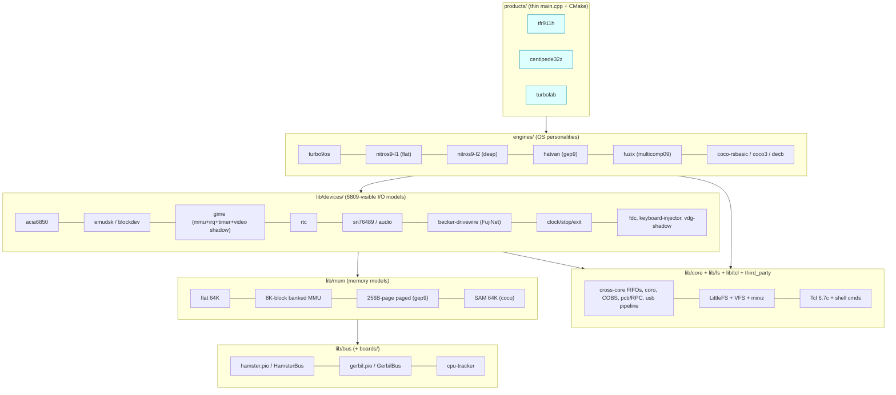

# tfr9 v5 — Notes, Discoveries, Snags, and Recommendations

*Status: proposal / analysis only.  No code has been copied from `../v4/`
yet, and nothing in `../v4/` or in `~/github.com/dillera/tfr9` was modified.
This is an independent analysis written from the code itself (v4 tree,
Andrew Diller's branch, `git` history); it deliberately did not consult any
earlier write-up.*

Sources studied (all read-only):

| Source | What it is |
|---|---|
| `tfr9/v4/` @ `f963d3f` (Oct 23) | Henry Strickland's current v4: `tfr911h/`, `centipede-32z/`, `turbolab/`, `tether/`, `firmware/one/`, `cpu-tracker/`, `systests/`, `docs/` |
| `~/github.com/dillera/tfr9`, branch `nitros9-l2-tfr911` | 15 commits by Andrew Diller, 2026‑10‑16 … 10‑18, on top of Henry's `4ac54bf` (Sep 28) |
| `coco-shelf/nitros9` (branch `work-deep65280-0`) | Henry's NitrOS‑9 fork with the `flat65280` / `deep65280` recipes |
| `coco-shelf/pico-sdk` 2.3.0, `arm-none-eabi-gcc` 13.2.1, `go` 1.26.3 | The installed toolchain |

---

## 0. TL;DR — the ten recommendations

1. **One firmware library, zero copies.**  v4 already has *two* drifted copies of
   the "shared" library (`firmware/one/` vs `centipede-32z/three/`; 10 of 189
   common files differ, and the differences include real bug fixes living in
   only one copy).  v5 gets exactly one `firmware/lib/` and one `third_party/`.
2. **Split the monolith along the seams that already exist in the code**:
   *board* (pins, flash layout) → *bus* (PIO + foreground loop) → *memory model* →
   *devices* (6809‑visible I/O) → *engine* (= OS personality: memory model + device
   set + boot loader) → *product* (thin `main.cpp`).
3. **Make "I/O emulation for the 6809" a device library**, not a pile of globals in
   `main.cpp`.  v4 contains **three GIME models, four ACIA‑6850 models, five block‑device
   request paths, two RTCs and two audio paths**; they should each become one
   parameterised device.  (§5.3, §7)
4. **Select the engine once (function pointer to a per‑engine `IN_RAM` foreground
   loop), not with `if (current_engine == …)` chains inside the bus loop.**  v4's
   TFR911H foreground evaluates those chains on every bus cycle.
5. **Keep exactly two bus loops** (Hamster/E‑Q master for the TFR/911H; Gerbil/snoop for the
   Centipede) but make everything *behind* them shared.  Don't try to unify the loops themselves.
6. **One source of truth for the wire protocol and the cross‑core tags.**  Today
   `FG2BG_*` numeric values *differ* between `tfr911h` and `centipede` even though a comment
   says they're the same.  (§4, snag S5)
7. **One Go module, one `tether`, many `Personality`s.**  v4 has three tether trees
   (12.7K, 15.5K and 5.5K lines).  Fold in Diller's tether changes — including a
   bug fix for `EmulateDiskWrite` that is *still present in Henry's v4*.
8. **Converge NitrOS‑9 Level 2** (Henry's `deep65280` engine vs Diller's `l2`
   engine) into a single `nitros9-l2` engine built on the shared GIME/ACIA/EmuDsk/RTC
   devices.  Take Diller's RTC / 60 Hz VBORD / sound / FujiNet, Henry's VFS‑loaded images.  (§9)
9. **FujiNet becomes a shared device (`becker`/DriveWire over UART0, GPIO 12/13, 921600 baud) plus
   a guest‑side kit**, usable from the TFR/911H *and* the Centipede (same hat, rev 41d).
   Decide the Becker address question first ($FF41 vs $FF45).  (§8)
10. **Never `cp -r ../v4`.**  `v4/` is **749 MB on disk but only 780 tracked files / 45 MB.**  Import
    with `git ls-files` / `git archive`, or you'll import 276 vim undo files, RCS dirs,
    `_log` (3.8 MB), `build/` trees, etc.  (§11)

---

## 1. What v4 actually is (inventory)

### 1.1 Products

| Product | Dir | Source size | What it does |
|---|---|---|---|
| **TFR/911H firmware** (`tfr911h_v4.uf2`) | `v4/tfr911h/` | `v4_tfr911h_main.cpp` **2,618 lines** + `v4_gep9_*.h`, `v4_multicomp09.h`, `turbo9*.h`, ROM headers | RP2350B *is* the motherboard: PIO "Hamster" generates E/Q, RP2350 provides RAM and all I/O. Tcl 6.7 REPL + LittleFS + VFS on core 0, bus loop on core 1. Engines: `turbo9os`, `flat65280`, `deep65280`, `gep9`, `gep9big`, `multicomp09`(Fuzix) |
| **Centipede 32Z firmware** (`centipede.uf2`) | `v4/centipede-32z/firmware/` | `centipede.cpp` **1,644 lines** + `gspoon.h` (1,231), `coco128k.h` (424), `coco64k.h`, `floppy.h`… | RP2350B in the CoCo cartridge slot. PIO "Gerbil" snoops the *real* CoCo's bus and substitutes RAM/ROM/IO selectively. Builds are selected by `#define`s: `BECOME_COCO3`, `FUZIX_COCO2CENTIPEDE`, `FOR_COCO3`, `SAM_BIT_*`, `CENTIPEDE_REV` (32d/32e/32z/original) |
| **TurboLab** (`turbolab_v4.uf2`) | `v4/turbolab/firmware/` | `main.cpp` 57 KB, `hamster.h`, `pio_assembler.h` | Student subset of the TFR/911H: tethered only, **no Tcl, no LittleFS**; trace/trigger/watchpoint focused; OS‑9 Level 1 / TurbOS only |
| **Centiscope** | `v4/centipede-32z/centiscope-firmware/` | small | Logic‑analyzer‑style variant of the Centipede PIO |
| **tether** (Go) ×3 | `v4/tether/`, `v4/centipede-32z/tether/`, `v4/turbolab/tether/` | 12.7K / 15.5K / 5.5K lines | Host program: USB CDC + COBS, VFS server (`/pc`), cycle decode, 6809 disassembler, OS‑9 module listings, web VDG viewer (`:8080`), RPC |
| **cpu-tracker** | `v4/cpu-tracker/` | header‑only C++ | 6809 instruction‑boundary predictor (replaces LIC on the Centipede). Host‑testable against `misc/golden-log-*.txt` |
| **systests** | `v4/systests/` | shell + expect | Hardware tests: RPC, Tcl/VFS, one per engine (turbo9os, flat, deep, fuzix) |

### 1.2 The shared pieces (what v5 must *really* share)

All of these are used by **both** `tfr911h` and `centipede`:

* **LittleFS** (7.8K lines, vendored) + `lfs-centipede.[ch]` flash glue.
* **Tcl 6.7c** (23.7K lines, vendored; `TCL_GENERIC_ONLY=1`; ~39 commands in `tcl_commands.h`).
* **miniz** (9.5K lines) for `zip`/`lzip` in the VFS.
* **VFS** (`vfs.h`, 50 KB): OOP nodes over LittleFS **and** over the tether‑hosted `/pc` (RPC); `vfs_rpc.h`, `pcb.h` (protobuf‑like RPC encoding).
* **COBS** transport (`cobs.h`, `cobs_tx.h`, `usb_pipeline.h`, `circbuf.h`).
* **Dual‑core plumbing**: `CrossCoreFIFO` (`fg2bg`, `bg2fg`), `coro.h` cooperative scheduler, `Say()` console path.
* **The I/O dispatch idiom**: `IOReader IOReaders[256]; IOWriter IOWriters[256];` — one function pointer per `$FFxx`
  — present *identically* in `tfr911h` (main.cpp:128‑131) and `centipede` (centipede.cpp:331‑332).  This is
  the natural seam for a shared device library.
* **Boot‑mode / `modeN.tcl` scripting** (`boot_mode` in `__uninitialized_ram`, `/rc/modeN.tcl`).
* **Config**: `centipede_config` struct + `menu fetch/store`.
* **Flash label** (`flash-label.h`, last 4 KB of 16 MB flash).
* **Go**: `serial`, `cobs`, `open_*.go`, `os9_level{1,2}`, `listings`, `ram_coco{1,3}`, `samvdg`… (25 of the 34 file names the two main tethers share are byte‑identical).

### 1.3 The two "worlds" the shared code must serve

| | TFR/911H | Centipede 32Z |
|---|---|---|
| Who generates E/Q | RP2350B (PIO Hamster) | Real CoCo (SAM) |
| CPU | 6309E/6809E on the board | CoCo's own 6809E |
| RAM | RP2350 SRAM (`ram[256K]`, banked by *emulated* MMU) | RP2350 SRAM substituting CoCo RAM (64K/128K/256K) |
| Real hardware on the bus | none | PIA, SAM, VDG, FDC slot, cassette, sound mux… |
| I/O window | all of `$FF00‑$FFFF` is emulated | only what the cart claims (`SLENB`, `SCS` `$FF40‑$FF5F`, `CTS`), plus snooped/overridden reads |
| Pin map | `RESET=20 … E=29 Q=30 R/W=31`, A on GPIO 32‑47 | `RW=20 E=21 Q=22 … CTS=8 SCS=9 …` (rev‑dependent) |
| Tracing | optional | core feature (FIC prediction via `cpu-tracker`, compressed cycles) |

Consequence: **device models, memory models, VFS/Tcl/FS, protocol, and background services are shareable;
the two foreground loops are not.**

---

## 2. Andrew Diller's work — catalog and assessment

Branch `nitros9-l2-tfr911` (15 commits; **base is Henry's Sep 28 `4ac54bf`**, so it predates Henry's
flat/deep/gep9/multicomp work of Oct 5‑19 — Diller's `v4/tfr911h/` has *no* `v4_gep9_*.h` or
`ENGINE_*` machinery, and Henry's v4 has *none* of Diller's changes).

| Commit | Date | Area | What | Value for v5 |
|---|---|---|---|---|
| `b009255` | 10‑16 | **fw+tether+OS** | `l2` Tcl command boots NitrOS‑9 L2: emulated mini‑CoCo3 (`v4_nitros9_l2.h`, 612 lines: GIME MMU, 60 Hz VBORD IRQ, 6850 ACIA @ `$FF14`, EmuDsk @ `$FF80`, RTC @ `$FFC0`); `nitros9-l2/` builds kernel track → `nitros9_l2_rom.h`; `rmake-l2.tcl`; `launcher.asm` at `$2500`; `run-l2.sh`. Tether: **fix `EmulateDiskWrite` shadowed `disk_param`**, `T_WALLTIME`, `-boot`, `-pass_ctrl_c` | **High** (RTC, GIME IRQ, tether fixes). *Redundant with Henry's `deep65280`* — see §9 |
| `2ed9768` | 10‑16 | OS | Unix‑style commands (`ls`,`cd`,`grep`… as chained alias modules), `unix.tcl`, `helpmsg` | Medium‑high (student usability, TurboLab) |
| `a1b261c` | 10‑16 | OS | Tetris, arrow keys | Demo/value‑add |
| `ca56704` | 10‑16 | **fw** | `v4_audio.h`: PWM audio on **GPIO 8**, 31.25 kHz timer IRQ mixing an **SN76489 @ `$FF41`**, keyclicks, bell, Tcl `beep`/`click`; `$FF42` control reg | High; needs pin abstraction (GPIO 8 is `CTS` on Centipede 32Z!) |
| `4186209` `feb85d9` `600efe4` `25ff98f` | 10‑16/17 | OS/doc | `zm` Z‑machine, `vi`, `info` (reads firmware report through info port `$FF43/$FF44`), ULTRIX‑style manual (LaTeX) | Nice; keep as `os/nitros9/apps/` and `doc/manual/` |
| `8fc598f` | 10‑17 | **fw+OS** | FujiNet: `v4_fujinet.h` (UART0 GPIO 12/13, 921600 8N1, becker port @ **`$FF45/$FF46`**, 4K rx ring, IRQ on core 0), `l2fn` boot, `fujinet` Tcl cmd; NitrOS‑9 `rbdw`, `scdwv`, `dwio`, `fn*` commands (GPLv3) | **High** — the only FujiNet implementation in the tree |
| `363aac3` `f10fd11` `599a314` `923cd18` | 10‑17/18 | OS | `fnnews`, `fnstocks`, `fnbounce`, `fnweather` (C), `fnbattleship`; **`fujinet-lib` v5.0.1 ported to NitrOS‑9** (`bus/os9`), color terminal layer `fujinet/c/term.c` | High for FujiNet story; large vendored code → isolate (§8, §12) |
| `e6c0d4c` | 10‑18 | **tether** | UTF‑8 pass‑through | Take (small) |
| `77ad30c` | 10‑18 | licensing | GPLv3 headers/LICENSE for FujiNet programs | **Needs a decision** (§12) |

Notes:

* **273 tracked files** under `nitros9-l2/`, almost all vendored FujiNet apps/libs.  Treat as a *guest software kit*, not firmware.
* Diller's firmware footprint is small and clean: 4 new headers (`v4_nitros9_l2.h`, `v4_fujinet.h`,
  `v4_audio.h`, two ROM headers) + ~95 lines in `main.cpp` + 2 lines in CMake. They were added to a
  monolith by *another* parallel mechanism (`boot_l2` global, `l2`/`l2fn` Tcl commands, `L2__Foreground`)
  instead of the `Config(engine)` mechanism Henry added the same week.  That's exactly what v5's
  engine registry should absorb.
* External dependencies of the FujiNet work that are **not in this repo**: fujinet‑firmware PR 1631
  (CoCo/DriveWire/`COCO_HS_UART` board), PR 2027 (merged Oct 2026; consume driver‑version byte after
  `OP_DWINIT`), and an **un‑upstreamed** DevKitC fix (`coco-devkitc-no-button-c` in `dillera/fujinet-firmware`:
  floating GPIO 14 "Safe Reset" caused reboots every few seconds under disk traffic and hung the 6309).
  Record these in v5 docs with exact commits, or the hat will "randomly hang" for the next person.

---

## 3. Duplication and drift — the evidence

### 3.1 `firmware/one` vs `centipede-32z/three` (the shared lib, twice)

`tfr911h/CMakeLists.txt` builds from `../firmware/one/…`; `centipede-32z/firmware/CMakeLists.txt` builds
from `../three/…`.  A *third* CMakeLists in `three/firmware/` is a stale leftover (points at a
`centipede.cpp` that is now `centipede.xxxxxxcpp`).

189 files exist in both: **179 identical, 10 differ**:

| File | Δ lines | What differs (important ones) |
|---|---|---|
| `firmware/vfs.h` | 57 | **`firmware/one` splits tether‑VFS `read`/`write` into 256‑byte RPCs and returns partial counts; `three` sends the whole request** → large file I/O via `/pc` behaves differently per product. Take the chunked version. |
| `firmware/pico_rpc.h` | 82 | `three` has `get-ram`, `put-ram`, `type`, `get-status`, `get-cycles`, keyboard injection; `one` doesn't (but these are Centipede‑specific → belong behind a product hook) |
| `firmware/keyboard_injector.h` | 116 | Centipede‑only features |
| `firmware/menu.h` | 69 | config schema differs per product |
| `firmware/tcl_commands.h` | 13 | `three` adds `type` + `run-decb` |
| `firmware/vfs_rpc.h`, `rtc.h`, `floppy.h`, `cobs_tx.h`, `util/cobs.h` | 21/12/26/10/19 | small drift |
| only in `one` | | `firmware/config.h`, `coco64k.h` |
| only in `three` | | `coco3_rom.h`, `coco64k.hxxxxxxxx`, `config.h.not` |

**Merge rule for v5:** for each of the 10, do a 3‑way merge and then push product‑specific parts out into
product hooks (e.g., `PicoRpcRegisterMethod("get-ram", …)` from the Centipede product), so the lib has no `#if`s on
product.

### 3.2 Two incompatible `struct CentipedeConfig`, same include guard

`firmware/one/firmware/config.h` (fields `engine`, `flat_img`, `drive0‑3`, `task1/2`) and
`centipede-32z/firmware/config.h` (fields `fuzix`, `become_coco3`, `preload_decb`) both use guard
`FIRMWARE_H_`.  Whichever is found first silently wins.  The name is also misleading on the TFR/911H.
**v5:** a typed `Config` with a common core + per‑product extension, exposed to Tcl uniformly (`menu fetch/store`).

### 3.3 Tether ×3

* `v4/tether/` (36 files) vs `v4/centipede-32z/tether/` (43 files): of the 34 names they share, **25 are byte‑identical**; the 9 that differ are `pico_rpc.go` (692 lines),
  `tconsole.go` (444), `samvdg.go` (387), `webserver.go` (310), `webserver_test.go`, `utility.go`, `ram_coco3.go`, `open_linux.go`, `load.go`.
  Centipede‑only: `bas_token*`, `font5x7`, `load_command*`, `save_command*`, `ucommand_test`.  TFR911H‑only: `dump_panic*`.
* `v4/turbolab/tether/` is a *separate module* (`module github.com/strickyak/tfr9/v4/turbolab/tether`, `go 1.22`), while the
  repo root `go.mod` says `go 1.25.1` and the installed Go is 1.26.3.
* `tfr911_compat.go` already exists to let one tether speak both firmwares' cycle formats (`C_CYCLE`=200 vs `C_COMPRESSED_CYCLES`=175).  The merge has been *started* by accident.

### 3.4 Hardware models implemented more than once (the "I/O emulation" overlap)

| Concept | Implementations | Where |
|---|---|---|
| **GIME / MMU (8K blocks, 2 tasks)** | (a) `deep65280` (`task_mmu_base[]`, `$FF90` reads 0, 6 Hz tick); (b) Diller `l2` (`slot_base[]`, `$FF90/91/92`, VBORD 60 Hz IRQ, constant page `$FE00`); (c) Centipede `coco128k.h` (full: init0/1, IRQ/FIRQ enr, timer, video regs, palettes, `mmu_base[]`); (d) multicomp09 `mc_map0/1` (different register layout, same 8K×8 idea); (e) gep9 paged MMU (different: 256‑byte pages) | `v4_tfr911h_main.cpp:530‑560, 750‑1000`; `v4_nitros9_l2.h`; `coco128k.h`; `v4_multicomp09.h`; `v4_gep9_mmu.h` |
| **ACIA 6850** | flat/deep `$FF88/89`; Diller `$FF14/15`; multicomp09 `$FFD0/D1`; (plus non‑6850 consoles: Turbo9Sim `$FF00‑03`, Hatvan `$FF00‑05`) | `flat65280_acia_*`, `l2::Acia*`, `mc_*acia*` |
| **Block device request to core 0** | EmuDsk (flat/deep) via `FG2BG_EMUDSK` + atomic status spin; Diller EmuDsk via a `DiskState` machine + `disk_phys[256]` + `disk_deadline`; gep9 disk `FG2BG_GEP9_DISK`; multicomp09 SD `FG2BG_MC_SD`; Centipede FDC `FG2BG_FLOPPY_*`; Centipede Fuzix SD `FG2BG_FUZIX_SD_*` | five+ mechanisms for "core 1 asks core 0 to move a sector, bus stalls until done" |
| **RTC** | `rtc.h` `get_system_time()` (shared) vs Diller `$FFC0‑C7` fed by `T_WALLTIME` | |
| **Audio** | Diller PWM/SN76489 on GPIO 8; Centipede `orchestra90.h` (stereo 8‑bit DAC `$FF7A/7B` on GPIO 10/11 PWM slice 5) | |
| **Timer tick** | 60 Hz `repeating_timer` (Turbo9Sim/L2), `CLOCK_AND_STOP` 60/50/6/0.1 Hz, multicomp 50 Hz, GIME timer (Centipede), 20 ms timer | |
| **"Exit/stop" port** | `CLOCK_AND_STOP $FC/$FD/$FE`, Hatvan `Exit.Code $FF05` | unify as `ExitPort` device |
| **Boot loaders** | DECB parser (`gep9`, Centipede `preload_decb`), raw 64 K image (flat/deep), ROM header embed (turbo9os, Diller L2), track‑35 launcher (Diller) | one `ImageLoader` |

### 3.5 Dead / half‑finished code in v4

* `v4/tfr911h/v4_core_engine.h`, `v4_engine_tfr911.h`, `v4_engine_centipede.xxxxxh`, `v4_compat_centipede.h`,
  `v4_console.h`, `v4_floppy.h`, `v4_interrupts.h`, `v4_os_loader.h`, `v4_ram.h`, `v4_trace.h`, `v4_turbo9sim.h`, `v4_types.h`:
  **none is reachable from `v4_tfr911h_main.cpp`'s include graph.**  They are an *unfinished refactor* toward exactly the CRTP
  platform‑engine design recommended below.  Mine them for ideas; don't resurrect them blindly (they redefine `byte`, `CrossCoreFIFO`,
  use `FG2BG_HIGH_WATERMARK = 6000` while the live code uses `50`, and `v4_multicomp09.h` even declares `extern queue_t fg2bg_queue`, never defined).
* Files disabled by renaming (`*.xxxxxxcpp`, `*.xxxxxxxxh`, `config.h.not`, `coco64k.hxxxxxxxx`): 5 tracked.  Prefer deletion (git remembers) or `#if 0` + comment.
* `hdbchs_rom.h`, `hdbdw3cc3_rom.h`, `hdbsdc_rom.h` (≈52 KB each) in the shared firmware dir: three different HDB‑DOS‑style ROMs that **all define the same array name `disk11_rom[8192]`**,
  and are not included by anything.  They are the obvious starting material for FujiNet/DriveWire‑from‑BASIC on the Centipede but are un‑wired — see §8.
* `v4/turbolab.BAK2/`, `v4-bak-fuzix-coco2-md-io/`, `v4/_err` (203 KB), `_log`, `_out`, `_trace_log.txt` — scratch.

---

## 4. Snags for the unwary

Numbered so other docs can cite them.  *(E = evidence is a file/line you can open; V = inferred, please verify.)*

**S1. The two "shared lib" copies have already diverged** (§3.1) — and the tfr911h copy has the VFS 256‑byte chunking fix the Centipede copy lacks.  (E)

**S2. `.gitignore` silently drops files v5 will need.**  Root `.gitignore` ignores `*.rom.h`, `*.decb`, `*.list`, `*.map`, `*.raw`, `*.rom`, `*.exe`, `*.s`, `*.o`, `_*`, `build/`, `generated/`, `build-*/`.
`git check-ignore --no-index -v` confirms e.g. `turbo9os.rom.h` (matches `*.rom.h`), `kernel_6809.decb`, and anything named `_something`.  The currently tracked ones were force‑added; **new** ROM headers or `.list` files will vanish from `git status`.  v5 needs its own `.gitignore` with explicit `!` exceptions for checked‑in generated headers (or, better, generate them in `build/` and don't check them in). (E)

**S3. `FG2BG_*` tags disagree between products although a comment says they're shared.**
`tfr911h`: `…SYNC_NEEDED=4, NMI=5, FLOPPY_COMMAND=6, FLOPPY_LATCH=7, W_256=8, PEEK_REPLY=9, START_KEYBOARD_INJECTOR=10, FIC=12, EMUDSK=13, GEP9_DISK=14, MC_SD=15`.
`centipede`: `…SYNC_NEEDED=4, FG0BG_FIC=5, UNUSED_NMI=6, FLOPPY_COMMAND=7, FLOPPY_LATCH=8, W_256=9, PEEK_REPLY=10, START_KEYBOARD_INJECTOR=11, FUZIX_SD_READ=12, FUZIX_SD_WRITE=13`.
Same names, different numbers, and `12` means `FIC` in one and `FUZIX_SD_READ` in the other.  Any shared background code compiled against the wrong enum misroutes events.
Same story for wire constants (`C_CYCLE=200` vs `C_COMPRESSED_CYCLES=175`; tfr911h has `C_PRE_LOAD`, `C_DUMP_*`, `C_CORE_DUMP=189`, Diller adds `T_WALLTIME=182`).  **One header + generated Go constants.** (E)

**S4. `main.cpp` is a unity build whose "headers" are not headers.**  `littlefs.h`, `vfs.h`, `tcl_commands.h`, `pico_rpc.h`… contain function *definitions* and depend on globals (`ram`, `IOReaders`, `Say`, `fg2bg`, `byte`, `boot_mode`) defined earlier in `main.cpp`.  The TFR911H main even defeats real headers by pre‑defining their include guards
(`#define FIRMWARE_CONSOLE_H_`, `#define _GSPOON_H_`) and supplies `console::` stubs (`v4_console_tfr911_stub.h`).  Include order is semantics.  The stub's `console::poke/peek` write `ram[addr & 0xFFFF]` — **physical offsets, wrong for banked engines** (deep/gep9) when used by Tcl `poke`/`peek`. (E)

**S5. A hot‑loop `if` chain on the engine.**  `Guts<T>::Foreground()` branches on `current_engine` (`ENGINE_MULTICOMP09`, `ENGINE_GEP9`, `ENGINE_GEP9BIG`, `ENGINE_FLAT65280`, `ENGINE_DEEP65280`, …) for IRQ evaluation every group and for read/write translation on every cycle (main.cpp:1482‑1860).  It works, but every new engine makes every other engine slower and the function bigger in SRAM.  (E)

**S6. Everything core 1 touches must be in SRAM — enforced only by discipline.**  The bus loop and *every* I/O callback are `IN_RAM` (`__not_in_flash`) because an XIP cache miss during a bus cycle makes the 6809 latch garbage (comment at main.cpp:422‑429).  `lfs-centipede.c` programs/erases flash on core 0 with only `save_and_disable_interrupts()` (core‑local); `grep` finds **no** `flash_safe_execute`/`multicore_lockout` anywhere.  So a flash write while core 1 is in Phase 2 is safe only if *no* flash‑resident code, vtable, literal pool, or `const` table is touched by core 1.  Notice: `const byte Nitros9L2_Rom[]` (Diller) is `const` → flash; `byte disk11_rom[8192]` (Centipede) is non‑`const` → RAM copy (probably deliberate).  Add a checklist/CI check (inspect the `.map` for core‑1 symbols in `.text` vs `.time_critical`). (E for facts, V for hazard)

**S7. Flash/LittleFS layout is hard‑coded for 16 MB flash.**  `lfs-centipede.h`: offset 4 MB, size 11 MB, 4 KB blocks, and `flash-label.h` at `0x10FFF000` (last 4 KB of 16 MB).  The `tfr911h_rp2350b` board header defines **no** `PICO_FLASH_SIZE_BYTES` (SDK default 2 MB), so the linker believes flash is 2 MB while the code assumes 16 MB.  Works only because the hardware really has 16 MB (Stamp XL‑class module; `CMakeLists` has the Stamp XL line commented out). Put this in a *board profile*. (E/V)

**S8. `TCL_MEM_DEBUG=1` is on globally** (`add_compile_definitions` in both CMakeLists) — Tcl's `ckalloc` debug wrapper in production firmware. Intentional? Measure RAM and speed with it off. (E)

**S9. Build depends on the shelf layout.**  `tfr911h`'s Makefile: `TOP = $(shell cd ../.. && pwd)` → needs `$TOP/{bin,pico-sdk,picotool-install}`; `centipede-32z/Makefile` uses `TOP = ../../..` and `make -C ../../v4/ TETHERS` + `cp ../../v4/build/tether.*.exe build/`, and `v4/Makefile` builds those from `./tether/` — **so the tether binaries bundled with the Centipede are built from the TFR911H tree, while `centipede-32z/tether.sh` (`make run`) uses `go run ./centipede-32z/tether/`**, which has features the bundled binary lacks (`bas_token`, `load_command`, `save_command`, different `pico_rpc`/web code); `centipede-32z/tether.sh` hard‑codes `/home/strick/modoc/coco-shelf/toolshed/cocoroms/...`; docs and skills contain dozens of absolute `/home/strick/...` paths; `misc/pc/*.dsk|img|bin|decb` are tracked **absolute‑path symlinks** into `nitros9/recipes`, `hatvan-os/build`, `~/nand/github.com/EtchedPixels/FUZIX`.  `turbolab/Makefile` references `../../../borges-saver/`.  The helper `misc/install-pico-sdk-and-picotool-on-shelf.sh` has header text for a differently named script and **copies `pico-sdk` into `$TOP/picotool`** (`cp -a pico-sdk "$TOP/picotool"` — should be `picotool`). (E)

**S10. `boot_mode` is overloaded.**  The same `modeNN.tcl` mechanism means different things per product and per place: Centipede `rc/mode84.tcl` = "become CoCo 3"; TFR911H `misc/pc/mode84.tcl` = "NitrOS‑9 L1 flat65280"; `27` (ESC/BREAK) = skip rc; `3/89/90` special‑cased in `centipede.cpp:1631`; TFR911H files are looked up in `/rc/` *then* `/pc/`.  (E)

**S11. Engine selection by string with undocumented aliases and one typo.**  `Config(engine)` accepts `multicomp09fuzix`, **`multicomp09fuxiz`** (typo alias), `multicomp09`, `fuzix`, `gep9big`, … ; `docs/tfr911h-engines.md` documents *four* engines but the code has *six* (`GEP9BIG`, `MULTICOMP09`).  The same doc says Flat65280 "has embedded flash fallback", which commit `d89000c` removed. (E)

**S12. Diller's `L2_RAM_KILOS` is defined twice.**  `v4_tfr911h_main.cpp:213` `#define L2_RAM_KILOS 256` sizes `ram[]` for *all* engines; `v4_nitros9_l2.h:32` `#ifndef … 128`.  The README table says 256K.  Fine today, a trap when someone reorders includes. (E)

**S13. `EmulateDiskWrite` bug is still in Henry's v4 tether** (both `tether/disk.go` and `centipede-32z/tether/disk.go`): `case 256+4:` declares `var disk_param [4]byte` that *shadows* the parameter and then copies it onto itself, so the real data is never used.  Diller's `b009255` fixes it. Carry the fix. (E)

**S14. Address‑map collisions are real the moment engines share devices** (§7).  E.g. Diller's ACIA at `$FF14/15` overlaps Hatvan's disk controller `$FF10‑17`; Diller's RTC at `$FFC0‑C7` and multicomp09's `$FFD0‑DF` sit on top of the CoCo **SAM** register window (`$FFC0‑$FFDF`) — harmless on the TFR/911H, **wrong on a Centipede in a real CoCo**; Diller's sound/info/becker `$FF41‑$FF46` sit inside the CoCo cartridge `SCS` window (`$FF40‑$FF5F`, where the FDC lives), which on a Centipede the cart really owns. (E)

**S15. Becker port address.**  Emulators and stock NitrOS‑9/HDB‑DOS DriveWire use `$FF41/$FF42`.  Diller moved it to `$FF45/$FF46` *only because he had put the SN76489 at `$FF41`*, and built NitrOS‑9's `dwio`/`rbdw`/`boot_dw` with `BECKBASE=$FF45`.  Decide which one moves **before** more guest software is built (§8). (E)

**S16. GPIO 8 is `CTS` on the Centipede 32Z and audio on the TFR/911H;** Diller's FujiNet UART is GPIO 12/13; Orchestra‑90 uses GPIO 10/11 + PWM slice 5.  Also hardware resources used outside the pins: alarm 2 (audio; "default pool uses 3"), UART0 + its IRQ (FujiNet, on core 0), PIO0 SM0 (bus).  Keep a per‑board resource ledger. (E)

**S17. Centipede board revisions are `#if`‑chained** (`CENTIPEDE_REV` 3204/3205/3226/original) with bodged pins for 32d (`CTS 18`, `SCS 19`).  Decide which revisions v5 supports. (E)

**S18. Three product flavors are chosen by `#define`s in the middle of the .cpp** (`BECOME_COCO3`, `FUZIX_COCO2CENTIPEDE`, `FOR_COCO3`, `SAM_BIT_16K/64K`, `ram[64K/128K/256K]`).  `keep/` holds hand‑named UF2s (`centipede-sam64k.uf2`, `…fff2_03`, `normal-coco2`).  Note `config.h` defaults `FUZIX_COCO2CENTIPEDE` to **1** via `#ifndef` while `centipede.cpp` sets 0 first (commit `e56b04a` made it non‑default); order‑dependent. (E)

**S19. `FG2BG_HIGH_WATERMARK` is 50 in TFR911H, 1000 in Centipede, 6000 in the dead refactor header**, and TFR911H builds with `JUST_WAIT_DONT_HALT=1` (spin with `sleep_us(1)`) instead of HALT throttling.  Document the reasoning before consolidating flow control. (E)

**S20. Docs lag code and contain machine‑specific paths.**  Examples: engines doc (S11); `docs/*.md` link to `file:///home/strick/...`; `.agents/skills/tfr911h-skill/SKILL.md` describes the TurboLab product but is named for tfr911h. (E)

**S21. Tooling‑clutter in the working tree.**  vim undo files (`.*.un~`, 276), RCS dirs (23) and `,v` files (205), `_log` (3.8 MB), `_err` (203 KB), `a.out`.  All ignored by git, but they make `cp -r`, `du`, `grep -r` and IDE indexing miserable. (E)

**S22. Licensing is mixed.**  Repo `LICENSE` is MIT; Tcl 6.7c, miniz, LittleFS carry their own; Diller's FujiNet kit is **GPLv3** (and includes code from NitrOS‑9, fujinet‑lib, fujinet‑news/battleship, bounce‑world‑client — two of which "state no license" per his README). Firmware doesn't link GPL code today; keep it that way unless intended. (E; not legal advice)

**S23. `systests/` need a live board and expect absolute tools; no host‑only CI exists** except `cpu-tracker` (`make test`) and `go test` in tether. (E)

**S24. Time‑critical console behavior:** per Diller, SCF costs ~300 µs per character, so `fnbounce` writes straight to the 6850 at `$FF15`. If a shared ACIA device is introduced, keep it zero‑cost on core 1 and don't add per‑byte `Say()` stalls. (E, from commit text)

**S25. The `V4` AGENTS/skills rules are v4‑scoped.**  `v4/AGENTS.md` (RULE ONE: never edit outside `v4/`; RULE TWO: commit only on `work*` branches) — v5 has no equivalent yet; v5 must obey "do not change v4".  Suggest a v5 `AGENTS.md`. (E)

---

## 5. Proposed v5 structure

### 5.1 Layering



Rules that keep the layering honest:

* `lib/core`, `lib/fs`, `lib/tcl`, `lib/devices`, `lib/mem` **never `#include` a product or board header**; they get pins/flash/RAM size from a `BoardProfile` (constexpr struct) passed in via a template parameter or a single `board.h` selected by CMake.
* `lib/devices` have **no dependency on the Pico SDK except through a tiny HAL** (`hal.h`: `gpio_*`, `time_us_64`, `multicore`, `irq`).  Then device models *compile on the host* and can be unit‑tested (§11).
* A device exposes: `Install(IoMap&, Params)` (claims addresses; **IoMap panics on overlap**), `IN_RAM` read/write handlers, optional `Poll()` (core 0), `Tick60Hz()`, `OnReset()`, `Report()` (for the `info` port/stats).
* An engine = `{name, aliases, boards, ram_bytes, Setup(Config) [core 0], Foreground [IN_RAM, core 1], Report}`.  `bye` → `EngineRegistry::Launch(name)`.  `l2`, `l2fn`, `bye` become *aliases/boot recipes*, not special globals.
* The bus loop is a template `Foreground<Bus, Mem, Irq, Trace>`; each engine instantiates **its own** `IN_RAM` function and core 0 does `multicore_launch_core1(engine.foreground)`.  (Centipede already does exactly this with `Engine0`/`Engine3` CRTP; the TFR911H should too.)  Check the RAM budget with the `.map` file — RP2350B has 520 KB SRAM and `ram[]` takes 256 KB.

### 5.2 Directory tree

```
v5/
  README.md                 what/where/how-to-build; supported matrix (product × engine × OS)
  AGENTS.md                 workspace rules (never edit ../v4; branch policy; "git ls-files" import rule)
  Makefile                  thin front door:  make doctor | all | tfr911h | centipede | turbolab | tether | test | systest
  .gitignore                explicit; with ! exceptions for any checked-in generated header
  cmake/                    toolchain discovery, pico_sdk_import wrapper, helper functions (add_tfr_product())
  scripts/                  env.sh ($SHELF), doctor.sh, import-from-v4.sh (git ls-files based), fetch-pico-sdk.sh (fixed)
  boards/
    tfr911h_rp2350b.h       PICO board header (+ pins.h, flash_layout.h, resources.md ledger)
    centipede32z.h          (and legacy revs only if you decide to keep them)
    hat-fuji.md             pinout of the 41d hat for both hosts
  third_party/
    littlefs/  miniz/  tcl6.7c/     vendored, with PATCHES.md (the exact local changes) and original LICENSEs
  firmware/
    lib/
      core/                 cross-core.h, circbuf.h, cobs*.h, usb_pipeline.h, pcb.h, coro.h, abort.h, flash-label.h, boot_mode.h, protocol.h (single source of truth)
      fs/                   lfs_pico.[ch] (parameterised by flash layout), vfs.h, vfs_rpc.h, littlefs cmds
      tcl/                  tcl_glue, tcl_io.h, shell commands split by concern (core, fs, config/menu, system, debug)
      bus/                  hamster.pio, gerbil.pio, hamster bus loop pieces, cpu_tracker/ (moved here)
      mem/                  flat64k.h, banked8k.h, paged256.h, sam64k.h
      devices/              acia6850.h, emudsk.h (blockdev), gime.h, rtc.h, audio_sn76489.h, becker_drivewire.h, clockstop.h, exitport.h, fdc_wd17xx.h, kbd_injector.h, vdg_shadow.h, orchestra90.h, turbo9sim_acia.h, hatvan_*.h, multicomp09_*.h
      images/               ImageLoader (raw64k, DECB, track-35 launcher), embedded-ROM helpers
    engines/                turbo9os/ nitros9_l1/ nitros9_l2/ hatvan/ fuzix_multicomp09/ coco_rsbasic/ coco3/   (one dir each: engine.h, setup.cpp, foreground.cpp, README.md w/ address map)
    products/
      tfr911h/              main.cpp (~200 lines), CMakeLists.txt, tcl_product.cpp (product-only Tcl cmds)
      centipede32z/         main.cpp, CMakeLists.txt, variants.cmake (coco2 | coco3 | fuzix | centiscope)
      turbolab/             main.cpp (+ pio_assembler.h, tuning), CMakeLists.txt  [no Tcl/LFS]
  host/
    go.mod                  one module
    cmd/tether/             main + personality wiring
    cmd/turbolab-tether/    only if a lean binary is still wanted (or: tether -profile=turbolab)
    internal/               serial, cobs, protocol (generated), rpc, vfsserver, trace, dis6809, os9 (listings, api, err), web (vdg viewer), bootmenu, uf2label
    tools/                  annealing, borges-saver (moved in, no ../../.. paths)
  os/                       guest software (built with lwasm/lwlink/cmoc/os9 from toolshed)
    nitros9/                recipes (l1 flat, l2 deep), modules (clock2_tfr911, dwio/scdwv, sc6850 descriptors), unix aliases, rmake*.tcl, startup, helpmsg
    fujinet/                cmds, lib, defs, apps(news, stocks, weather, bounce, battleship), fujinet-lib/os9 bus  — own LICENSE (GPLv3)
    hatvan/  fuzix/  turbos/  rsbasic/      (build notes + patch queues; images stay outside git, referenced by manifest)
  rc/                       the modeNN.tcl catalog, one place, one table (see §6)
  tests/
    host/                   go test; device-model unit tests (C++ host build); cpu-tracker golden logs
    systests/               hardware tests (one per engine + fujinet), common.sh with SHELF/ports from env
  doc/
    v5-notes-and-recommendations.md   (this file)
    architecture.md  io-map.md  protocol.md  boot-modes.md  board-resources.md  engines/*.md  user/ (manual)
```

### 5.3 Device library — concrete suggestions

* Keep `IOReaders[256]/IOWriters[256]` (it's what both products do and it's fast), but **widen the handler signature to carry a context pointer** — `byte (*)(void* ctx, uint addr)` — so two ACIAs (or an ACIA at a different base) can exist without copy/paste globals.  Measure; one extra register argument is negligible against a 1–2 MHz bus.
* **`IoMap::Claim(base, len, name)`** records ownership and aborts at `Setup()` on overlap.  Generate `doc/io-map.md` from the registry at build time (a `make io-map` that dumps each engine's table).  This turns S14 from a trap into a test.
* **`BlockDevice` request** replaces the five bespoke paths:
  `struct BlockReq { uint8 drive; uint32 lsn; uint16 count; AddrXlate xlate; Cmd cmd; atomic<int8> status; }`, one `FG2BG_BLOCK` tag,
  one core‑0 service coroutine (VFS file, tether file, or LittleFS), per‑engine `AddrXlate` (flat, 8K MMU, paged).  Sector size/protocol (EmuDsk 256 B, multicomp SD 512 B + status protocol, FDC) stay in the *device front‑end*.
* **`Gime` device with feature levels**: `Mmu` (deep65280) → `+Irq/VBORD` (Diller L2) → `+Timer/FIRQ + video‑shadow + palettes` (Centipede coco3).  The NitrOS‑9 L2 engine then differs from the Centipede CoCo3 mode only in `Bus`, not in GIME code.
* **`Acia6850`** parameterised by base address and IRQ line; Turbo9Sim ACIA and Hatvan console stay separate small devices.
* **`Audio`**: pin from the board profile; SN76489 + clicks + `beep` in one module; Orchestra‑90 as a second front‑end on the same PWM mixer.  On the Centipede the `G_SND` pin (26) is the natural output; verify analog routing before enabling.
* **`Becker`** (DriveWire over UART) — §8.
* **IRQ policy** as a tiny object (`IrqSources` bitmask → `ChangeInterruptPin`) rather than a function per engine.

### 5.4 Core/boot flow to preserve (it works; keep the semantics)

Phase 1 (core 0): GPIO init, 250 MHz, USB stdio, PIO load, CPU held in RESET+HALT, Tcl REPL on USB → `bye`.
Transition: read `Config`, `engine.Setup()` (open drives via VFS, load images, install devices), reset PIO, `multicore_launch_core1(engine.foreground)`, wait for `foreground_running`, release RESET/HALT.
Phase 2: core 1 = bus + devices only; core 0 = coroutine scheduler (`drain_task`, USB pump, console, block service, timers).
Keep the property documented in v4 docs that the 6309 is *static* (clock stop during block I/O is safe) — and **write down that this is why the bus can be stalled**; it does not hold for a real 6809E on the Centipede.

---

## 6. Migration map (v4 → v5) and merge decisions

| v4 | v5 | Action |
|---|---|---|
| `firmware/one/{littlefs,miniz,tcl6.7c}` ≡ `three/{…}` (identical, 179 files) | `third_party/` | Copy once; add `PATCHES.md` (diff vs upstream: Tcl 6.7c compat dir, `TCL_GENERIC_ONLY`, `lfs-centipede.*`) |
| `firmware/one/firmware/{cobs_tx,usb_pipeline,cross-core,coro,abort,pcb,flash-label,compress}.h`, `util/{cobs,circbuf}.h` | `firmware/lib/core/` | 3‑way merge cobs/cobs_tx; `compress.h` is Centipede‑trace‑only → `lib/bus/` |
| `vfs.h`, `vfs_rpc.[hc]`, `littlefs.h`, `tcl_io.h`, `tcl_commands.h`, `menu.h`, `pico_rpc.h`, `rtc.h` | `lib/fs`, `lib/tcl` | Take **chunked** VFS from `one`; split product methods (`get-ram`, `type`, `run-decb`…) into product hooks |
| `hamster.pio` (tfr911h), `turbolab/firmware/hamster.pio` | `lib/bus/hamster.pio` | They differ by **one line: TurboLab's has `gpio_pull_up(31)` (R/W) which tfr911h's lacks** — relevant to the HALT phantom‑write issue described in main.cpp:1630. Verify on hardware, then keep one |
| `gerbil.pio`, `centiscope-firmware/gerbil.pio` | `lib/bus/gerbil.pio` + centiscope variant | Diff, decide |
| `cpu-tracker/` | `lib/bus/cpu_tracker/` (+ `tests/host`) | Move as is; keep golden logs |
| `tfr911h/v4_tfr911h_main.cpp` (2,618 l.) | split → `products/tfr911h/main.cpp` + `lib/*` + `engines/*` | The big refactor (Phase 3 below) |
| `v4_gep9_{mmu,io}.h` | `engines/hatvan/` + `mem/paged256.h` | Mostly self‑contained already |
| `v4_multicomp09.h` | `engines/fuzix_multicomp09/` | Keep the SD‑write fix (docs/fuzix-summary §D); drop bogus `extern queue_t fg2bg_queue` |
| flat/deep EmuDsk/ACIA/CLOCK_AND_STOP/Install_* in main.cpp | `devices/{emudsk,acia6850,clockstop}.h`, `engines/nitros9_l1`, `engines/nitros9_l2` | |
| `turbo9sim.h`, `turbo9os.h`, `*.mod.h`, `turbo9os.rom.h`, `romlist.h` | `engines/turbo9os/` (+ ROM headers generated from `os/turbos`) | |
| Diller `v4_nitros9_l2.h`, `v4_audio.h`, `v4_fujinet.h`, `nitros9_l2*_rom.h` | `engines/nitros9_l2/` (merge), `devices/audio_*`, `devices/becker_drivewire.h` | §8, §9 |
| `centipede.cpp`, `coco64k.h`, `coco128k.h`, `floppy.h`, `gspoon.h`, `keyboard_injector.h`, `console.h`, `egg.h`, `bug.h`, `disk11_rom.h`, `coco3_rom.h` | `products/centipede32z/`, `devices/{gime,sam64k,fdc,kbd_injector,vdg_shadow}`, `engines/coco_*` | Keep Centipede's CRTP `Engine0/Engine3` shape as the template for others |
| `v4_core_engine.h`, `v4_engine_tfr911.h`, `v4_compat_centipede.h`… (dead) | *(mine, don't copy)* | Delete after extracting ideas |
| `hdb*_rom.h` | `os/rsbasic/` (generated) | They define the same symbol; generate one chosen ROM per build |
| `tether/`, `centipede-32z/tether/`, `turbolab/tether/` | `host/` | Union (take the larger set), add Diller's patches, replace hand constants with generated `protocol`; then peel `package main` into `internal/*` |
| `docs/*`, `turbolab/docs/*`, `centipede-32z/docs/*` | `doc/` | Rewrite paths relative; keep the BASIC "unravelled" text dumps (≈2.4 MB) out of the default tree or under `doc/reference/` |
| `misc/pc/*` | `rc/` + a `manifest` | **No absolute symlinks.** A `manifest.txt` of `name → build recipe/URL`, and `scripts/stage-pc.sh` that creates `/tmp/pc` |
| `systests/`, `turbolab/systests/` | `tests/systests/` | Parameterise ports/paths; add `fujinet` + `nitros9-l2` |
| `turbolab/tool/{annealing,borges-saver}.go` | `host/tools/` | |
| `misc/golden-log*.zip` (31 MB!) | Git LFS or external release asset | |

### Boot modes (`rc/`)
One catalog (`rc/README.md` table: *mode → product → effect*), and prefer **named** modes (`boot nitros9-l2`) with numeric keys as shortcuts.
Reserve numeric namespaces per product to end S10 (e.g., 1‑99 Centipede keyboard‑chord modes, 100+ TFR911H).  Keep `27` (BREAK = skip rc) global.

### Protocol
`firmware/lib/core/protocol.h` is the source; a small generator (Go or Python, run by `make`) writes `host/internal/protocol/protocol_gen.go`.
Allocate wire IDs and FIFO tag ranges once, with a "reserved/never reuse" list (`FG2BG_NMI`‑era values, `C_RAM*`…).

---

## 7. Consolidated I/O address map (as found) and proposal

| Range | Meaning today | Used by |
|---|---|---|
| `$FF00‑03` | Turbo9Sim ACIA (`TX,RX,Stat,Ctrl`) | turbo9os |
| `$FF00‑05` | Hatvan console `Term.Out/In, Reg.Stat/Ctrl, logchar, Exit.Code` | gep9 |
| `$FF00‑$FF23` (real CoCo) | PIA0/PIA1 — **real hardware** | Centipede |
| `$FF10‑17` | Hatvan disk (`/d0‑/d3`) | gep9 |
| **`$FF14/15`** | MC6850 console | Diller L2 ← *overlaps Hatvan disk* |
| `$FF20‑2F` | TaskFuse, DMA engine, curtain, TaskFlags, PurgeTaskMem | gep9 |
| `$FF40‑5F` (real CoCo) | **Cartridge SCS window** (FDC at `$FF40‑4B`) | Centipede floppy |
| **`$FF40‑47`** | gep9 lets *user* tasks touch this range | gep9 |
| **`$FF41/42`** | Diller: SN76489 / sound control (bit0 click, bit1 bell, bit7 raw arrows) | L2 |
| `$FF43/44` | Diller info port | L2 |
| **`$FF45/46`** | Diller becker (status/data) — *standard is `$FF41/42`* | L2 + FujiNet |
| `$FF7A/7B` | Orchestra‑90 L/R DAC | Centipede |
| `$FF80‑86` | EmuDsk | flat, deep, Diller L2 |
| `$FF87` | CLOCK_AND_STOP (`$FC`/`$FD`/`$FE` = stop/fail/panic‑dump) | flat, deep |
| `$FF88/89` | MC6850 console | flat, deep |
| `$FF90‑9E`, `$FFA0‑AF`, `$FFB0‑BF` | GIME init/IRQ/timer/video, MMU, palettes | deep, Diller L2, Centipede coco3 |
| `$FFC0‑C7` | Diller RTC (clock2_jvemu‑style) — *on the SAM window* | L2 |
| `$FFC0‑DF` (real CoCo) | SAM (`$FFD4/D5` P1, `$FFDE/DF` TY handled in `coco64k.h`) | Centipede |
| `$FFD0/D1`, `$FFD8‑DC`, `$FFDD`, `$FFDE/DF` | multicomp09 ACIA, SD, 50 Hz timer, MMU | fuzix |
| `$FFF0‑FF` | vectors | all |

Proposal:
* The map is **per engine**, generated and documented; a TFR/911H engine may use any free address.
* For things that must also work on a **Centipede in a real CoCo**, stay inside the cart's window (`$FF40‑$FF5F`, or `$FF60‑$FF6F` if free), and avoid `$FF00‑$FF3F` and the SAM/GIME ranges unless emulating a CoCo 3.
* Suggested allocation for the *new, shared* devices (to be confirmed): Becker at **`$FF41/$FF42`** (standard; no guest rebuilds for stock drivers), SN76489 + control + info at a free cart‑window slot (e.g. `$FF50‑$FF55`), keeping Diller's bit layout.  Cost: change `BECKBASE` back (trivial) and re‑address `beep.asm`, `click.asm`, `tetris.c`, `vi`, `info` (small, all his).

---

## 8. FujiNet — one shared implementation

What exists: *only* Diller's `v4_fujinet.h` on the TFR/911H and the 41d hat (README: "Works with Centipede 32z and the TFR/911h").  The Centipede firmware has **no** FujiNet code in v4 (grep: nothing), though the hat and the ROM stubs `hdb*_rom.h` suggest the intent.

Plan:
1. **`devices/becker_drivewire.h`** from `v4_fujinet.h`, with: pins/UART/baud from `boards/…` (GPIO 12/13, `uart0`, 921600 8N1), address from `IoMap::Claim`, rx ring filled by a *core‑0 UART IRQ*, tx ring drained by core 0, core 1 touches only the rings (this design is correct for a bus loop that must answer every cycle — keep it).  Add the stats hook for `info`.
2. **Centipede**: expose the same Becker device in the cart's `SCS` window.  Open points:
   * the CoCo's own interrupts: Becker status polled (NitrOS‑9 `dwio`, HDB‑DOS DW) — no IRQ line needed;
   * **HDB‑DOS**: pick *one* variant ROM, generate `disk11_rom`‑slot content from a build step rather than three same‑named headers.  Verify which HDB variant expects Becker vs bit‑banger (**V** — I did not disassemble the ROMs).
3. **Guest side** (`os/fujinet/`): Diller's `dwio/scdwv/rbdw`, `fn*` commands, `fujinet-lib` NitrOS‑9 bus, apps.  Keep GPLv3 here with its own `LICENSE`, *outside* `firmware/`.  Bring the same DriveWire/`fujinet-lib` approach to Fuzix and Hatvan only after NitrOS‑9 is stable.
4. **Documentation of external requirements** (S‑section above): FujiNet firmware build target `fujinet-coco-devkitc-centipede`, PR 1631 / PR 2027 / `coco-devkitc-no-button-c`, the floating‑GPIO‑14 symptom (`BUTTON_C: SHORT PRESS`, `ACTION: Reboot` in the FujiNet log).
5. **Tests**: `systests/07_fujinet.exp` — `fujinet` link check, `fujinet mount 1`, `l2fn` boot, CRC of a transferred file; run with and without the hat (skip cleanly).

---

## 9. NitrOS‑9 Level 2 — converging Henry's `deep65280` and Diller's `l2`

| | Henry `deep65280` (+`flat65280`) | Diller `l2` / `l2fn` |
|---|---|---|
| NitrOS‑9 source | `coco-shelf/nitros9` fork, branch `work-deep65280-0`, `recipes/{flat,deep}65280` | **stock** NitrOS‑9 tree via `$NITROS9_DIR`, modules assembled by `rmake-l2.tcl` (adapted from v3's TFR/905H) |
| Boot path | whole 64 K boot image (`deep65280.img`, `$FFFE`→`OS9Cold`) loaded from VFS at `bye` | kernel *track* + `launcher.asm` at `$2500` → `rel` at `$2602` (same as Disk BASIC `DOS`), embedded in firmware as ROM header |
| Console | 6850 `$FF88`, driver `sc6850` | 6850 `$FF14`, driver descriptors adapted |
| Clock | `CLOCK_AND_STOP` `$FF87`, 6 Hz tick, modified `clock` | **60 Hz GIME VBORD IRQ**, `clock2_tfr911` on RTC `$FFC0` (wall time via `T_WALLTIME`) |
| RAM | 256 KB, mask `0x1F` (shadow `$20‑$3F`) | `L2_RAM_KILOS` (256), block‑wrap probing |
| Disk | EmuDsk `$FF80`, async FG2BG | EmuDsk `$FF80`, state machine + `disk_phys[256]` |
| Extras | stop/panic port, core‑dump | sound, info port, FujiNet, unix cmds, games, manual |
| Selection | `Config(engine)="deep65280"` + `bye` (`-bootmode=8`) | `l2` / `l2fn` Tcl commands |

Recommendation: **one engine, `nitros9-l2`**, built on shared `Gime(Mmu+Irq)`, `Acia6850`, `EmuDsk`, `Rtc`, `ExitPort`:

* Hardware personality: take Diller's (closer to a real CoCo 3: VBORD IRQ at 60 Hz, RTC) — but **choose the ACIA address once**. `$FF14` collides with nothing in an L2‑only map, but matching the CoCo/Wildbits convention may matter if stock descriptors are wanted; `$FF88` is Henry's.  (Open question Q3.)
* Boot path: keep **both** as options of the same engine: *(a) image from VFS* (developer loop; no firmware rebuild) and *(b) embedded kernel track* (students: works with only `-disks`).  Ship the `launcher.asm` approach only if it avoids maintaining a fork of NitrOS‑9.
* NitrOS‑9 source: prefer **stock + patches** (Diller) over a long‑lived fork, unless `deep65280`'s `krn` placement changes are needed upstream; record the exact NitrOS‑9 commit in `os/nitros9/VERSION`.
* Keep `flat65280` (L1) as a sibling engine sharing every device except the MMU.
* Both the stop port (`$FF87 $FC/$FD/$FE`) and Diller's info port survive as `ExitPort` and `InfoPort` devices.
* Acceptance: both existing systests (`04_engine_flat65280`, `05_engine_deep65280`) pass unchanged; add `08_nitros9_l2_unix` (Diller's `man unix`, `ls`, `vi` smoke) and `l2fn`.

---

## 10. TurboLab inside the unified structure

TurboLab's spec is explicit: *no Tcl, no LittleFS, tether‑only, "completely independent … not necessarily compatible"* with the normal v4 firmware/tether, student‑facing, "alpha".  Respect that.

* Keep it a **separate product** (own `main.cpp`, own UF2, `-profile=turbolab` for the tether or a lean `cmd/turbolab-tether`) so a student never sees Tcl/LFS surface area — but have it **consume the same `lib/core`, `lib/bus/hamster.pio`, `boards/tfr911h`, `protocol.h`, `host/internal/{serial,cobs,trace,os9,dis6809}`**.
* TurboLab's unique asset is the **bus trace machinery**: FIC tracking, `--trigger/--stop/--watch` (module‑relative `@kernel+0x1B`), runtime PIO assembler (`pio_assembler.h`) and the annealing tuner.  Treat those as `lib/bus/trace/` + `lib/bus/pio_assembler.h`; TFR911H and Centipede can then opt in.
* Its `hamster.pio` is the one with `gpio_pull_up(31)`; make it the baseline (verify).
* The simplicity argument also applies to **setup**: provide `make turbolab-bundle` that outputs `{turbolab.uf2, tether.<os>.exe, run.sh/run.bat, turbos image, listings}` in one zip (v4 already does half of this with `build/tether.*.exe` and `data/turbos-*.zip`).  `tether --exit` (probe which exe runs on this host) is a good trick to keep.
* Rename the agent skill (`tfr911h-skill` describes TurboLab) to avoid confusing future agents.

---

## 11. Build, test, and developer‑environment recommendations

1. **`make doctor`** checks: `PICO_SDK_PATH` = pico‑sdk **2.3.0**, `picotool`, `arm-none-eabi-gcc` (13.2.1 here), `cmake ≥ 3.13`, `go ≥ 1.25`, `tclsh`, `lwasm/lwlink/lwar`, `cmoc`, `os9` (toolshed), optional `fujinet` build tree. Prints versions; fails with *how to fix*.
2. **Configurable `SHELF`**, defaulting to `../..` but overridable; no `../../..` or `/home/strick` in committed files.
3. **One CMake superproject**, one build dir per product (`build/tfr911h`, `build/centipede32z-coco2`, `-coco3`, `-fuzix`, `build/turbolab`), named UF2 artifacts (no hand‑renamed `keep/`).  Variants are CMake options → generated `config_variant.h`, **not** `#define`s at the top of a `.cpp`.
4. **Generated headers are generated**: ROM/boot images, `*.pio.h`, protocol constants → `build/generated/`; check in only the *inputs*.  Fixes S2.
5. **Import discipline**: `scripts/import-from-v4.sh` takes a path list and uses `git -C ../ archive HEAD:v4/<path>` or `git ls-files`.  Never `cp -r`.
6. **Host tests** (no board): `go test ./...`; `cpu-tracker` against golden logs; **device models as host‑compilable C++** with a fake bus, and replay of recorded bus logs; later, run the real OS images against the device library on the host using `gep9`/gomar‑style emulation (the Hatvan `gep9` emulator already defines the expected hardware for that engine).
7. **Hardware tests** (`tests/systests`): keep Henry's expect‑based per‑engine suites; make port, tether binary, and image paths environment‑driven; add FujiNet (skippable) and L2.
8. **Map‑file lint** in CI: assert that symbols reachable from core‑1 entry points are in `.time_critical*`/RAM (S6); report SRAM usage per engine.
9. **Perf notes to keep with the code**: PIO timing constants (250 MHz), `GROUP_SIZE`, `DUMP_FIRST_CYCLES`, the `JUST_WAIT_DONT_HALT` decision, flash `qmi` divider (`safe_adjust_flash_speed`: 250/4 = 62.5 MHz, rxdelay 4).
10. **Go**: single module, pin one Go version (`go 1.25.1`/toolchain), `CGO_ENABLED=0` cross‑builds from the Makefile (the 8 targets in v4 are good).
11. **Docs**: relative links, no `file:///home/strick`; each engine README holds its register map (generated); `doc/manual/` carries Diller's ULTRIX‑style manual (LaTeX source + built PDF, ~300 KB).

---

## 12. Suggested order of work

| Phase | Deliverable | Exit test |
|---|---|---|
| **0 Scaffold** | tree, `AGENTS.md`, `.gitignore`, `Makefile doctor`, `scripts/import-from-v4.sh`, CI skeleton | `make doctor` green |
| **1 Lib** | `third_party/` + `firmware/lib/{core,fs,tcl}` merged from `firmware/one` + `three`; **TFR911H builds from them with behavior unchanged** (still monolithic main) | systests 01‑03 pass |
| **2 Tether** | single Go module `host/`; union of tethers; Diller's `disk.go` fix, `T_WALLTIME`, `-boot`, `-pass_ctrl_c`, UTF‑8; generated protocol | `go test ./...`; talks to both fw builds |
| **3 Devices/engines (TFR911H)** | split main.cpp; `Acia6850`, `EmuDsk/BlockDevice`, `ClockStop`, `Gime(Mmu)`, `IoMap::Claim`; per‑engine foregrounds; engines: turbo9os, nitros9‑l1, nitros9‑l2 (merged), hatvan, fuzix | systests 03‑06 pass; SRAM and bus‑speed numbers ≥ v4 |
| **4 Centipede on the lib** | `products/centipede32z` using shared core/fs/tcl + `Gime(full)`, `Sam64k`, FDC, VDG shadow; board header; variants via CMake | CoCo2 BASIC + CoCo3 modes demo (existing "CoCo Nation" skill) + Fuzix‑coco2 |
| **5 Audio + Becker + FujiNet** | devices; both products; `os/fujinet`; docs of external fujinet‑firmware requirements | `l2fn` boot; Centipede NitrOS‑9/HDB mount from FujiNet |
| **6 TurboLab flavor** | separate product + bundle; trace lib reuse | existing `turbolab/systests` pass |
| **7 Docs/CI/release** | generated io‑map, manual, release notes | |

---

## 13. Open questions for Strick

1. **Becker address**: `$FF41/42` (standard; Diller's modules re‑address sound) or keep Diller's `$FF45/46`?
2. **Is TurboLab one UF2 or two?**  I recommend two (separate product, shared libs).  Keep "no Tcl/no LFS" strictly?
3. **NitrOS‑9 L2 console ACIA address** (`$FF88` vs `$FF14`) and whether stock NitrOS‑9 descriptors or the `deep65280` fork are the baseline.
4. **Which Centipede board revisions does v5 support?** (32z only? 32e? 32d with bodges?)
5. **Fuzix/Hatvan/RS BASIC on Centipede**: which are in scope for v5.0 vs later? (Fuzix‑coco2‑Centipede and CoCo 3 mode exist today in v4.)
6. **Licensing**: keep GPLv3 FujiNet kit in-tree (under `os/fujinet/`) or as a submodule / separate repo?  Anything with "no license stated" upstream must be resolved before redistribution.
7. **Large artifacts** (`golden-log.zip` 31 MB, BASIC "unravelled" dumps 2.4 MB, `turbos-*.zip`): Git LFS, release assets, or leave behind?
8. **Branch policy for v5** (v4 required commits only on `work*` branches) and who coordinates with Diller (upstream his Tether/firmware patches, or has he agreed to rebase on v5)?
9. **The TFR/911H flash size** (16 MB assumption in LittleFS offset and label address) — confirm all 911H boards carry 16 MB parts.
10. **`TCL_MEM_DEBUG=1`** — intentional in production builds?
11. Should the *name* `CentipedeConfig` / `centipede_config` go away on the TFR/911H (`Config`)?  (I recommend yes; Tcl‑visible array name `Config` stays.)

---

## Appendix A — Where to look (evidence index)

* Include graph / dead headers: `v4/tfr911h/v4_tfr911h_main.cpp` lines 44‑100, 239‑455 (includes), `v4_core_engine.h` header comment.
* Engine enum & selection: `v4_tfr911h_main.cpp:460‑468`, `2450‑2470`; hot‑loop chains `1482‑1860`.
* IO tables: `v4_tfr911h_main.cpp:125‑131`, `centipede.cpp:331‑332`.
* Flat/deep devices: `v4_tfr911h_main.cpp:470‑760`.
* Centipede engines: `centipede.cpp:1511‑1562` (`Engine0`, `Engine3`), `coco64k.h`, `coco128k.h`.
* FG2BG tag enums: `v4_tfr911h_main.cpp:140‑157`, `centipede.cpp:358‑376`.
* Flash layout: `three/littlefs/lfs-centipede.h`, `three/firmware/flash-label.h`.
* Shared‑lib drift: `diff -rq v4/firmware/one v4/centipede-32z/three`.
* Config structs: `v4/firmware/one/firmware/config.h`, `v4/centipede-32z/firmware/config.h`.
* Tether duplicates: compare `v4/tether`, `v4/centipede-32z/tether`, `v4/turbolab/tether`; bug at `v4/tether/disk.go` (`EmulateDiskWrite`).
* Diller: `git -C ~/github.com/dillera/tfr9 log 4ac54bf..HEAD`; `v4/tfr911h/v4_nitros9_l2.h`, `v4_fujinet.h`, `v4_audio.h`; `v4/nitros9-l2/README.md`, `fujinet/README.md`.
* NitrOS‑9 recipes: `coco-shelf/nitros9/recipes/{flat65280,deep65280}`.
* gitignore effect: `git check-ignore --no-index -v v4/tfr911h/turbo9os.rom.h v4/misc/pc/kernel_6809.decb`.
* Repo clutter: `du -sh v4` (749 MB) vs `git ls-files v4 | wc -l` (780 files, 45 MB).

## Appendix B — Things I did **not** verify

* I did not build or flash anything (v4 must not be modified; builds write into it).
* Hazards marked **V** (S6 flash‑vs‑core‑1, S7 hardware flash size, HDB ROM variants, `pull_up(31)` effect, Centipede audio routing) need a hardware check.
* RAM/SRAM budgets per engine (520 KB total, `ram[]` 256 KB) were not measured; check the `.map` files in `build/`.
* I did not read the contents of any file whose mode is `000`, per instruction.
